# Share_Test オフライン版 — 使い方

自分のWindows PC 1台で、画像・MSIデータ・ROI・MRMライブラリを扱うための配布版です。
**最初は START_HERE.txt を読み、詳しい操作はこの説明書を参照してください。**

## 1. 最初に確認すること

| 項目 | この配布版の使い方 |
| --- | --- |
| 対象PC | Windows 10 / 11、64ビット x64 |
| ブラウザー | 最近のMicrosoft EdgeまたはGoogle Chrome。毎回同じブラウザー・同じプロファイルを使用 |
| インターネット | 初回も、その後の利用も不要 |
| 事前インストール | Python / Node.js / Gitなどは不要。実行環境を同梱 |
| 権限・ログイン | 通常の起動に管理者権限・アカウント・マスターパスワードは不要 |
| 保存場所 | 使用したブラウザーの中。アプリの展開フォルダーとは別 |
| 共有・同期 | クラウド共有、自動同期、同時編集には対応しない |

Windows ARM64やWindows 7/8、macOSでの動作は確認していません。実データのサイズに見合う空き容量・メモリが必要です。初めて扱う形式は小さなデータから確認してください。

## 2. 起動と終了

### 初回の起動

1. 受け取った **Share_Test_Offline.zip** をPCに保存します。
2. ZIPを右クリックして **「すべて展開」** します。
3. 展開先の Share_Test_Offline フォルダーを開き、**START_OFFLINE.bat** をダブルクリックします。
4. 起動ウィンドウにアドレスが表示され、ブラウザーが開きます。
5. アドレスが **http://127.0.0.1:8765/** であることを確認します。

ブラウザーが自動で開かない場合は、普段使用するEdgeまたはChromeで上記アドレスを開いてください。このアドレスは自分のPC内のアプリを指します。別のPCへURLだけを送ってもデータは共有されません。

**ZIP内から直接BATを実行しないでください。** BATだけを別フォルダーへ移すこともできません。runtime、vendor、offline、viewerなど、展開したフォルダー全体を一緒に保管します。HTMLファイルを直接開いてアプリを使う方法には対応しません。

### 2回目以降・終了

- 次回も同じ **START_OFFLINE.bat** を起動します。起動するたびに環境をインストールし直す必要はありません。
- 利用中は黒い起動ウィンドウを開いたままにします。
- 終了前に処理の完了を待ち、必要なバックアップを保存します。保存中・保存失敗の確認が出たら、閉じずに内容を確認します。
- ブラウザーのアプリ画面を閉じ、起動ウィンドウで **Ctrl+C** を押します。バッチ終了の確認が表示された場合は、その案内に従って終了します。

## 3. プロジェクトを開く・作る

### 元ファイルから新しく作る

1. 管理画面の **「+ 新規プロジェクト」** を押します。
2. **プロジェクト名・実験日時・サンプル種・装置** を入力します。サンプル種は1つ以上必要です。複数ある場合はカンマ・読点・スペースで区切れます。
3. 必要ならMemoなどを入力し、**Create** を押します。そのままビューアが開きます。
4. 作成済みのプロジェクトを再度開くときは、管理画面の **Open** を使います。ビューアの **← Projects** で管理画面へ戻れます。

Google Keep欄は空欄で構いません。オフライン版では外部サイトへのリンクは開きません。

### バックアップや受け取ったデータから始める

1. 管理画面からプロジェクトを作成してビューアを開きます。
2. 上部の **Import ZIP** を押し、このアプリの **Export ZIP** で作成したプロジェクトZIPを選びます。
3. 読み込み後、プロジェクト名・切片・画像・ROIを確認します。最初に作った空のプロジェクトは別に残ります。

**アプリ配布用のShare_Test_Offline.zipはImport ZIPで読み込むファイルではありません。** プロジェクトZIPはアプリから書き出したデータ用のZIPです。画像をまとめただけの一般的なZIPもこの手順の対象ではありません。

### フォルダーで整理する

管理画面の **+ フォルダ** で整理用フォルダーを作成できます。プロジェクトの **📁 移動** で移動先を選びます。検索中にフォルダーが見えなくなった場合は **クリア** で検索を解除します。フォルダー階層はプロジェクトZIPには含まれません。

## 4. 画像・MSIデータを取り込む

### HE/IF画像とExcel/TXTのMSI

1. ビューア上部の **+ Section** で切片を作成します。
2. 切片をクリックするか、切片ツールバー左端の選択欄で、取り込み先の切片を選びます。
3. 次の表の手順で元ファイルを登録します。

| データ | 操作 |
| --- | --- |
| HE/IF画像 | **+ HE/IF** → Layer nameを選択 → TIFF / PNG / JPEG fileを選択 → **Register**。Transform JSONは任意です。位置合わせは後からAlignで行えます。 |
| ExcelのMSI | **+ MSI** → .xlsx / .xlsを選択 → Sheet、Header row、X column、Y column、Intensity column(s)、Data start rowを確認 → **Register**。行番号は1から数えます。ヘッダー行を変えたらReload columnsで列を更新します。 |
| TXTのMSI | **+ MSI** → .txtを選択 → 検出された列・化合物名・取り込む項目を確認 → **Register**。 |

Excelの強度列はCtrlを押しながら複数選択できます。ファイル選択欄は .xlsx / .xls / .txt に対応します。任意の表が自動でMSIとして読み込めるわけではなく、位置と強度の列を指定する必要があります。

同じ切片へ同じLayer nameでHE/IF画像を登録すると既存画像を置き換えます。追加画像には別のレイヤー名を選んでください。

### Parquet

上部の **+ parquet** を押し、本体の .parquet と、あれば対応する _feature_annotations.parquet をまとめて選びます。読み込み後に取り込む切片を選び、**登録** を押します。この経路では切片を自動作成するため、事前の+ Sectionは不要です。

このアプリが対応するTIMSデータ構造が対象です。サイドカーファイル単独や _temp.parquet は本体として使えません。**parquet 差し替え** は、登録済みデータと同じ内容の再パック版などへ交換するための操作です。

### Waters RAW

対応するDESI-TQ-MSIデータでは **+ .raw** から .rawフォルダーまたは .raw.zipを選び、チャンネルなどの読み取り結果を確認して **登録** します。全装置・全RAW形式に対応する汎用読み込みではありません。元の測定ファイルは別途保管してください。

## 5. 表示・ROI・メモ

- **Free / Compound**：表示モードを切り替えます。Compoundは1つのMSI成分を切片間で比較するための表示です。
- **Align**：HE/IF画像とMSIの位置合わせを開きます。
- **Range・Opacity・Colormap**：強度の表示範囲、不透明度、色を調整します。
- **表示・画素サイズを反映**：HDIに近い配色・最大値基準の表示と、登録したμm/pxに基づく縦横比を選べます。原本・ROI定量は変わりません。新規プロジェクトはON、旧プロジェクトは従来表示を維持します。PPTでは「表示スタイルを使う」を選ぶと配色・Rangeなども反映できます（初期OFF）。
- **🔗**：同じプロジェクト内の切片で表示設定をそろえます。クラウド同期の操作ではありません。
- **Memo**：画面右側で試料やメモを記録できます。

### ROIを描く

1. 元のMSIデータが読み込まれた切片を選択して、対象のMSIを表示します。HE画像だけでは描画できません。
2. **ROI LIST → + 新規** を押します。
3. 画像上で3点以上をクリックします。
4. **Enter**、ダブルクリック、または最初の点をクリックして確定し、ROI名を入力します。

確定前に取り消すときはEscapeまたは中止を使います。**Show** はROI線の表示、**ROIのみ** はMSIの切り抜き表示です。

削除の範囲に注意してください。上部の **Delete** はプロジェクト全体、切片ツールバーの赤い **×** は選択中の切片、**delete file** はそのファイルの全レイヤーを削除します。必要なデータは先にExport ZIPで保存します。

## 6. MRMライブラリを使う

### 手動登録

1. 管理画面の **MRM管理** → **+ 化合物** を押します。
2. 化合物名を入力し、必要なタグ・極性・登録先などを指定して **Create** を押します。
3. 化合物の **+ トランジション** から必要な値を入力し、**Add** で保存します。CE/CVなどは入力欄の見出しを確認してください。

ビューアのMethod (MRM)表で対象行のチェックボックスにチェックを入れ、**選択を管理へ登録** からこのPCのMRMライブラリへ登録することもできます。

### Excel・表の一括登録

- **一括登録 → 表に入力 / 貼り付け**：Excelの範囲をコピーして表の先頭セルへ貼り付け、列と登録先を確認して **登録する** を押します。見出し行も含めると列を確認しやすくなります。
- **一括登録 → Excel ファイル → ファイルを選択…**：.xlsx / .xlsを選択し、プレビューを確認して **取り込み実行** を押します。
- ファイルの推奨見出しは **CompoundName / Precursor / Product / CV / CE** です。手持ちのExcelの列順と照合してください。無効と表示された行は登録されません。

**Excelファイルの再取り込みで、同名データのタグ・メモ・推奨などが更新される場合があります。取り込み前にMRM バックアップを保存してください。**

「検証済みライブラリ」と「使用実績アーカイブ」は登録先を切り替えて使います。クラウド全体の「実測棚卸し」は使用しません。**+ 化合物** または **一括登録** から登録先を指定します。

## 7. 保存・バックアップ・復元

### 自動保存

編集内容は、このPCの**使用中のブラウザープロファイル**に自動保存されます。上部の「このPCに保存 · ZIPでバックアップ」は保存先の案内です。処理中の変更すべてが保存済みであることを示す完了ランプではありません。操作直後は処理が落ち着くまで待ってください。

**保存失敗 · クリックで再試行** と表示されたら、その表示をクリックして再試行します。失敗が解消しない状態でブラウザーを閉じたり、サイトデータを削除したりしないでください。

### 2種類のバックアップを保存する

| 対象 | 書き出す操作 | 復元する操作 | 含まれるもの |
| --- | --- | --- | --- |
| 各プロジェクト | ビューアの **Export ZIP** | **Import ZIP** | 取り込んだ画像/MSIなどの原本、ROI、メモ、保存対象の表示設定など |
| MRMライブラリ全体 | MRM管理の **MRM バックアップ** | **MRM 復元** | 化合物、トランジション、使用履歴、メソッドセット、登録済みテンプレート |

Export ZIPの処理が終わり、**Export ready** と表示されたら、ブラウザーのダウンロード先にZIPができていることを確認します。MRMは DESI_MRM_backup_日付.json というファイルが保存されます。プロジェクトが複数ある場合は、それぞれでExport ZIPを行います。

**MRM 復元は、現在のMRM全体をバックアップの内容で置き換えます。追加・結合ではありません。復元前にも現在のJSONを保存してください。** プロジェクトのImport ZIPは、同じプロジェクトが既にある場合は別のプロジェクトとして取り込みます。似た名前が並んだときは内容を確認してから整理します。

作業の区切り、データを削除する前、更新やPC移行の前にバックアップします。PC故障に備える場合は、書き出したZIPとJSONを外付け媒体など別の保存先にも保管してください。

### 保存について間違えやすい点

- **アプリフォルダーのコピーだけでは、作業データはバックアップされません。**
- EdgeとChrome、異なるブラウザープロファイルは保存先が別です。プライベート/シークレットウィンドウでは利用しないでください。
- ブラウザーのサイトデータを削除すると保存データが失われます。アプリのZIPを展開し直しても、そのデータは戻りません。
- 管理画面のフォルダー階層はプロジェクトZIPに含まれません。別の環境では整理し直します。
- 原本が欠けたプロジェクトはバックアップや復元に失敗することがあります。オフライン版はクラウドから自動取得しません。

## 8. 配布・別PCへの移行・更新

### アプリを別の人へ渡す

**配布用のShare_Test_Offline.zipを丸ごと渡します。** 受け取った人は展開してSTART_HERE.txtを読み、START_OFFLINE.batを起動します。この配布ZIPには利用者の作業データやテスト用プロジェクトは含まれません。

データも渡す場合は、必要なプロジェクトをExport ZIPで別途書き出して渡します。MRMも移す場合はMRM バックアップのJSONを添えます。送り先では、プロジェクトZIPのImportとMRM 復元をそれぞれ行います。これらのファイルには原本やメモが含まれるため、渡す前に内容を確認してください。

### 別PCへ移す

1. 元のPCで各プロジェクトのZIPとMRM JSONを保存します。
2. 移行先でアプリ配布ZIPを展開し、BATを起動します。
3. プロジェクトをImport ZIP、必要ならMRM 復元を行います。
4. 画像・ROI・MRMなどを確認してから、元の環境を整理します。

同じプロジェクトがまだない環境では、復元時に元の識別情報を保持し、MRM使用履歴との対応を保ちます。既存プロジェクトと重複する取り込みは別プロジェクトになるため、移行先の内容を確認してください。

### アプリを更新する

バックアップを保存してアプリを終了し、新しい配布ZIPを**別フォルダー**へすべて展開します。古い版と新しい版は同時に起動しません。同じPC・同じブラウザープロファイル・同じアドレスで利用する場合、保存先は共通です。旧版に戻してもデータそのものは巻き戻りません。将来版の形式変更は、その配布版の説明書に従ってください。

### オンライン版からデータを持ってくる

オンライン版で**原本を含むプロジェクトZIP**をあらかじめ作成し、この版でImport ZIPします。共有URLを開くだけでは移行できません。オンライン版で原本が未取得の場合は、その環境で取得してから書き出します。

## 9. 困ったとき

| 症状 | 確認すること |
| --- | --- |
| 起動ウィンドウが閉じる・Startup failed | ZIPをすべて展開したか、BATとruntimeなどが同じフォルダーにあるかを確認。表示されたエラー文を控えて配布元へ連絡します。 |
| Package file is damaged / checksum mismatch | 新しいフォルダーへ配布ZIPを展開し直します。ブラウザーのサイトデータは消さないでください。 |
| Port 8765 is used | 起動中の別コピーを終了します。ポートやアドレスを変更すると保存先が変わるため、変更しません。 |
| ブラウザーが開かない・接続できない | 起動ウィンドウを開いたままにし、http://127.0.0.1:8765/ をEdge/Chromeで開きます。 |
| 前のプロジェクトが見えない | 以前と同じブラウザー・プロファイル・アドレスか確認。保存先を消す前にこの違いを確認します。 |
| 空白・表示が崩れる | 最新の配布物を完全に展開したか確認し、画面を再読み込み。保存中の処理がある場合は先に完了を待ちます。 |
| 保存失敗 | 赤い表示から再試行。PCの空き容量やブラウザーの保存容量を確認し、エラー文を控えます。解消前にサイトデータを削除しないでください。 |
| Excelの列が出ない | シート名とHeader rowを見直してReload columns。MRM一括登録の場合はプレビューの列対応と見出しを確認します。 |
| Import ZIPに失敗 | アプリ配布ZIPではなく、Export ZIPで作ったプロジェクトZIPか確認。原本が欠けている場合は元の環境で再書き出しします。 |
| ROIを描けない | 選択した切片に元のMSIデータを読み込み、対象成分を表示しているか確認します。 |

組織のPCで実行制限の表示が出た場合は、表示文を配布元やPC管理者に確認してください。問題の連絡時は、Windowsとブラウザーの種類、操作手順、エラー文、使用したファイル形式があると切り分けやすくなります。

## 10. 同梱ファイルと確認範囲

| ファイル | 用途 |
| --- | --- |
| **START_HERE.txt** | 最初に読む短い手順 |
| **HOW_TO_USE.html** | この説明書。BAT起動前でもダブルクリックで読める。Ctrl+Pで印刷可能 |
| **START_OFFLINE.bat** | アプリの起動・同梱ファイルの確認 |
| **OFFLINE_GUIDE.md** | アプリのHelpに表示する同じ操作説明 |
| **DISTRIBUTION_NOTE.txt** | 配布時の案内文ひな形。本文をメール本文または別ファイルへコピーして記入。同梱ファイル自体は変更しない |
| **VALIDATION.txt** | 動作確認の範囲・制限 |
| **build-info.json** | アプリ版・ビルド元チェックアウトの基準コミット・実行環境の版 |
| runtime / vendor / offline / viewer | 実行に必要なファイル。削除・移動しない |

説明書更新日：2026年10月9日。確認内容と実行方法はVALIDATION.txtに記録しています。小さな合成データによる起動・読み込み・保存・バックアップ復元と回帰テストを確認対象としています。全ての実データ、大容量データ、全装置形式の動作を確認したものではありません。

アプリの外部通信は制限しています。ブラウザー本体やWindowsが独立して行う更新などの通信を止める機能ではありません。

元ソース：Ryoma67744/Share_Test。オンライン版と共通のソースから生成するオフライン配布版です。実行環境と第三者ライブラリの出所はvendor/SOURCES.json、ライセンスはvendor/LICENSE-*とruntime/LICENSE.txtに収録しています。

<!-- GUIDED_HELP_START -->

## 実画面でたどる操作ガイド

[手順型 Help を開く](help.html?role=master&lang=ja&mode=offline)

MSI の説明には、同じ実測マウス脳データを使った再描画図と実アプリ画面を掲載しています。そのほかの操作画面は説明用の合成データで撮影しています。各図の出典・表示条件を確認してください。

### はじめに・画面の見方

プロジェクトを開き、切片・分子・ROI の関係を確認します。脳の実測データを使った比較図・実操作画面と、合成データを使った操作画面を区別して掲載しています。

> オフライン版は START_OFFLINE.bat から起動します。クラウドへのログインや Publish は利用しません。

1. **利用する画面を開く** — 作成者は Projects からローカルプロジェクトを開きます。共有された URL では、求められた閲覧パスワードを入力します。
2. **切片と分子を選ぶ** — 左側で切片、Method / Compound で測定法と分子を選びます。Main view が選んだ切片を表示します。この実画面では左下の Method に Malate-1 と Glutamate を表示しています。
3. **画像を確認する** — 拡大・移動して分布を確認します。HE / IF / MSI のチェックと透明度を変えると、重なりを見比べられます。
4. **目的の章へ進む** — 左の目次または検索から操作を選びます。「集計への影響」「保存と共有」で、画像表示と数値・保存先の違いを確認できます。

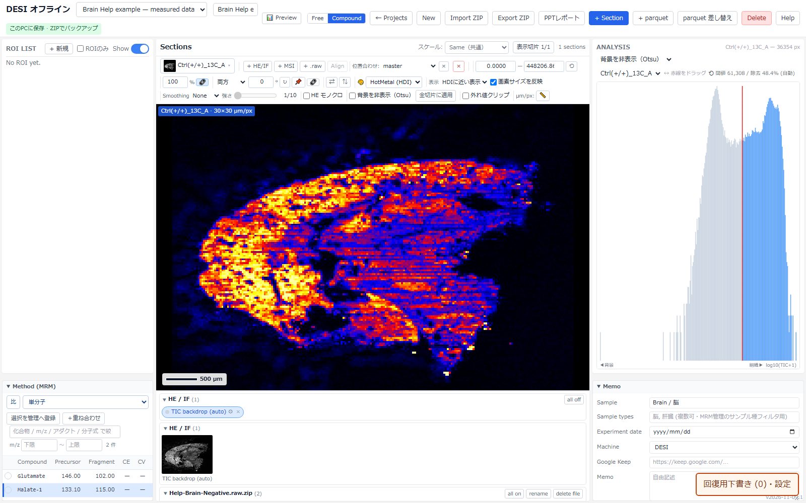

実操作画面：独立したローカル環境に原本を読み込み、2 分子を表示。共有データは変更していません。

**集計への影響**

色の見た目と測定値は区別します。Range・カラーマップ・Median・Linear は表示調整です。ROI の数値は元データから計算します。

**保存と共有**

ローカル編集は、このブラウザーの保存領域に保存されます。別 PC へ渡すときは Export ZIP または Publish を使います。

共有リンクの閲覧権限と管理権限は異なります。画面に出ない編集操作を、Help から有効にすることはできません。

### プロジェクトを管理する

新規作成、フォルダー整理、ローカルとサーバーの区別、保存状態を確認します。

> オフライン版ではローカルプロジェクトを管理します。サーバー一覧と共有 URL の操作はオンライン版で利用します。

1. **新規プロジェクトを作る** — Projects の New project を押し、名前と説明を入力します。作成後に Viewer を開きます。
2. **一覧を整理する** — フォルダーを作成し、プロジェクトを移動します。Local / Server の表示で保存先を区別します。未公開のプロジェクトの保存状態は「このPCのみ・未公開」です。
3. **必要なコピーを開く** — ローカルデータは Open で編集します。初めて使う別 PC では「サーバから一覧取得」→ Open (master) で公開済みの内容を取り込みます。閲覧するだけなら共有 URL を開きます。
4. **共有の最新版を確認する** — 共有先のあるローカルプロジェクトで「共有の最新版を確認」を押し、この PC とサーバーの公開版番号・切片数を比較します。「このプロジェクトに反映」または「別コピーで取得」を選びます。未公開の変更や公開結果の確認待ちがある場合は、別コピーでの取得だけが利用できます。
5. **削除前にバックアップする** — Export ZIP を保存し、確認ダイアログで削除対象を読みます。ローカル削除とサーバー側の削除は別の操作です。

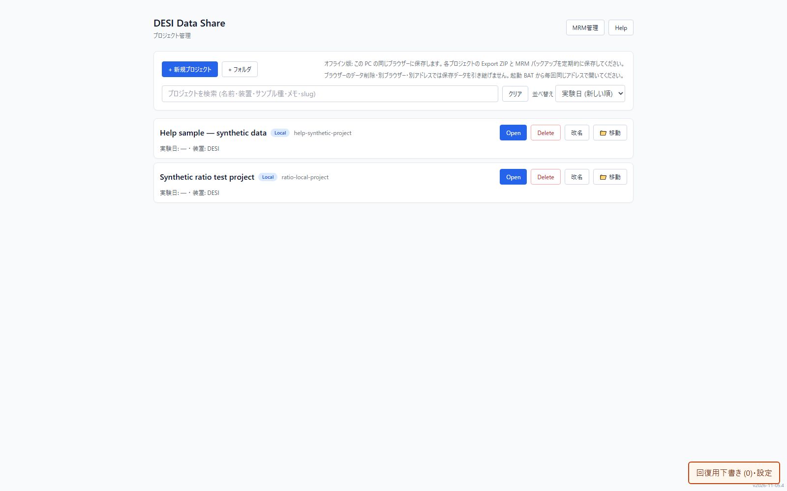

プロジェクト管理画面

**集計への影響**

フォルダー整理や名前の変更は測定値を変更しません。複数 PC のローカルコピーは、それぞれ独立しています。

**保存と共有**

保存競合が出たら、編集を続ける前に再読み込みまたは回復用下書きの内容を確認します。回復用下書きの自動作成は設定で選べます。

ブラウザーデータの削除・端末故障に備え、ZIP を別の保存場所へ定期的に書き出します。

既存プロジェクトへの反映が成功すると、同じプロジェクトの内容を更新し、直前の版を Projects に「サーバー版取り込み前 ...」という別のローカルコピーとして残します。このコピーは共有先との関連を外して保存され、回復用下書きの自動作成が OFF でも作られます。

原本や ROI を取得できない場合、取得中に別タブの内容やサーバーの公開版番号が変わった場合は、既存版への反映を中止します。同じ Google アカウントでログインしても、PC やブラウザー間のローカルプロジェクトは自動同期されません。

### 切片とデータを登録する

HE / IF 画像と MSI の数値データを、対応する切片へ登録します。

1. **切片を用意する** — 切片を追加し、名前・順番を確認します。切片名や分子名は作成者の編集画面で変更できます。
2. **HE / IF 画像を選ぶ** — 対応する切片の画像登録操作から画像を読み込みます。MSI と重ねる画像の位置は、登録後に Align で調整します。
3. **MSI の列と形式を確認する** — xlsx / txt・CSV などの数値データでは、X 座標・Y 座標・信号列を指定します。Waters .raw は対応する変換環境で読み込みます。
4. **読み込み結果を点検する** — Method / Compound、向き、MSI pixel size を確認します。Parquet の追加・置換では確認画面の対象切片と分子を必ず確認します。

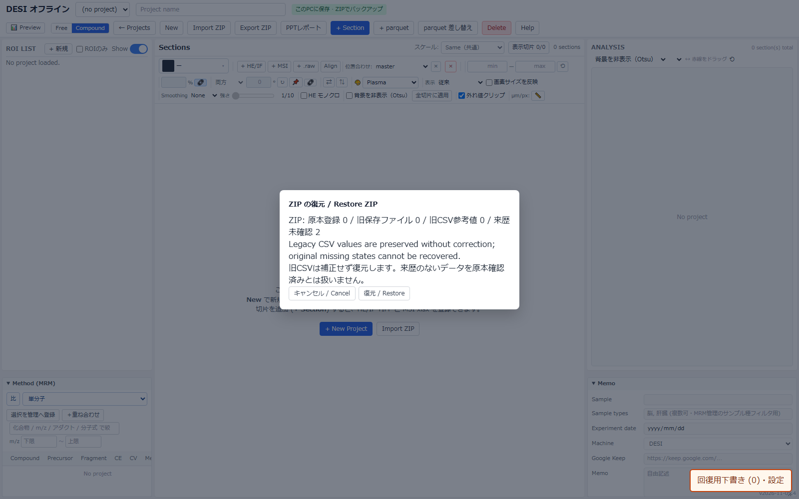

元データを含むプロジェクトの復元確認

**集計への影響**

比や ROI を計算するには元の数値データが必要です。色付きの MSI 画像だけでは、信号値を復元して計算することはできません。

元データの座標と行の対応を保ちます。異なる測定座標や互換性のない入力は、確認せずに同じ画素として扱わないでください。

**保存と共有**

インポート後はローカルプロジェクトを保存し、Export ZIP で数値ソースと画像を含むバックアップを作ります。

### 切片と分子を見比べる

Free / Compound、表示切片、レイヤーを組み合わせて、同じ条件で画像を見比べます。

1. **View を選ぶ** — Free は切片ごとに分子を選びます。Compound は選んだ分子を切片間で揃えて比較します。下の例では同じ切片の Malate-1 と Glutamate を切り替えます。
2. **表示する切片を絞る** — 表示切片の選択で必要な切片を残します。非表示は削除ではありません。再表示して比較を続けられます。
3. **レイヤーを組み合わせる** — HE / IF / MSI のチェックを切り替え、歯車から透明度・Grayscale・Apply opacity を調整します。HE 未登録時は TIC 背景が使われる場合があります。
4. **向きと尺度を確認する** — 拡大・移動・Rotation とスケールバーを確認します。作成者は切片の Flip H / V を変更できます。
5. **KMD 図で系列を探す** — ANALYSIS で KMD図を選び、CH₂・H₂・O の単位を切り替えます。点のクリックで分子を表示、ドラッグで囲むと Method 表を絞ります。系列の「重ねる」で色分けし、⟲ または Method 表の「KMD 選択」で解除します。

#### 分子を切り替えて、信号の分布を見比べる

Method の分子一覧で Malate-1、Glutamate を選びます。同じ切片でも、分子によって明るく見える場所が変わります。

**Malate-1**

MRM 133.101 → 115

Malate-1：登録原本からの再描画

**表示範囲: 0 - 448,206.855 信号強度**

**Glutamate**

MRM 146 → 102

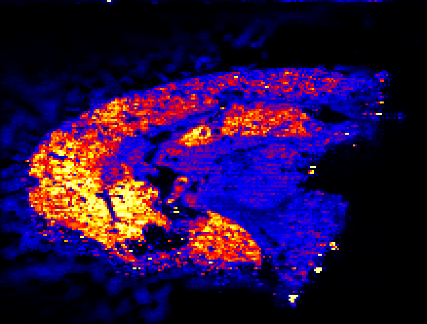

Glutamate：登録原本からの再描画

**表示範囲: 0 - 1,116,827.345 信号強度**

> HotMetal ／ Smoothing: None ／ 各分子の Range は 0 ～ 原信号の 99.5 パーセンタイル値。背景除外は使っていません。

> 色は信号強度を表します。この例は分子ごとに表示上限が異なるため、画像間の同じ色が同じ信号強度や濃度を意味するわけではありません。

**出典・条件**: 261030_Hirabayashi_13C_Brain ／ Ctrl(+/+)_13C_A。登録原本の同じ切片を再描画しています。登録画素サイズは 30 × 30 µm。

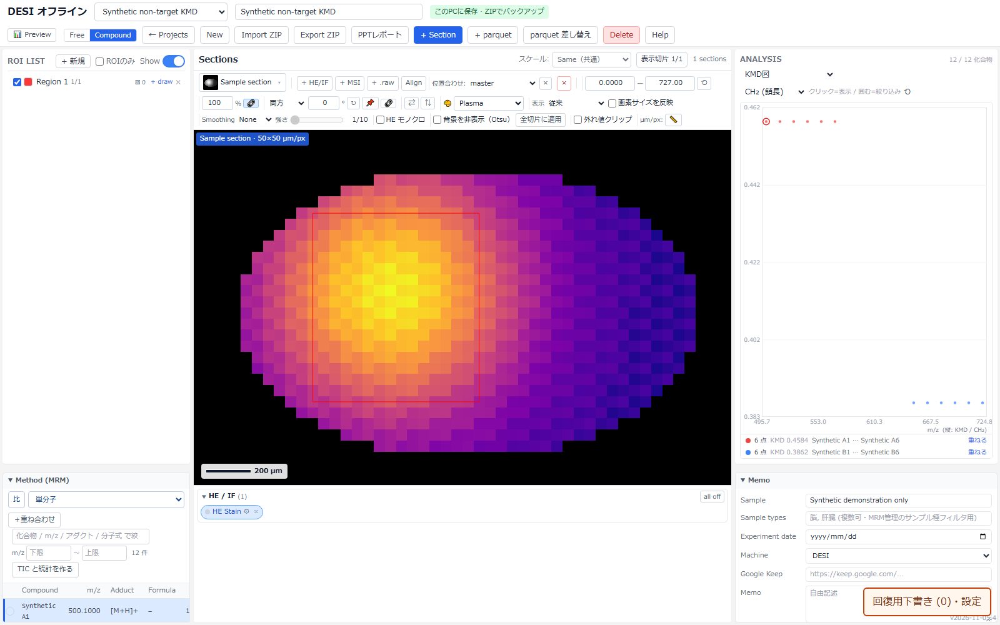

ANALYSIS の KMD図：単位選択、系列一覧、重ねる、選択解除

**集計への影響**

レイヤーの表示、透明度、ズーム、表示切片の選択だけでは元の信号値は変わりません。非表示の切片が出力対象に含まれるかは出力画面で確認します。

KMD は m/z から Kendrick 質量欠損を計算する図です。MRM では precursor を使い、m/z のない候補は件数を示して除外します。比（X / Y）とは別の見方で、元信号や ROI 集計は変えません。

ノンターゲット表には m/z・Adduct・Formula・Mean・Max が表示されます。検索や m/z 範囲、列見出しで候補を絞り、並べ替えられます。Mean が未計算なら「TIC と統計を作る」を使います。source 別の TIC と表示用の TIC backdrop は用途が異なります。

**保存と共有**

表示操作の保存範囲は操作と権限によって異なります。共有画面で行う一時的な見え方の調整を、公開元データの変更と混同しないでください。

KMD の選択・Method 表の絞り込み・系列の「重ねる」は一時的です。プロジェクトの比定義や保存済み重ね合わせには追加されません。別プロジェクトへ移動すると選択を解除します。

### 色・Range・滑らかさを調整する

表示だけを調整して分布を読み取りやすくします。Median と Linear の強さは、それぞれ 1～10 で選べます。

1. **表示スタイルと色を選ぶ** — MSI style とカラーマップを選びます。物理縦横比の表示を使うと、MSI pixel size に基づいた見え方になります。 背景を非表示（Otsu）と外れ値クリップも、必要に応じて表示を整えるために使います。
2. **Range を合わせる** — 表示する強度範囲を調整します。Same は比較対象の尺度を揃え、Individual は各画像に合わせます。下の Malate-1 の例では下限 0、上限 448206.855 を入力します。明るい領域が最大色になる場合は上限を見直します。
3. **Smoothing と強さを選ぶ** — None は平滑化なし。Median は近傍の中央値を使う表示用フィルターです。Linear は補間なしに近い 1 から、従来の Linear と同じ 10 まで選べます。
4. **ROI の範囲を見やすくする** — ROIのみ表示では表示対象の ROI に絞って確認できます。自動 Range の対象が変わるため、全体表示と明るさが変わることがあります。

#### Range の上限を下げて、弱い信号を見やすくする

同じ Malate-1 の画像で Range だけを変えます。上限 448206.855 を入力した例では、信号を色へ割り当てる範囲が変わります。

**全測定値が収まる上限**

上限 = 原信号の最大値

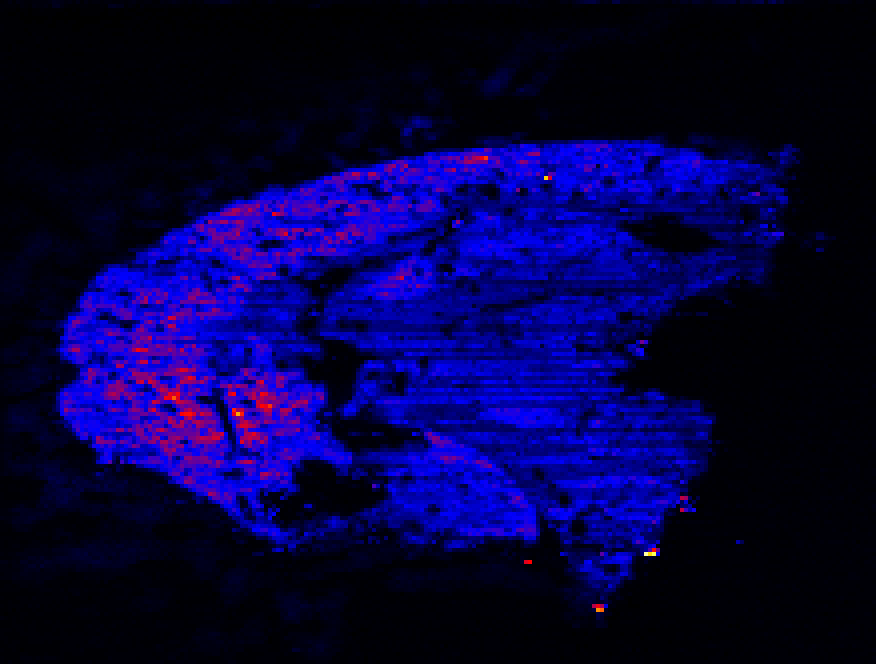

Range 0 ～ 1,026,290：原本からの再描画

**表示範囲: 0 - 1,026,290 信号強度**

**弱い信号を見やすくした例**

上限 = 原信号の 99.5 パーセンタイル値

Malate-1：登録原本からの再描画

**表示範囲: 0 - 448,206.855 信号強度**

> 元データ・ROI の集計値は変わりません。低い上限の図では、上限を超える 182 点が最大色になります。明るく見えたことだけで信号が増えたとは判断しません。

> 99.5 パーセンタイルは、この説明例のために原本から求めた値です。自動設定ボタンの紹介ではありません。配色・倍率・Smoothing: None は同一です。

**出典・条件**: 261030_Hirabayashi_13C_Brain ／ Ctrl(+/+)_13C_A。登録原本の同じ切片を再描画しています。登録画素サイズは 30 × 30 µm。

#### 同じ場所を拡大し、滑らかさと細部を確認する

Smoothing で種類を選び、強さスライダーを調整します。以下は同じ拡大範囲・同じ Range での比較です。

**None**

補間・メディアン処理なし

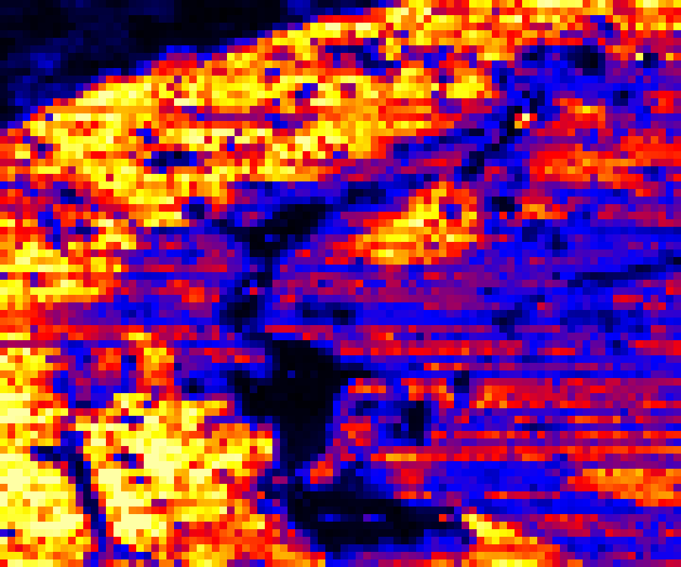

None：同じ範囲の拡大再描画

**表示範囲: 0 - 448,206.855 信号強度**

##### 比較する表示

**Linear 10 / 10**

Linear は画素間の色を補間します。1 は補間なしに近く、10 が従来の Linear と同じ強さです。

**Linear 10 / 10**

従来の Linear と同じ最大の補間量

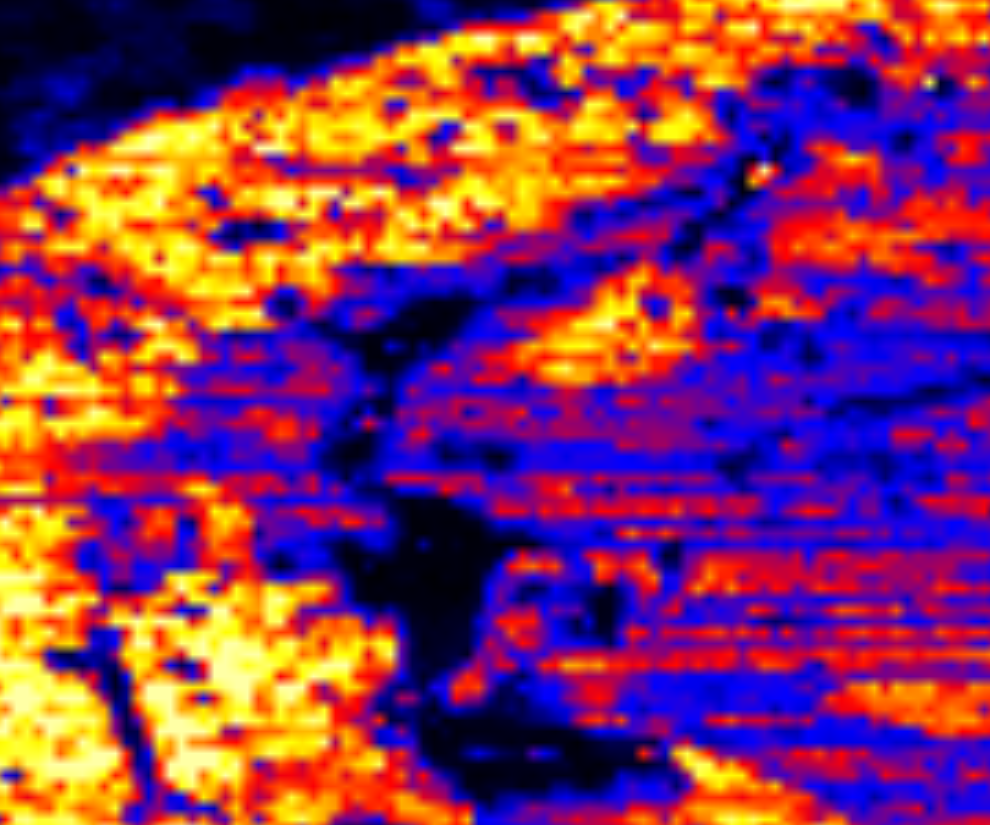

Linear 10 / 10：表示専用の補間

**表示範囲: 0 - 448,206.855 信号強度**

**Median 3 / 10**

Median は周囲の表示値の中央値を使います。この例は 3 / 10（7 × 7 画素）。細かい点や細い構造も変わるので、None と見比べて強さを選びます。

**Median 3 / 10**

近傍 7 × 7 画素の中央値を用いた表示

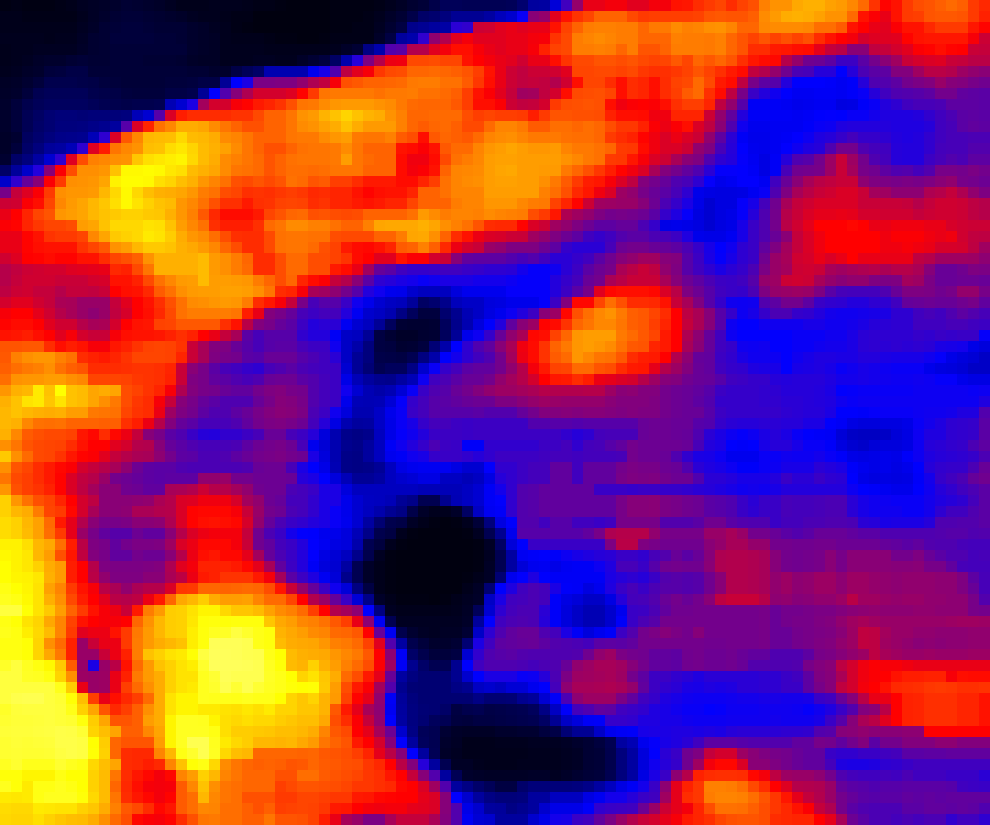

Median 3 / 10：表示専用のフィルター

**表示範囲: 0 - 448,206.855 信号強度**

> 元データ・ROI の集計値は変わりません。強くすると細い構造が見えにくくなることがあります。

> HotMetal、Range 0 ～ 448,206.855。拡大図は同じ 90 × 75 画素の範囲です。

**拡大した位置を確認**

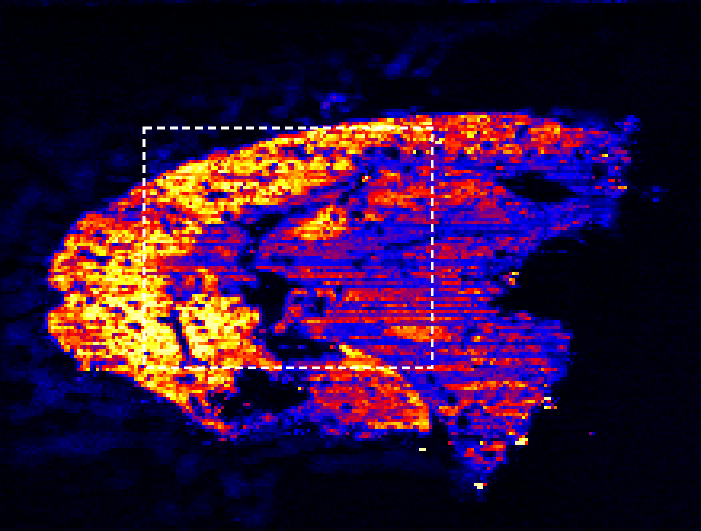

拡大した場所：原本からの再描画に範囲を追記

**出典・条件**: 261030_Hirabayashi_13C_Brain ／ Ctrl(+/+)_13C_A。登録原本の同じ切片を再描画しています。登録画素サイズは 30 × 30 µm。

**集計への影響**

Median・Linear・Range・カラーマップ・物理縦横比は、元データや ROI 集計値を変更しません。集計は平滑化前の数値を使います。

Median の段階は表示の滑らかさを選ぶためのものです。異なる装置やアプリの同じ番号と同一処理を保証する尺度ではありません。

ROIのみ表示で自動 Range が変わっても、ROI の形や集計対象の元データは変わりません。

背景を非表示（Otsu）は TIC のヒストグラムで背景を判定する表示機能です。ANALYSIS で閾値を調整し、必要なら全切片に適用します。元の強度・座標・ROI 定量・数値出力は変えません。

**保存と共有**

作成者の表示設定はプロジェクトの保存・ZIP・公開に引き継がれます。共有画面の MSI style・色・Median / Linear はこのタブの個人設定で、再読み込み後も保持します。viewer と Admin は別設定です。公開元は変更しません。

Range はプロジェクトごとの一時的な表示設定です。固定条件で比較したいときは範囲と Same / Individual を記録してください。

### 比（X / Y）を表示する

同じ切片の 2 分子から比画像を作ります。酸化分子 / 非酸化分子など、任意の X / Y に使えます。

1. **「比」を開く** — 数値データを含むプロジェクトで「比」を開きます。作成済みの比は一覧から選べます。
2. **分子 X と分子 Y を選ぶ** — 分子側（X）と分母側（Y）を切片ごとに選び、名前を付けます。この例は X = Malate-1、Y = Glutamate です。検索で候補を絞り、同名ならファイル・列・測定条件で区別します。別ファイルでは座標の単位と原点が同じことを確認します。
3. **分母の下限を確認する** — Y の下限は初期値 0 です。下限以下の Y、欠損、負の信号は有効な比として扱いません。無効部分は 0 に置き換えず、計算対象から除きます。
4. **比画像を表示して比較する** — 「保存して表示」で比画像と ROI 集計を確認します。「ROI集計CSV」は指標を、「測定点CSV」は測定点ごとの値・有効性・除外理由を保存します。

#### 分母が弱い場所を含めるかで、比の画像が変わる

「比」で X に Malate-1、Y に Glutamate を指定します。この例では同じ RAW ファイル・function 1 の同じ測定位置で、原信号 X ÷ Y を計算しています。

**分母の下限: 0**

Glutamate > 0 の点を採用

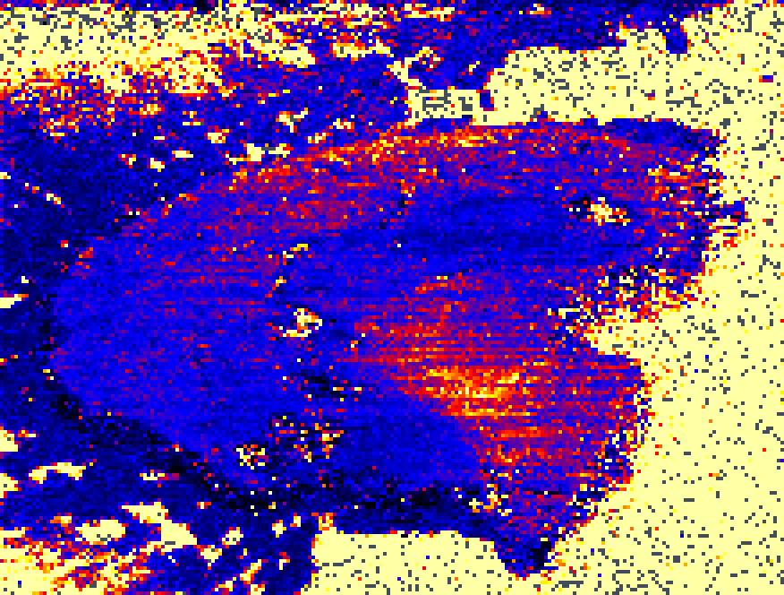

分母下限 0：原本からの信号比を再描画

**表示範囲: 0 - 1.5 信号比**

有効 35,267 / 36,354 点（97.0%）

**分母の下限: 10,000**

Glutamate > 10,000 の点を採用

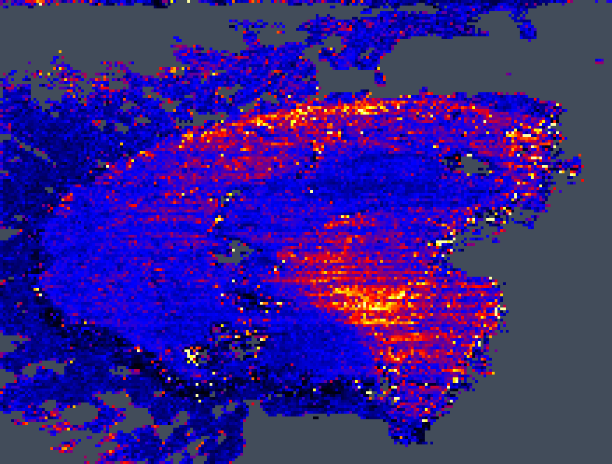

分母下限 10,000：原本からの信号比を再描画

**表示範囲: 0 - 1.5 信号比**

有効 23,512 / 36,354 点（64.7%）

> この比較図では無効点を灰色で表示しています。説明用に再描画した図であり、実際の Viewer の背景色は表示設定によって異なります。両図とも HotMetal、Range 0 ～ 1.5、None、Otsu なしです。

> 10,000 は操作説明用の任意の値で、検出限界や推奨基準ではありません。分母が 0 または下限以下の点は、比を 0 にせず表示・比の集計から除外します。下限 0 では 1,087 点、下限 10,000 では 12,842 点が除外されています。

> 表示上限の 1.5 を超える比は最大色です。下限 0 では 8,715 点、下限 10,000 では 99 点が該当します。表示 Range の変更は計算済みの比を変えません。

> これは測定信号の比です。濃度比や生物学的な差を、この画像だけから断定しません。分母下限は比の有効点と統計を変えますが、原本や元の分子別 ROI 集計は変えません。

**出典・条件**: 261030_Hirabayashi_13C_Brain ／ Ctrl(+/+)_13C_A。登録原本の同じ切片を再描画しています。登録画素サイズは 30 × 30 µm。

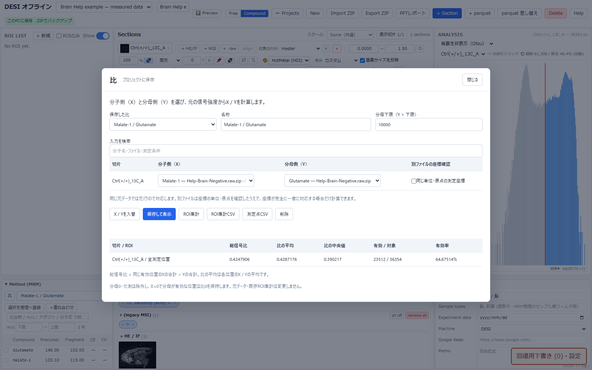

実操作画面：同じ測定ファイルの信号比を設定

**集計への影響**

比は対応する元データの値から計算します。表示済みの色や、Median / Linear をかけた画像から計算しません。X = 0、Y > 下限の位置は有効な 0 です。

ROI総信号比 = 有効な位置の X の合計 / 同じ位置の Y の合計。個別比の平均 = 各位置の X / Y の平均。個別比の中央値 = 各位置の X / Y の中央値。これらは異なる指標です。

例：X が 2, 8、Y が 1, 2 のとき、ROI総信号比は 10 / 3 ≈ 3.33、個別比の平均は (2 + 4) / 2 = 3 です。

結果には有効数・有効率・除外理由・分母下限を添えて判断します。元の分子別 ROI 集計と比の集計は別の結果です。

**保存と共有**

作成者が保存した比の定義は、プロジェクト・ZIP・公開に含まれます。定義は X / Y と分母下限を記録し、元の信号値を書き換えません。

共有の閲覧者・管理者が編集した比は、このタブの個人用設定です。同じタブの再読み込み後も保持し、タブを閉じると失われます。公開元の比定義や他の閲覧者の設定を上書きしません。

比の ROI 結果は専用出力で保存します。画像や PPT に表示する比と、数値結果の指標・条件を対応させて記録します。

### HE / IF と MSI を位置合わせする

Align で同じ組織の位置を揃え、重ね合わせて確認します。

1. **切片から Align を開く** — 対象の切片を選び、Align を開きます。HE / IF、Source、比較する MSI を選びます。
2. **尺度と手動位置を調整する** — MSI pixel size を確認し、移動・回転・拡大縮小などの手動スライダーでおおまかに揃えます。
3. **対応点または自動整合を使う** — Landmark では両画像の同じ位置を対応させます。シルエットによる自動整合も結果を目視確認してから採用します。
4. **重ね合わせを確認して保存する** — 重ね合わせ表示と MSI の濃さを使ってずれを点検します。Save で確定、Cancel で今回の変更を破棄します。

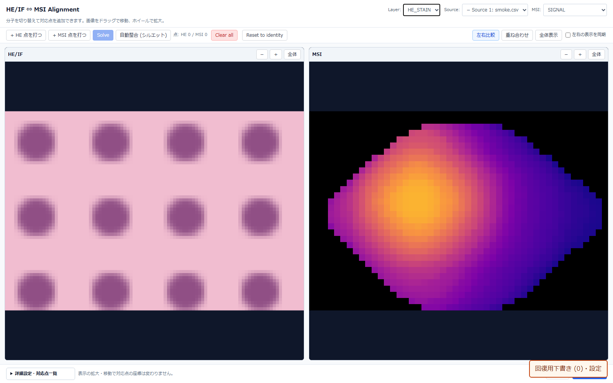

対象画像・尺度・対応点を確認

**集計への影響**

位置合わせは表示座標の対応です。元の MSI 信号値を書き換えません。ROI はどの座標系で描かれたかを保って扱います。

**保存と共有**

作成者の Save はプロジェクトへ保存します。共有画面では必要な書き込み権限・ロックを確認します。Cancel では確定しません。

### ROI を描いて集計する

関心領域を描き、元の信号値を集計します。比の集計では、分子単独の値と区別します。

1. **ROI と編集権限を確認する** — ROI 一覧で名前・色・表示状態を確認します。共有画面で描画や削除をするときは、必要な書き込みロックを取得します。
2. **領域を描く** — ROI の描画操作を選び、画像上で領域を囲みます。同じ ROI を別切片へ描く場合も、切片ごとに対応する位置を確認します。
3. **表示と対象を点検する** — ROI の表示切替・ROIのみ表示を使い、意図した範囲か確認します。削除は確認画面で対象 ROI を確認してから行います。
4. **集計を確認して出力する** — 元信号の集計を確認します。比の場合は専用結果の指標名、有効数、除外理由、分母下限も合わせて確認します。

#### ROI の数値を元の測定値から確認する

位置が分かるように、同じ大きさの仮 ROI A・B を重ねました。この説明用の ROI は、原本・プロジェクト・共有データには保存していません。

**Malate-1 と仮 ROI**

None ／ 各 ROI: 30 × 25 画素

仮 ROI A・B：原本からの再描画に説明用の枠を追加

**表示範囲: 0 - 448,206.855 信号強度**

ROI A・B は説明用の名称です。解剖学的な部位を意味しません。

**原本 Malate-1 の集計**

| 仮 ROI | 測定点数 | 平均信号 |
| --- | --- | --- |
| ROI A | 750 | 307,293.13 |
| ROI B | 750 | 177,911.67 |

> Range・Linear・Median を変更しても、この集計対象と元信号は同じです。画像の色ではなく、ROI 内の元の測定値を集計しています。

> 「比」の ROI 集計では、分母条件を満たす有効点だけが対象です。単分子の ROI 集計と区別し、ROI総信号比・個別比の平均などの指標名も確認します。

**出典・条件**: 261030_Hirabayashi_13C_Brain ／ Ctrl(+/+)_13C_A。登録原本の同じ切片を再描画しています。登録画素サイズは 30 × 30 µm。

**集計への影響**

ROI 集計は元の数値データを対象とします。Median / Linear・色・Range を変更しても集計値は変わりません。

比の「ROI総信号比」と「個別比の平均」は異なります。比の章の式を確認し、結果に記載された指標を使って比較してください。

**保存と共有**

作成者の ROI はプロジェクト・ZIP に保存します。共有 ROI の書き込みは共有権限とロックに従います。非表示は削除ではありません。

ZIP では元データと ROI 情報を分けて保存します。比の専用出力も、測定条件が分かる名前で保存してください。

### ROI に顕微鏡画像を付ける

ROI に対応する顕微鏡画像を登録し、MSI と一緒に確認します。

1. **対象 ROI の画像画面を開く** — ROI の画像操作を開き、対象の切片と ROI を確認します。複数の顕微鏡画像を同じ ROI に関連付けられます。
2. **画像と説明を登録する** — 画像ファイルを選び、タイトルや説明を入力します。位置・倍率など、読み手が対応関係を判断できる情報を残します。
3. **MSI と見比べる** — 顕微鏡画像を拡大して確認し、ROI の MSI 表示と見比べます。分子または比の選択・表示条件も確認します。
4. **順番・説明を整えて保存する** — 画像の順序や説明を整え、不要な画像は確認して削除します。共有時は画像を含めた公開・書き出し結果を確認します。

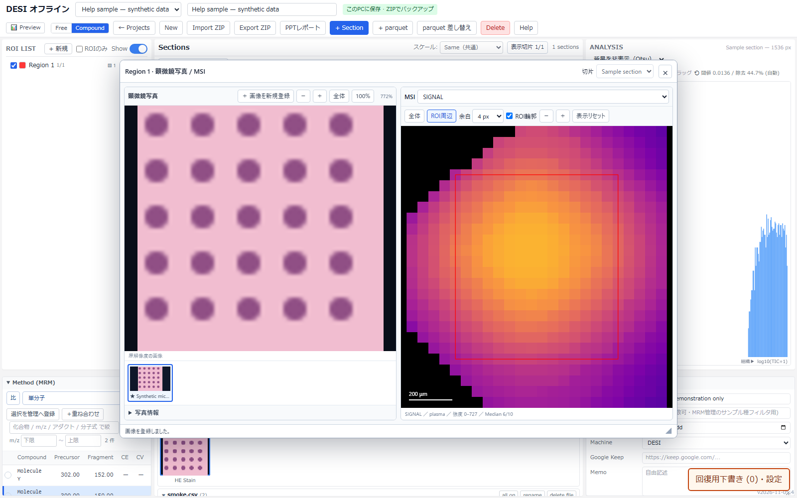

ROI に関連付ける顕微鏡画像

**集計への影響**

顕微鏡画像は ROI の説明資料です。画像を追加しても MSI の元信号や ROI の集計値は変わりません。

**保存と共有**

画像と説明は ROI に関連付けて保存し、ZIP・共有に含めます。編集の可否はローカル / 共有の権限に従います。

### Preview・重ね合わせ・PPT

画像一覧で比較し、複数分子のカラー合成や PPT レポートを作ります。

1. **Preview を開く** — Preview で分子や比、切片の画像を一覧表示します。公開前には、受け手の見え方を確認します。
2. **比較条件を揃える** — 表示切片と分子を選び、Range・Same / Individual・色・ROI の表示を確認します。
3. **複数分子を重ね合わせる** — 重ね合わせで複数分子に色を割り当てます。明るさを揃える設定の意味を確認して分布を比較します。比の多色重ね合わせは対象外です。
4. **PPT レポートを作る** — PPTレポートを開き、出力する切片・分子・比と画像条件を確認して書き出します。分子・測定条件が未登録の切片は、分子別ページの対象から外れます。一覧では切片の列を保ち、未登録の組み合わせの表示を省きます。登録済みデータの読み込み失敗は表示に残ります。出力後に各スライドの見出しと尺度を確認します。

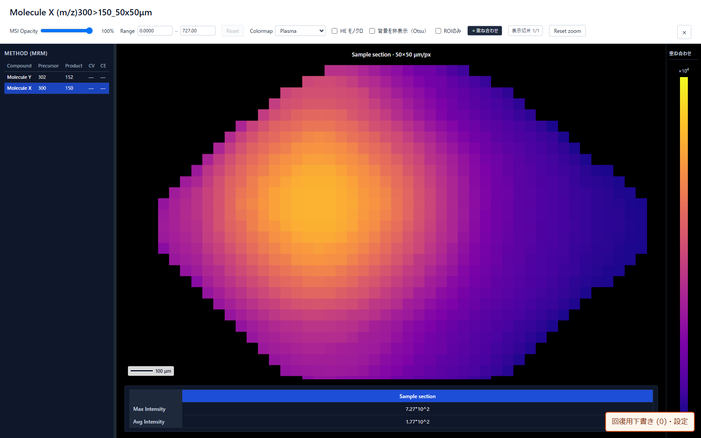

切片・分子を一覧で比較

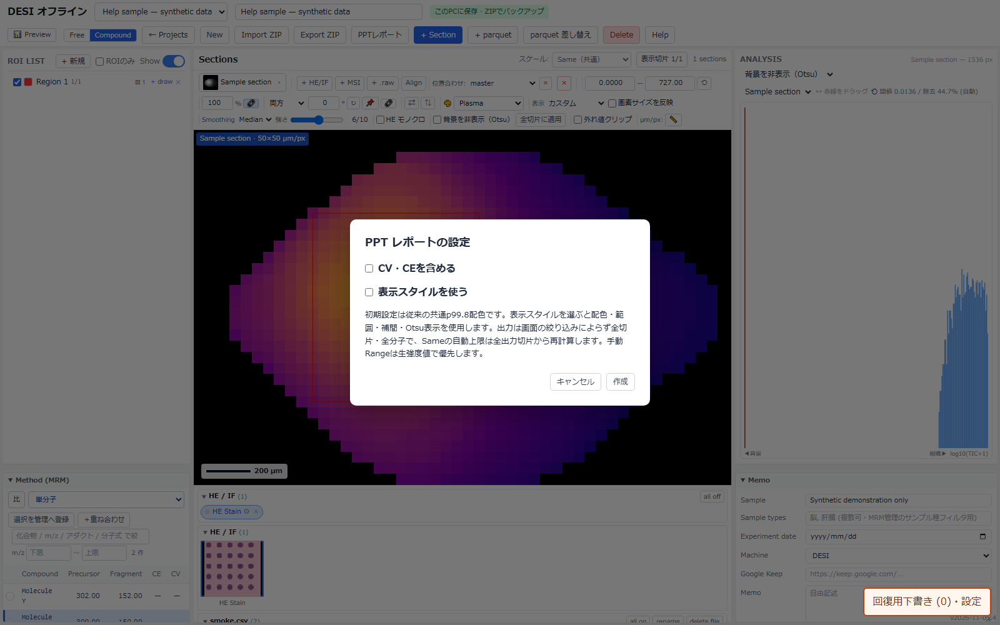

レポートの出力条件を確認

**集計への影響**

重ね合わせの色や明るさは表示条件です。色の混ざり方から、比や元信号の集計値を読み替えないでください。

**保存と共有**

PPT は書き出した時点の画像を保存します。プロジェクトを編集しても、既存の PPT は自動更新されません。

共有画面で個人設定を使った場合は、その条件を資料にも記録します。

共有先で作った重ね合わせは、対応する共有環境では同じ URL の利用者に共有されます。作成者が公開した重ね合わせは読み取り専用です。保存できない環境では画面の通知に従います。

### 保存・ZIP・共有・Memo

ローカル保存、ファイルバックアップ、サーバー公開を目的に応じて使い分けます。

> オフライン版では Export ZIP / Import で移動・復元します。Publish と Auto-publish は利用できません。

1. **Memo と保存状態を確認する** — 実験条件や気付きを Memo に残し、保存状態を確認します。「このPCのみ・未公開」はブラウザー内の保存、「このPCに保存・公開待ち」は共有先への反映待ちです。保存エラーがあるときは内容を確認してから閉じてください。
2. **Export ZIP でバックアップする** — Export ZIP を選び、元データ・ROI・顕微鏡画像・比の定義を含むアーカイブを保存します。ZIP は公開とは独立しています。
3. **Import で復元する** — 保存した ZIP を読み込み、復元内容を確認して確定します。別 PC でも対応するアプリから復元できます。
4. **公開内容を確認して共有する** — 作成者は Preview の後に Publish to share を実行します。完了と Sync 状態を確認し、共有 URL と必要なパスワードを渡します。

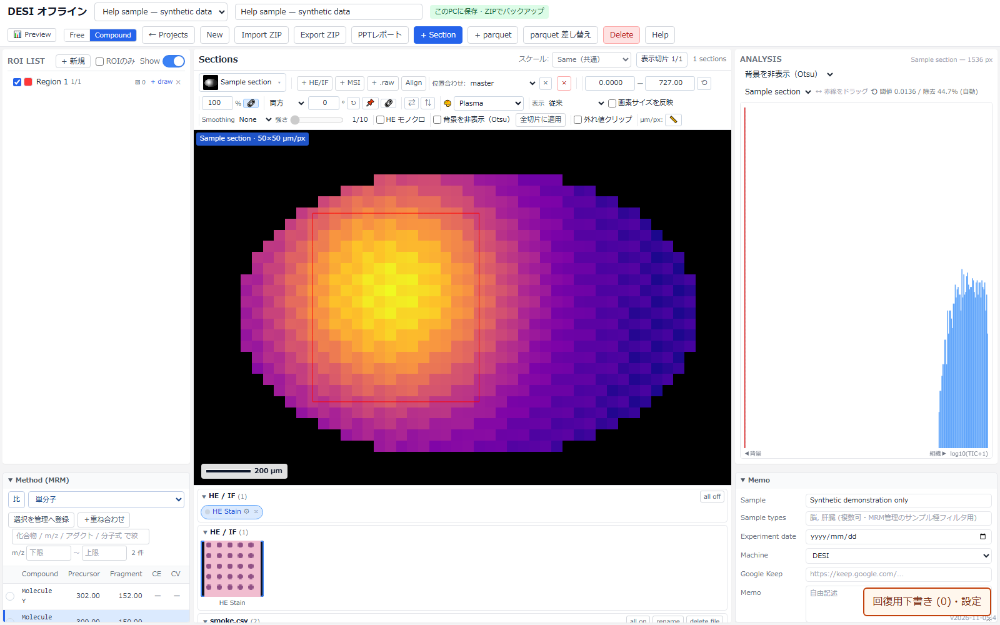

バックアップと記録の入口

**集計への影響**

保存・ZIP・公開は、表示用の色を元信号に置き換える操作ではありません。元データと ROI・比の定義を区別して保持します。

**保存と共有**

ローカル保存はこのブラウザー内、Export ZIP は自分で保存したファイル、Publish はサーバー上の共有内容です。それぞれ別の保存先です。

「✓ 公開版 vN を保存済み」は、この PC が保存した公開版の基準番号です。別 PC の変更まで含めた最新版との一致を保証する表示ではありません。他 PC の公開内容を取り込むときは「共有の最新版を確認」を使います。

Auto-publish は公開済みプロジェクトのローカル変更を共有先へ送る処理です。共有版との競合や基準番号が未確認のときは停止します。比較・再公開を明示するまで、ローカル保存だけで自動再公開は再開しません。再 Publish は共有側への影響を確認し、大容量アップロードは完了まで進捗を確認します。

同じ Google アカウントでもローカルデータは PC ごと・ブラウザーごとに独立しています。初回の別 PC ではサーバー一覧から Open (master) で取り込むか、閲覧用の共有 URL を開きます。未公開の内容は Export ZIP / Import で移せます。

共有の表示設定と比の個人変更は、公開元への保存ではありません。共有 ROI・位置合わせ・重ね合わせの保存は各機能の権限とロックに従います。共有画面の Memo 編集は一時的で、再読み込みで破棄されます。

### MRM ライブラリと .exp 編集

MRM を化合物・タグで管理し、測定履歴や .exp ファイルを確認します。

1. **MRM 管理を開く** — Projects の MRM 管理から移動します。検証済みライブラリと使用実績アーカイブを切り替え、検索とフィルターで絞ります。
2. **MRM を登録する** — 化合物追加、表への入力・貼り付け、Excel 一括登録を使います。precursor / product・CE / CV、タグ、出典を確認します。
3. **履歴とメソッドセットを整理する** — 実測棚卸しで未登録の測定履歴を確認します。メソッドセットを保存・読み込み、出力するトランジションを選びます。
4. **.exp を確認して書き出す** — テンプレートから選択を .exp 出力するか、「.exp を開いて編集」で既存ファイルを確認します。変更点と検証結果を読み、別名で保存します。

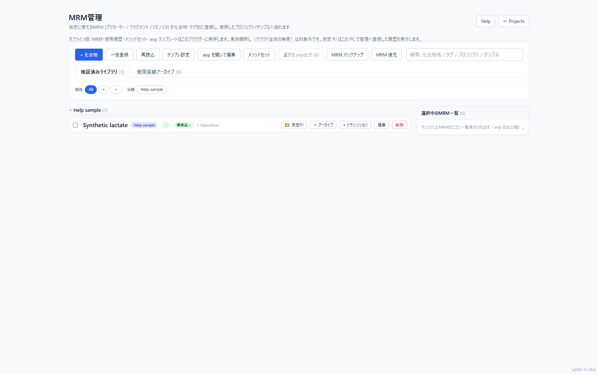

MRM ライブラリ

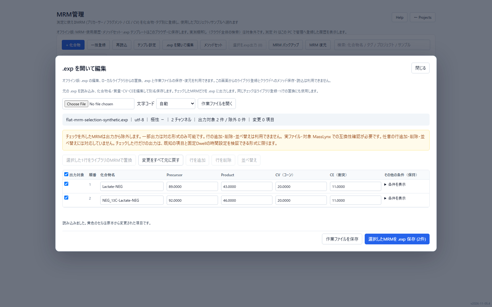

exp の内容と変更を確認

**集計への影響**

MRM ライブラリの編集は、読み込み済み MSI の信号値や ROI 集計値を書き換えません。測定条件の管理と画像解析は別の操作です。

**保存と共有**

オフライン版のライブラリはローカルに保存します。オンラインの共有ライブラリを操作するときは保存先と権限を確認します。

.exp 出力は元ファイルを直接上書きせず、保存したファイルを装置側で点検します。未対応の設定や検証メッセージを確認してください。

### 困ったとき・ショートカット

表示、データ不足、保存、共有、オフライン起動の問題を切り分けます。

1. **画面の状態を確認する** — 画像が見えないときは、切片・Method / Compound・レイヤーのチェック・Opacity・Range・ROIのみ表示を確認します。
2. **数値データの有無を確認する** — 比や ROI が計算できないときは、元ソースがあるか、X / Y が同じ位置に対応するか、分母下限で全て除外していないかを確認します。
3. **保存先と権限を確認する** — 保存競合・容量不足・共有ロックの通知を読みます。未保存の作業は ZIP や回復用下書きで確保してから再読み込みします。
4. **操作をやり直す** — Method 表では ↑ / ↓ で分子を移動します。ROI 描画は Enter で確定、Esc で中止します。問い合わせ時はビルド番号・操作・入力形式・エラー文を記録します。

プロジェクト管理画面

**集計への影響**

計算できない領域を 0 と解釈しないでください。欠損・分母条件・非対応データなどの理由を確認し、有効データと区別します。

**保存と共有**

オフライン版は ZIP を完全に展開して START_OFFLINE.bat を起動します。起動用ウィンドウを閉じるとローカルサーバーも終了します。保存済みブラウザーデータと ZIP バックアップは別です。

Help の印刷 / PDF から、現在の権限・言語の全章を紙面にできます。画像をクリックすると実画面を拡大できます。

<!-- GUIDED_HELP_END -->
