# DESI Data Share — Project Management Guide

This guide covers the **management page (`/`)** and includes a complete illustrated feature guide below. Use the audience selector at the top of Help to switch to Author or Shared viewer instructions.

---

## Table of Contents

1. [What this page does](#1-what-this-page-does)
2. [Login (password)](#2-login-password)
3. [Screen layout](#3-screen-layout)
4. [Creating a new project](#4-creating-a-new-project)
5. [Opening / deleting a project](#5-opening--deleting-a-project)
6. [Pulling the list from the server (works on any PC)](#6-pulling-the-list-from-the-server-works-on-any-pc)
7. [Copying the share URL](#7-copying-the-share-url)
8. [Where data is stored](#8-where-data-is-stored)
9. [Build tag (bottom-right badge)](#9-build-tag-bottom-right-badge)
10. [Troubleshooting](#10-troubleshooting)

---

## 1. What this page does

- Lists every project you've created (local + server)
- Creates a new project with metadata up front (experiment date, machine, matrix, Google Keep, memo)
- Opens or deletes existing projects
- **Copies the share URL** of a published project in one click
- Pulls the list of published projects from the server (so you can see them from any PC)

Layer registration (HE/IF, MSI) and `Publish to share` happen in the viewer after `Open` (see "Data sharing (admin)").

---

## 2. Login (password)

The management page is gated by an admin password.

- Default is `MSIadomine` (the same value pre-filled in the Publish modal's admin field)
- Once accepted, the unlock state is cached in sessionStorage for **12 h** — no re-prompt
- Closing the tab clears it
- When Supabase is reachable, the password is checked server-side via `list_projects(pw)` (bcrypt)
- When offline, a SHA-256 hash compare is used as a fallback

> This gate is shoulder-surf-level only. Real protection for shared content lives in Supabase (bcrypt).

---

## 3. Screen layout

- **Header**: title + Help button
- **Action row**: `+ 新規プロジェクト` (New project) / `サーバから一覧取得` (Refresh from server)
- **Project list**: each row shows
  - Name + badge (`Local` / `Local + Server` / `Server only`)
  - Experiment date / machine / matrix / Google Keep / first lines of the memo
  - `Open` / `Copy URL` / `Delete`

### Badge meanings

| Badge | Meaning |
| --- | --- |
| **Local** | Only in this browser's IndexedDB (not yet published, or made on another PC, etc.) |
| **Local + Server** | Exists both locally and on the server (you published it from this PC) |
| **Server only** | Only on the server (published from another PC, or local copy was deleted) |
| **空** (empty) | The local record has no sections at all (created but never populated). Opening it only ever shows "no layers" |

Local copies sharing a server slug are listed separately by local ID. Matching display names never automatically link a project to the server. Server imports create a new copy and retain existing local copies. Local + Server indicates a link, not verified equality of content.

---

## 4. Creating a new project

1. Click `+ 新規プロジェクト`
2. Fill in the metadata form:
   - **Project name** (required)
   - **Experiment date**: `<input type="date">`
   - **Machine**: DESI / TIMS / LTQ / Other
   - **Matrix**: shown only when the machine is non-DESI
   - **Google Keep**: a related note URL (optional)
   - **Memo**: free-form text
3. `Create` redirects to the viewer ready for layer registration

These values appear in the viewer's bottom-right Memo panel automatically.

---

## 5. Opening / deleting a project

The buttons differ by row badge. **Open**, **Open (master)** and **Share view** open a new tab, leaving the manager, search and folder expansion in place. On return, local project summaries refresh without fetching or republishing the server folder tree. A project imported in another tab appears as a local copy. Editing dialogs and in-progress actions finish before this automatic refresh.

| Badge | Buttons | Use |
| --- | --- | --- |
| Local / Local + Server | `Open` / `Copy URL` / `Delete` | Edit on this PC / copy share URL / drop from local IDB |
| **Server only** | **`Open (master)` / `Share view` / `Delete (server)`** | Master-edit a project published from another PC / view as a recipient / **fully delete from the server** |

### 5-1. Server-only row buttons

- **Open (master)**: opens a new viewer tab at `?import=<slug>`, authenticates with the **master password** (the same one that unlocks this manager), downloads the blobs from Storage, then boots the master view.
  - Only valid master authentication is carried over, with its original expiry. If it has expired, the new tab asks you to authenticate, then opens the selected project.
  - parquet (TIMS non-target) sources are **not downloaded**; they are read straight from Storage (putting hundreds of MB into IndexedDB blows the quota).
  - An imported project does not inherit the share passwords (viewer / admin). The first edit turns the sync indicator into **🔑 共有パスワード未設定**; click it once and set the passwords in `Publish to share`. After that, saves auto-publish as usual.
- **Share view**: opens an ordinary `#share=<slug>` viewer link in a separate tab (recipient flow — needs the viewer password). Admin authentication from the original tab is not carried over. To include CE/CV, enter Admin in this shared tab and select the fields in the PPT report dialog.
- **Delete (server)**: requires master pw + a confirm dialog. Removes the `projects` row + cascading children (sections / rois / project_credentials / session_tokens / roi_locks) + every Storage object under `<slug>/...`. **No undo**; double-check the slug.

### 5-2. Delete on Local / Local + Server rows

- Removes the entry from the local IndexedDB only.
- If the project is also on the server, the server copy stays (the row downgrades to `Server only`).
- To wipe the server too, use the `Delete (server)` button on the `Server only` row, or the Supabase dashboard.

---

## 6. Pulling the list from the server (works on any PC)

When you want to see, from this PC, projects you published from a different PC:

1. Click `サーバから一覧取得`
2. Enter the **admin password** (default `MSIadomine`)
3. Every project that has that admin password registered shows up
4. The password is cached in sessionStorage for 12 h (no re-prompt next time)
5. Rows that are not in the local IDB show the **`Server only`** badge with `Open (master)` / `Share view` / `Delete (server)` buttons

> If you use a single shared admin password across projects, one entry retrieves the entire catalogue from any PC.
> The standard "one operator, multiple PCs" workflow is: publish from PC A → on PC B click `Open (master)` (= `?import=<slug>`) → continue editing → auto-publish → on PC C click `Open (master)` again, and so on.

---

## 7. Copying the share URL

Published projects expose a `Copy URL` button.

- Clicking it copies `https://.../viewer/index.html#share=<slug>` to the clipboard
- The button briefly flips to `Copied ✓`
- The viewer (and admin) passwords must be shared **on a separate channel** (Slack, e-mail)

Unpublished projects show a disabled `URL なし` (No URL) button. `Open` → publish in the viewer → return here and `Copy URL` becomes available.

---

## 8. Where data is stored

| Location | What | Scope |
| --- | --- | --- |
| **Local IndexedDB** (`desi-projects`) | Project meta + section structure + ROIs + memo + raw files (TIFF/xlsx/txt/parquet/.raw.zip) | This browser, this profile |
| **Supabase** (published projects only) | Section structure / ROIs / memo / binaries / bcrypt-hashed passwords | Whole server |
| **localStorage** | Last opened project id, layout sizes | This browser, this profile |
| **sessionStorage** | Admin pw cache, master unlock flag | This tab |

> Important: IndexedDB capacity is not unlimited. Browsers may evict it under storage pressure, so **always use `Publish to share` to back up important projects to the server**.

---

## 9. Build tag (bottom-right badge)

A small **`v:YYYY-MM-DD-rN`** badge is permanently visible in the bottom-right corner.

- After updating files, hard-reload (Ctrl+F5) and confirm the badge changed — that proves the new build is in effect.
- When filing bug reports, include the tag (e.g. `v:2026-05-08-r15`) so issues can be reproduced precisely.
- The same tag appears on the manager, master and share-recipient views.

---

## 10. Troubleshooting

| Symptom | Action |
| --- | --- |
| `Init failed: The requested version (X) is less than the existing version (Y)` | DB schema mismatch. Update to the latest code and hard-reload (Ctrl+F5) |
| Server list refresh errors | The admin pw is wrong, or Supabase is unreachable |
| Copy URL button is missing | Project hasn't been published yet. `Open` → publish in the viewer |
| Password keeps being rejected | Clear cache + reload. If still failing, the admin password may have been changed |
| Projects from another PC not showing | Press `サーバから一覧取得` and re-enter the admin password |
| `Delete (server)` reports "失敗: N 件" | The Storage publish-token DELETE policy has not been applied. Re-run §4 of `supabase/share_locks.sql` |
| `Open (master)` keeps asking for the master password | Expected on the first `?import=<slug>` open — it is the same password that unlocks the manager |
| `Open (master)` bounces back to the list after entering a password | Older builds asked for the project's own **admin password**. Projects published without one have no correct answer, so every attempt bounced. Reload to get the current build, or set an admin password from `🔑 パスワード` |
| The viewer says "no layers" right after opening | Check for the **空** (empty) badge in the list — that record was created but never populated. Open the one that holds the data |
| Multiple rows have the same name or share slug | Different local IDs are separate preserved copies. Every copy is listed; compare the IDs and contents before deleting any |

## 11. Save conflicts and recoverable drafts

Use the bottom-right **回復用下書き (count)・設定** button, available even with zero drafts, to choose **自動作成する** (create automatically) or **自動作成しない** (do not create). The default is on. The setting applies to all local projects in this browser, persists after reload, and is read by other tabs on their next save. Turning it off does not delete existing drafts.

When multiple tabs edit the same local project, the first committed version is preserved. An older revision is rejected; when automatic recovery is on, the attempted edit is stored as a recovery draft. With recovery off, the edit remains unsaved and cannot be recovered through this feature after closing the tab. Normal saving, publication and conflict prevention remain enabled. Content is not merged automatically. Use **別コピーとして復元** (restore as a separate copy) to create an independent project without its previous share link or passwords. If storage is full and the draft itself cannot be committed, a save error is shown.

Deleting a project in another tab retains originals referenced by an editing tab, recovery draft, or running job. Ended-session data proven to match a successful save does not add a duplicate recovery draft. The recovery list can restore a recoverable snapshot or explicitly discard it using **下書き・保持を破棄**. Discarding does not remove originals needed by another project or job. Live editing tabs cannot have their retention discarded. Snapshot-free retention created with recovery off is released only after the tab is confirmed ended and all references are checked; no expiry timer deletes uncertain data.

Before the DB v6 upgrade, finish saves in old tabs, export important projects as ZIP, then close old tabs. Reload all pages after updating. Old writers are fenced out; do not delete the database to fix a version error. See [Local storage upgrade procedure](docs/LOCAL_STORAGE_UPGRADE.md) for rollout and rollback notes.

<!-- GUIDED_HELP_START -->

## Step-by-step guide with actual screenshots

[Open guided Help](help.html?role=manage&lang=en&mode=online)

The MSI examples use one measured mouse-brain dataset, shown as rendered figures and actual application screenshots. Other interface screenshots use synthetic demonstration data. See the source and display settings beside each figure.

### Getting started

Open a project and identify its sections, molecules and ROIs. This guide distinguishes comparisons and actual application screenshots using measured brain data from operation screenshots using synthetic data.

1. **Open your workspace** — Authors open a local project from Projects. For a shared URL, enter the viewing password when requested.
2. **Choose a section and molecule** — Select a section on the left and use Method / Compound to choose the acquisition method and molecule. Main view shows the selected section. In this measured-data screenshot, Method at the lower left lists Malate-1 and Glutamate.
3. **Inspect the image** — Zoom and pan to inspect the distribution. Toggle HE / IF / MSI layers and adjust opacity to compare them.
4. **Continue with a task** — Choose a chapter or search for a feature. The results and saving tabs explain numerical effects and persistence.

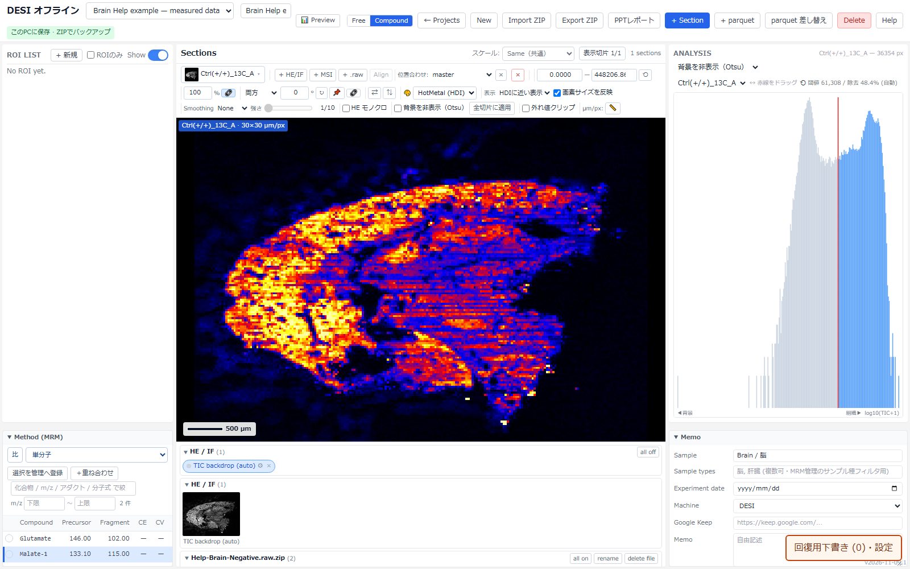

Actual application screenshot: source data loaded in an isolated local workspace with two molecules. Shared data was not changed.

**Effect on results**

Colour appearance is separate from measured values. Range, colour map, Median and Linear adjust the display. ROI results use source data.

**Save and share**

Local edits are stored in this browser. Use Export ZIP or Publish to transfer work to another computer.

Shared viewer and administrator permissions differ. Help cannot enable editing operations that your account cannot use.

### Manage projects

Create and organise projects, distinguish local and server copies, and check storage status.

1. **Create a project** — Choose New project in Projects, enter a name and description, then open the Viewer.
2. **Organise the list** — Create folders and move projects. Local / Server badges distinguish storage locations. An unpublished project's save status reads このPCのみ・未公開 (This PC only, unpublished).
3. **Open the required copy** — Use Open to edit local data. On another PC, first retrieve the server list and choose Open (master) to import the published content. For viewing, open the shared URL.
4. **Check the shared version** — For a local project linked to a share, choose 共有の最新版を確認 (Check the latest shared version) and compare this PC's publication revision and section count with the server. Choose このプロジェクトに反映 (Apply to this project) or 別コピーで取得 (Get a separate copy). If local changes are unpublished or a publish result is unresolved, only the separate-copy option is available.
5. **Back up before deleting** — Save an Export ZIP and read the deletion confirmation. Removing a local project and deleting server data are separate operations.

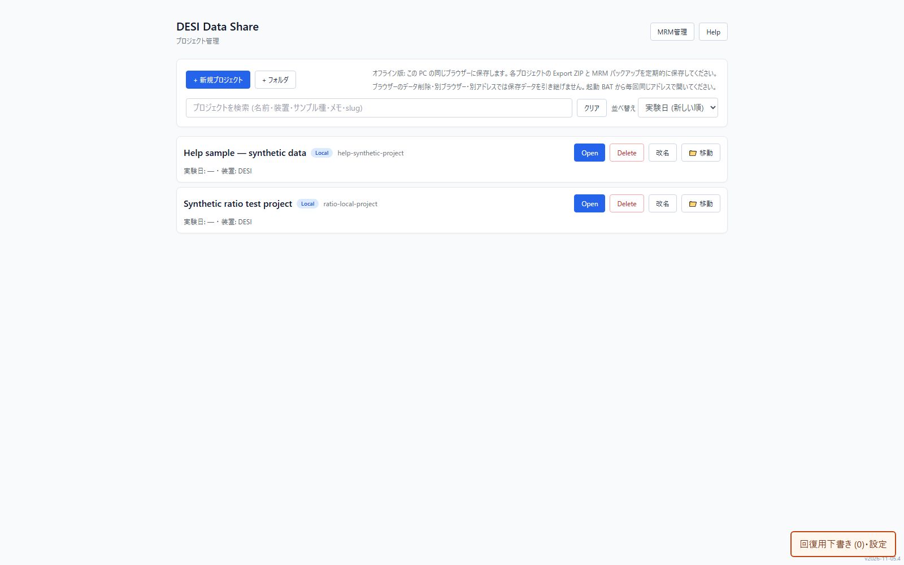

Project manager

**Effect on results**

Folders and names do not change measurements. Local copies on different computers are independent.

**Save and share**

When a storage conflict appears, review reload or recovery draft options before continuing. Automatic recovery drafts are optional.

Export ZIP backups regularly to another location in case browser storage is cleared or a device fails.

A successful application updates the same local project and retains its previous version as a separate Projects entry named サーバー版取り込み前 ... (Before server import). This backup is detached from the share and is created even when automatic recovery drafts are OFF.

Application stops without replacing the existing project if a source or ROI cannot be retrieved, another tab changes the local record, or the server publication revision changes during retrieval. Signing in with the same Google account does not automatically synchronise local projects between PCs or browsers.

### Import sections and data

Register HE / IF images and numerical MSI data in the matching section.

1. **Prepare the section** — Add a section and check its name and order. Authors can rename sections and compounds.
2. **Select HE / IF images** — Import images into their section. Use Align after import to register them with MSI.
3. **Check MSI columns and format** — For numerical xlsx / txt / CSV data, select X, Y and signal columns. Waters .raw requires a supported conversion environment.
4. **Review the result** — Check Method / Compound, orientation and MSI pixel size. For Parquet additions or replacements, review the listed sections and compounds.

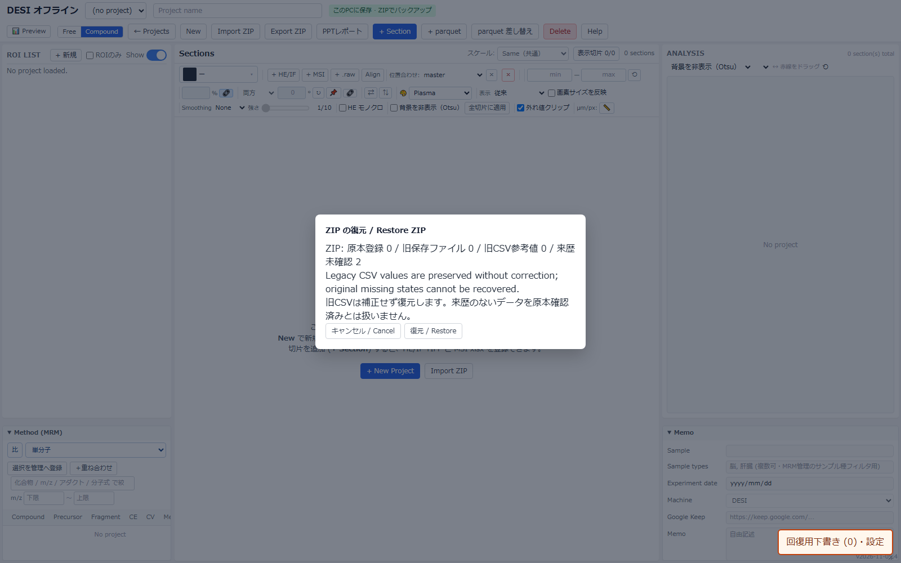

Review restoration of a project with source data

**Effect on results**

Ratios and ROI quantification require source numerical data. Signal values cannot be recovered from a coloured MSI image alone.

Preserve source coordinates and row correspondence. Do not assume incompatible acquisitions represent the same pixels.

**Save and share**

After import, save the local project and export a ZIP containing numerical sources and images.

### Compare sections and molecules

Use Free / Compound modes, section visibility and layers to compare images consistently.

1. **Choose a View mode** — Free lets each section show a different compound. Compound aligns the selected compound across sections. The example below switches between Malate-1 and Glutamate in the same section.
2. **Choose visible sections** — Use section visibility to keep the relevant sections. Hidden sections are not deleted and can be shown again.
3. **Combine layers** — Toggle HE / IF / MSI and use layer settings for opacity, Grayscale and Apply opacity. A TIC background may be used when HE is absent.
4. **Check orientation and scale** — Inspect zoom, pan, Rotation and the scale bar. Authors can change a section's Flip H / V.
5. **Explore series in the KMD plot** — Choose KMD in ANALYSIS and select CH₂, H₂ or O. Click a point to display its molecule; drag a rectangle to filter the Method table. Use Overlay for a series, and clear the filter with ⟲ or KMD selection in the Method table.

#### Switch molecules to compare signal distributions

Select Malate-1 and Glutamate in the Method molecule list. Different molecules can show different distributions within the same section.

**Malate-1**

MRM 133.101 → 115

Malate-1: re-rendered from the registered source

**Display range: 0 - 448,206.855 Signal intensity**

**Glutamate**

MRM 146 → 102

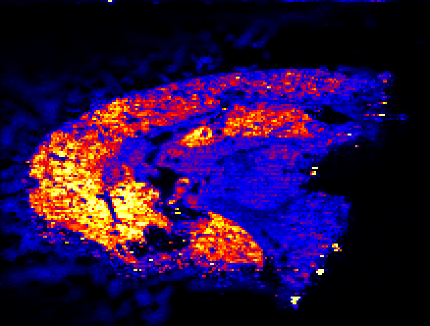

Glutamate: re-rendered from the registered source

**Display range: 0 - 1,116,827.345 Signal intensity**

> HotMetal / Smoothing: None / Each molecule uses a Range from 0 to the 99.5th percentile of its original signals. Background exclusion is off.

> Colour represents signal intensity. Each image has a different upper limit, so matching colours across these images do not imply matching signal intensities or concentrations.

**Source and settings**: 261030_Hirabayashi_13C_Brain / Ctrl(+/+)_13C_A. These images are re-rendered from the same registered source section. Registered pixel size: 30 × 30 µm.

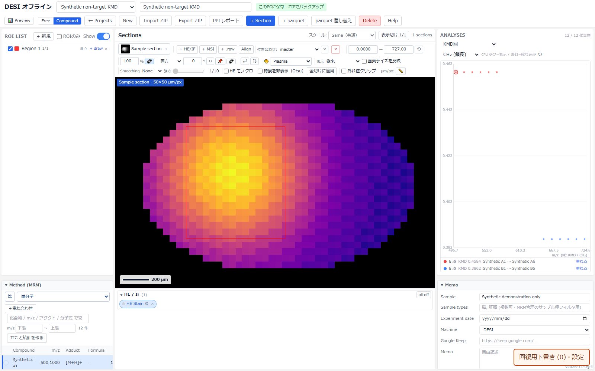

ANALYSIS KMD plot: units, series list, overlay and reset

**Effect on results**

Layer visibility, opacity, zoom and section visibility do not change source signals. Check the export dialog for whether hidden sections are included.

KMD plots Kendrick mass defect calculated from m/z, using precursor mass for MRM. Entries without m/z are counted and excluded. This is separate from X / Y ratios and does not change source signals or ROI statistics.

The non-target table displays m/z, Adduct, Formula, Mean and Max. Search, m/z bounds and column headings filter or sort candidates. Use Build TIC and statistics when Mean has not been calculated. Per-source TIC and the display-only TIC backdrop serve different purposes.

**Save and share**

Persistence depends on the setting and your permissions. Temporary display changes in a shared view do not change the published source data.

KMD selection, Method filtering and series overlays are temporary. They do not add ratio definitions or saved overlays to the project. Switching projects clears the selection.

### Adjust colour, Range and smoothing

Make distributions easier to inspect with display-only adjustments. Median and Linear each have levels 1–10.

1. **Choose style and colour** — Choose MSI style and colour map. Physical aspect display uses the specified MSI pixel size. Hide background (Otsu) and outlier clipping can also adjust the display.
2. **Set the Range** — Adjust the displayed intensity range. Same uses a common scale; Individual adapts to each image. For the Malate-1 example below, enter a lower bound of 0 and an upper bound of 448206.855. Review the upper bound when bright regions reach the maximum colour.
3. **Choose smoothing and strength** — None disables smoothing. Median is a display filter using neighbourhood medians. Linear ranges from nearly un-interpolated at 1 to the original Linear appearance at 10.
4. **Inspect the ROI display** — ROI-only display focuses on visible ROIs. Its automatic Range uses the displayed ROI area, so brightness may differ from the full image.

#### Lower the Range upper limit to reveal weaker signals

Only the Range changes between these Malate-1 images. Entering an upper limit of 448206.855 changes how the signals map to colours.

**Upper limit covering all measurements**

Upper limit = maximum original signal

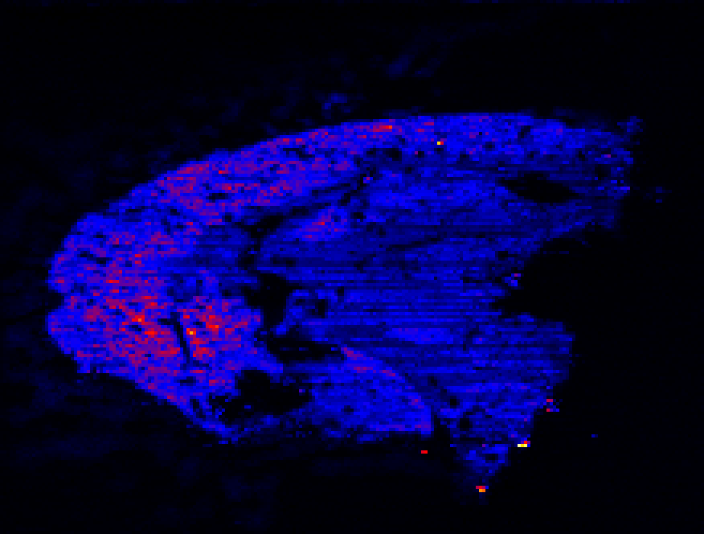

Range 0–1,026,290: re-rendered from the source

**Display range: 0 - 1,026,290 Signal intensity**

**Example revealing weaker signals**

Upper limit = 99.5th percentile of original signals

Malate-1: re-rendered from the registered source

**Display range: 0 - 448,206.855 Signal intensity**

> Source data and ROI statistics are unchanged. In the lower-limit image, 182 measurements above the limit use the maximum colour. A brighter appearance does not mean the measured signals increased.

> The 99.5th percentile was calculated from the source for this example; this is not an automatic-setting button. Colour map, magnification and Smoothing: None are identical.

**Source and settings**: 261030_Hirabayashi_13C_Brain / Ctrl(+/+)_13C_A. These images are re-rendered from the same registered source section. Registered pixel size: 30 × 30 µm.

#### Compare smoothness and detail in the same enlarged area

Choose a Smoothing method and adjust its strength slider. These comparisons use the same enlarged area and the same Range.

**None**

No interpolation or median filtering

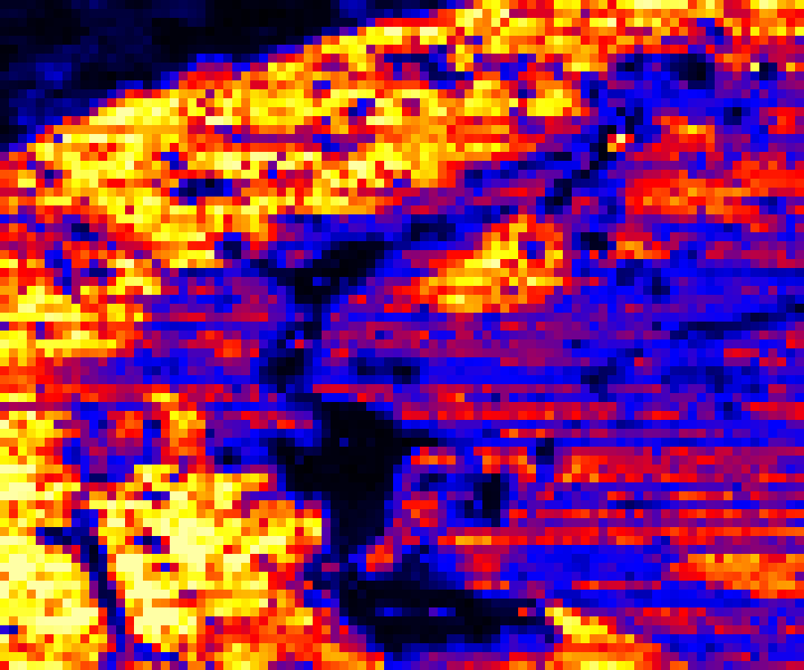

None: enlarged re-rendering of the same area

**Display range: 0 - 448,206.855 Signal intensity**

##### Display to compare

**Linear 10 / 10**

Linear interpolates colours between pixels. Level 1 is close to no interpolation; level 10 matches the original Linear strength.

**Linear 10 / 10**

Maximum interpolation, matching the original Linear

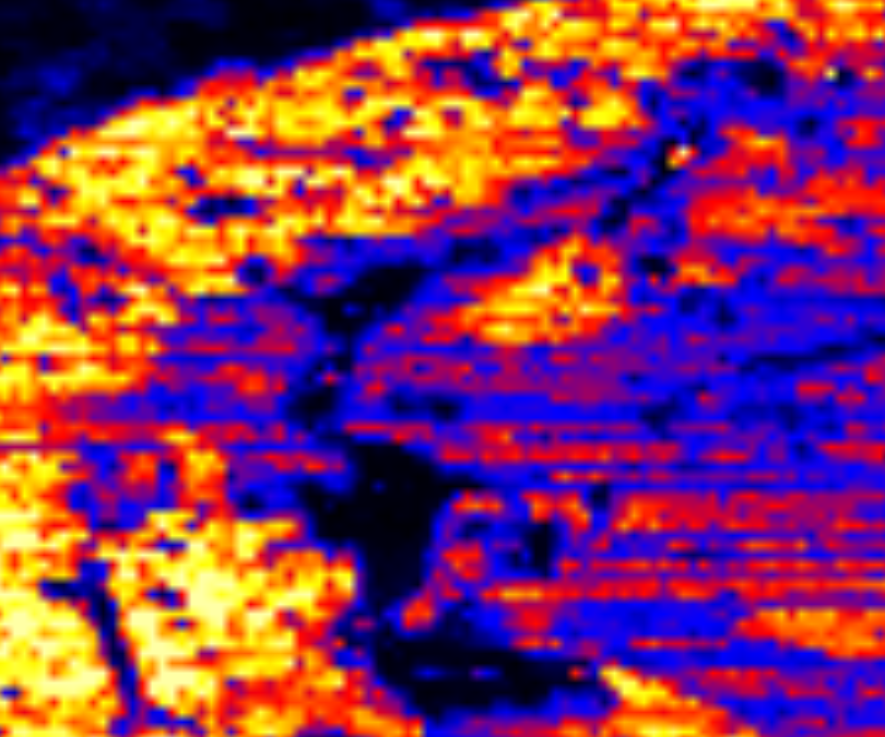

Linear 10 / 10: display-only interpolation

**Display range: 0 - 448,206.855 Signal intensity**

**Median 3 / 10**

Median uses the median of neighbouring display values. This example is level 3 / 10, a 7 × 7 window. Small spots and thin structures can change, so compare with None when choosing the strength.

**Median 3 / 10**

Display using the median of a 7 × 7 neighbourhood

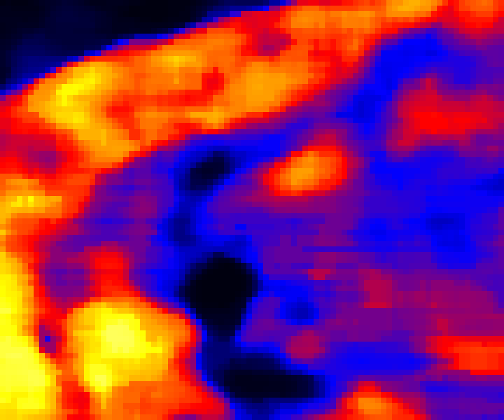

Median 3 / 10: display-only filtering

**Display range: 0 - 448,206.855 Signal intensity**

> Source data and ROI statistics do not change. Stronger smoothing may make thin structures harder to see.

> HotMetal, Range 0–448,206.855. Each enlarged image covers the same 90 × 75 source-pixel area.

**Locate the enlarged area**

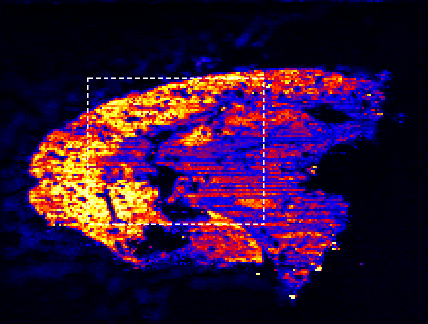

Enlarged area: marked on a source-data re-rendering

**Source and settings**: 261030_Hirabayashi_13C_Brain / Ctrl(+/+)_13C_A. These images are re-rendered from the same registered source section. Registered pixel size: 30 × 30 µm.

**Effect on results**

Median, Linear, Range, colour map and physical aspect do not alter source data or ROI statistics. Quantification uses unsmoothed numerical values.

Median levels select display smoothness. The same number in another instrument or application does not imply identical processing.

Automatic Range changes in ROI-only display do not change ROI geometry or its source measurements.

Hide background (Otsu) classifies background from the TIC histogram. Adjust its threshold in ANALYSIS and apply to all sections when needed. It does not change source intensities, coordinates, ROI quantification or numerical outputs.

**Save and share**

Author display settings are carried by project saving, ZIP and publication. Shared MSI style, colour and Median / Linear preferences are personal to this tab and survive reloads. Viewer and Admin preferences are separate. The published source remains unchanged.

Range is a temporary display setting per project. Record the bounds and Same / Individual mode when comparisons require fixed conditions.

### Display a ratio (X / Y)

Create a ratio image from two molecules in the same section, for example oxidised / non-oxidised molecules or any other X / Y pair.

1. **Open Ratio** — Open Ratio in a project containing numerical sources. Existing definitions can be selected from the list.
2. **Select molecules X and Y** — Choose X and Y for each section and name the ratio. This example uses X = Malate-1 and Y = Glutamate. Search to narrow candidates; distinguish identical names by file, column and acquisition conditions. For different files, confirm matching coordinate units and origin.
3. **Review the denominator threshold** — The default denominator threshold is 0. Y at or below the threshold, missing values and negative signals do not produce valid ratios. Invalid positions are excluded, not replaced with zero.
4. **Display and compare the ratio** — Use Save and display to inspect the ratio image and ROI statistics. ROI summary CSV saves metrics; measurement-point CSV saves per-position values, validity and exclusion reasons.

#### Including weak denominator signals changes the ratio image

In Ratio, select Malate-1 for X and Glutamate for Y. This example divides original signals X by Y at matching measurement positions in the same RAW file and function 1.

**Denominator threshold: 0**

Include positions with Glutamate > 0

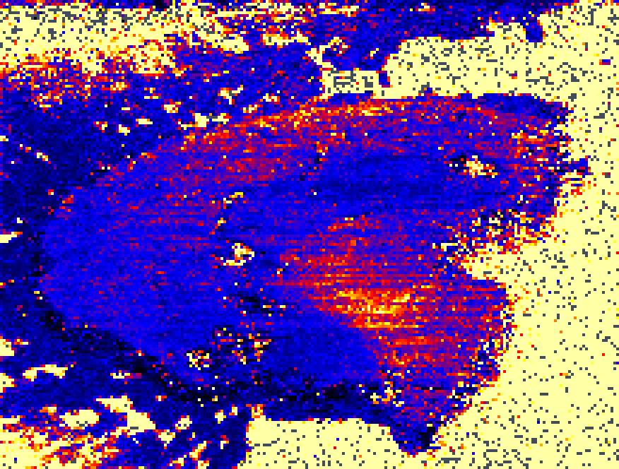

Threshold 0: re-rendered signal ratios from source values

**Display range: 0 - 1.5 Signal ratio**

Valid: 35,267 / 36,354 positions (97.0%)

**Denominator threshold: 10,000**

Include positions with Glutamate > 10,000

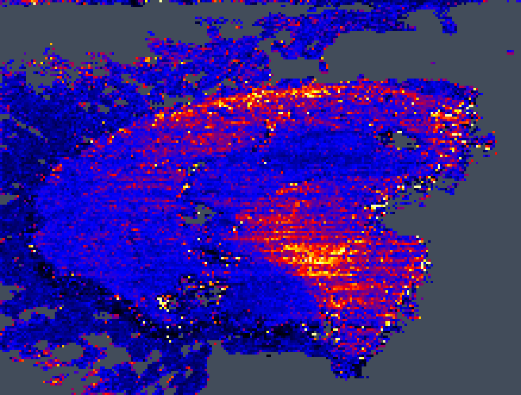

Threshold 10,000: re-rendered signal ratios from source values

**Display range: 0 - 1.5 Signal ratio**

Valid: 23,512 / 36,354 positions (64.7%)

> In these comparison images, invalid positions are shown in gray. These are explanatory re-renderings; the actual Viewer background depends on its display settings. Both use HotMetal, Range 0–1.5, None and no Otsu.

> 10,000 is an arbitrary setting for the demonstration, not a detection limit or recommended threshold. A denominator of zero or at or below the threshold is excluded from the ratio display and statistics, not replaced with zero. The thresholds 0 and 10,000 exclude 1,087 and 12,842 positions, respectively.

> Ratios above the display limit of 1.5 use the maximum colour: 8,715 positions at threshold 0 and 99 at threshold 10,000. Changing the display Range does not change calculated ratios.

> This is a measured-signal ratio. The image alone does not establish a concentration ratio or biological difference. The denominator threshold changes valid positions and ratio statistics, but not the source or original single-molecule ROI statistics.

**Source and settings**: 261030_Hirabayashi_13C_Brain / Ctrl(+/+)_13C_A. These images are re-rendered from the same registered source section. Registered pixel size: 30 × 30 µm.

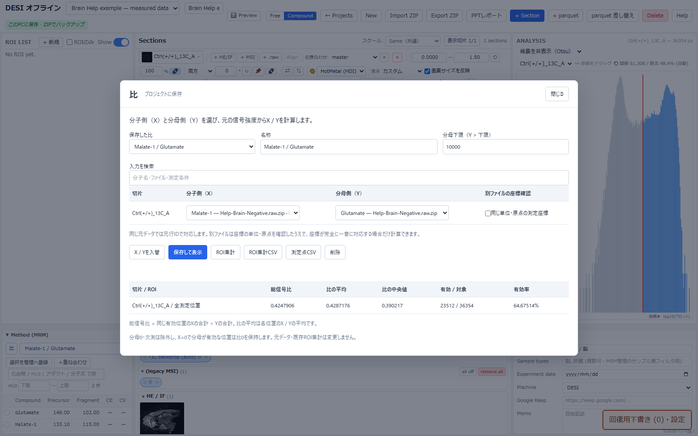

Actual application screenshot: configure a signal ratio from the same acquisition file

**Effect on results**

Ratios use corresponding source values, not rendered colours or images processed with Median / Linear. X = 0 with Y above the threshold is a valid zero.

ROI total-signal ratio = sum of X / sum of Y over the same valid positions. Mean of individual ratios averages each X / Y; median of individual ratios takes their median. These are different metrics.

Example: X = 2, 8 and Y = 1, 2 gives a total-signal ratio of 10 / 3 ≈ 3.33, while the mean of individual ratios is (2 + 4) / 2 = 3.

Interpret results with valid count, valid fraction, exclusion reasons and denominator threshold. Original molecule ROI statistics and ratio ROI statistics are separate results.

**Save and share**

Author ratio definitions are included in the project, ZIP and publication. They record X / Y and the denominator threshold without rewriting source signals.

Ratio edits by shared viewers and shared administrators are personal to this tab. They survive reloads in the same tab and are lost when the tab closes. Published definitions and other viewers’ settings remain unchanged.

Save ratio ROI results using the dedicated output. Record the metrics and conditions alongside ratio images or PPT reports.

### Align HE / IF with MSI

Use Align to register matching tissue positions and inspect their overlay.

1. **Open Align for a section** — Select the section and open Align. Choose HE / IF, Source and the comparison MSI.
2. **Adjust scale and position** — Check MSI pixel size, then use manual translation, rotation and scale controls for an initial match.
3. **Use landmarks or automatic alignment** — Landmarks pair corresponding positions in the two images. Review silhouette-based automatic alignment visually before accepting it.
4. **Review the overlay and save** — Use the overlay and MSI opacity to inspect registration. Save accepts the change; Cancel discards the current adjustment.

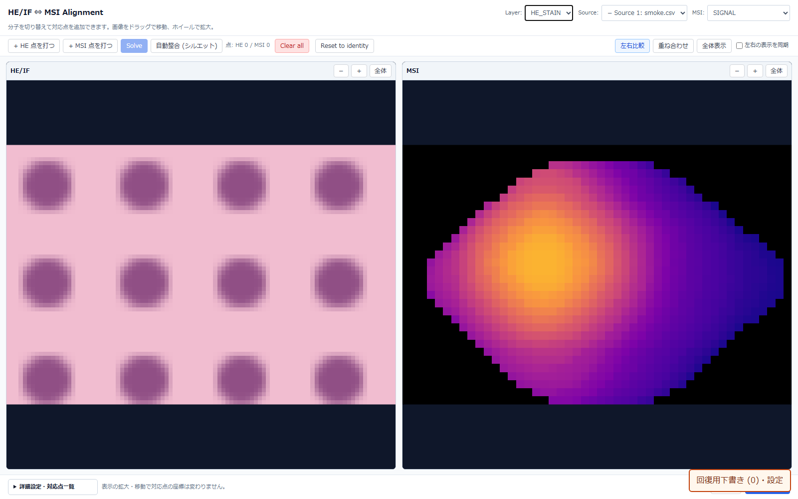

Review images, scale and landmarks

**Effect on results**

Alignment defines coordinate correspondence; it does not rewrite MSI signals. ROI geometry retains its coordinate reference.

**Save and share**

Author Save writes to the project. In shared views, check required write permissions and locks. Cancel does not commit the adjustment.

### Draw and quantify ROIs

Draw regions of interest and quantify their source signals. Keep ratio statistics distinct from single-molecule results.

1. **Check ROI and editing access** — Check ROI names, colours and visibility. Acquire the required write lock before drawing or deleting in a shared view.
2. **Draw the region** — Choose ROI drawing and outline the region. When extending the same ROI to another section, verify that section's geometry.
3. **Review visibility and scope** — Use ROI visibility and ROI-only display to inspect the intended area. Confirm the target ROI before deleting.
4. **Review and export results** — Review source-signal results. For a ratio, also inspect the metric, valid count, exclusion reasons and denominator threshold.

#### Read ROI statistics from original measurements

Two temporary ROIs of equal size, A and B, mark the example locations. These illustrative ROIs were not saved to the source, project or shared data.

**Malate-1 with temporary ROIs**

None / Each ROI: 30 × 25 pixels

Temporary ROI A and B: illustrative outlines on a source-data re-rendering

**Display range: 0 - 448,206.855 Signal intensity**

ROI A and B are illustrative labels, not anatomical region names.

**Original Malate-1 signal statistics**

| Temporary ROI | Measurement count | Mean signal |
| --- | --- | --- |
| ROI A | 750 | 307,293.13 |
| ROI B | 750 | 177,911.67 |

> Range, Linear and Median leave these selected measurements and source signals unchanged. Statistics use original measurements inside the ROI, not image colours.

> Ratio ROI statistics use only valid positions meeting the denominator condition. Distinguish them from single-molecule ROI statistics and check metric names such as total-signal ratio and mean of individual ratios.

**Source and settings**: 261030_Hirabayashi_13C_Brain / Ctrl(+/+)_13C_A. These images are re-rendered from the same registered source section. Registered pixel size: 30 × 30 µm.

**Effect on results**

ROI quantification uses source numerical data. Median / Linear, colour and Range do not change results.

A ratio's total-signal ratio differs from its mean of individual ratios. Consult the formulas in the Ratio chapter and compare like metrics.

**Save and share**

Author ROIs are saved with the project and ZIP. Shared ROI writes follow sharing permissions and locks. Hiding is not deletion.

ZIP keeps source data and ROI information separate. Save dedicated ratio results with names that identify the measurement conditions.

### Attach microscopy images to ROIs

Attach microscopy images to an ROI and inspect them alongside MSI.

1. **Open images for the ROI** — Open the ROI image controls and confirm the section and ROI. Multiple microscopy images can belong to one ROI.
2. **Add images and descriptions** — Select image files and enter titles or descriptions. Record position or magnification so readers can understand the correspondence.
3. **Compare with MSI** — Zoom into the microscopy image and compare it with ROI MSI. Check the selected molecule or ratio and display settings.
4. **Organise and save** — Organise image order and descriptions; confirm before deletion. When sharing, check that the published or exported result contains the images.

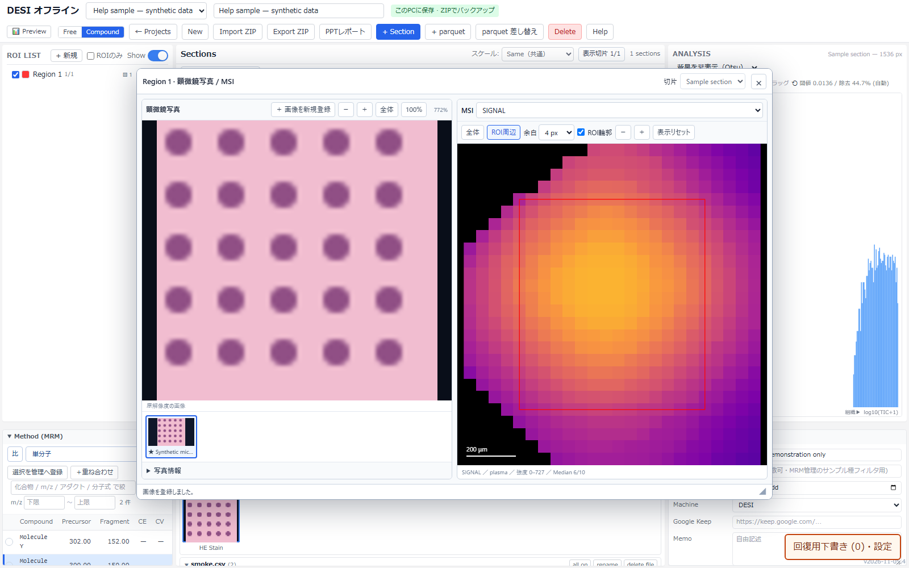

Microscopy images associated with an ROI

**Effect on results**

Microscopy images document the ROI. Attaching them does not change MSI source signals or ROI statistics.

**Save and share**

Images and descriptions are stored with their ROI and carried by ZIP and sharing. Editing follows local or shared permissions.

### Preview, overlays and PPT

Compare images in a grid, create multicolour molecule overlays and produce PPT reports.

1. **Open Preview** — Open Preview to view molecule or ratio images across sections. Before publishing, inspect the recipient's view.
2. **Match comparison settings** — Select sections and molecules, then check Range, Same / Individual, colour and ROI visibility.
3. **Overlay molecules** — Assign colours to multiple molecules in an overlay. Review brightness normalisation before comparing distributions. Multicolour ratio overlays are not supported.
4. **Create a PPT report** — PPT reports initially include every section independently. Choose output sections and assign comparisons to named groups. Each group shares an automatic Range per strictly matched molecule; independent sections use their own automatic Range. Viewer Same/Individual and manual Range do not determine report windows. Add, rename or delete groups, assign checked rows in bulk, or reset all assignments to independent. Unregistered molecules are omitted; registered load failures remain visible. Check group labels and raw ranges in the exported slides.

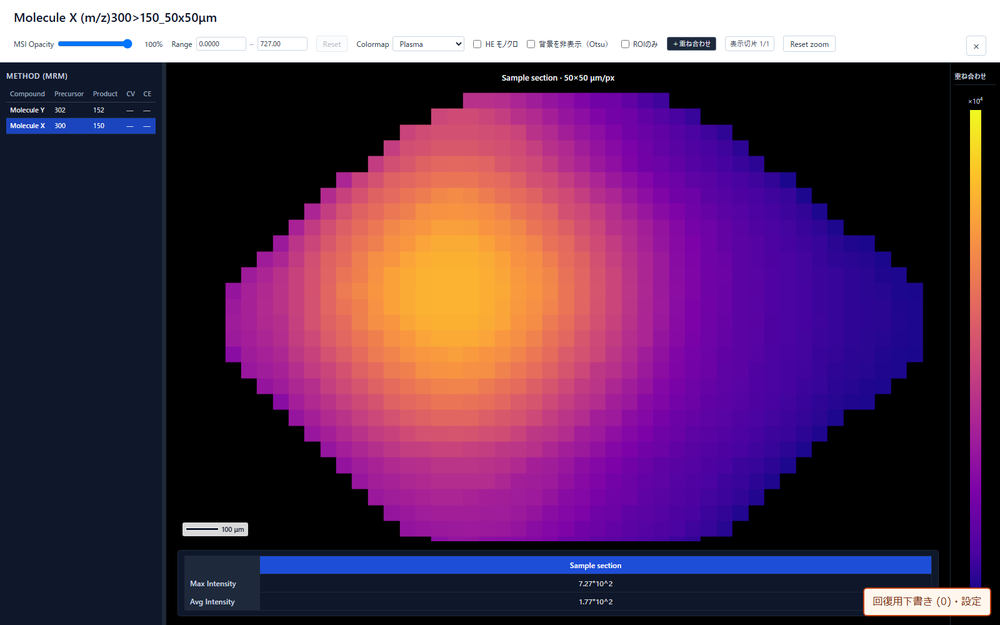

Compare sections and molecules in a grid

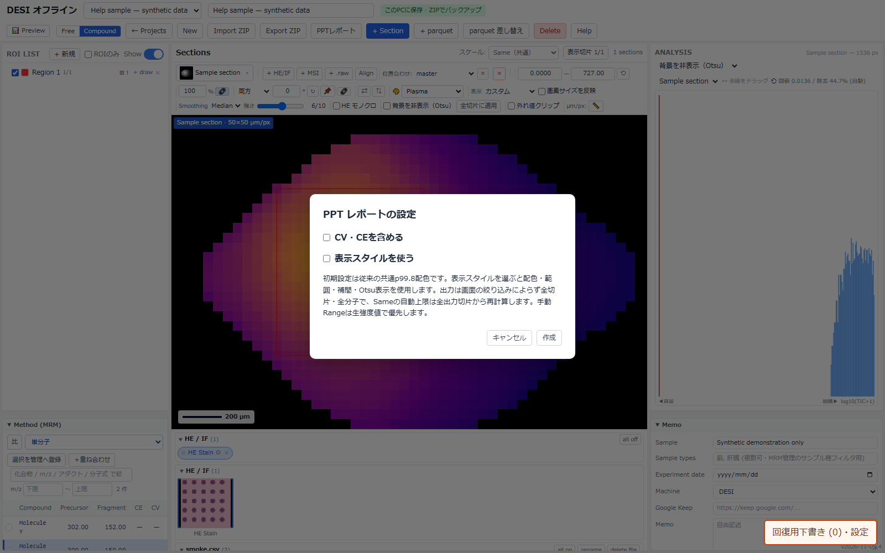

Review report export conditions

**Effect on results**

Overlay colours and brightness are display settings. Colour mixtures are not numerical ratios or source-signal statistics.

**Save and share**

PPT contains images captured at export time. Later project edits do not automatically update an existing PPT.

If a shared view uses personal settings, document those conditions in the report.

In supported sharing environments, overlays created by recipients are shared with users of the same URL. Published author overlays are read-only. Follow the on-screen notice if shared saving is unavailable.

### Save, ZIP, share and Memo

Choose browser saving, file backup or server publication according to your needs.

1. **Check Memo and save status** — Record conditions and observations in Memo and check storage status. このPCのみ・未公開 means browser-only, unpublished data; このPCに保存・公開待ち means saved on this PC and awaiting publication. Review any save error before closing the page.
2. **Back up with Export ZIP** — Use Export ZIP to save sources, ROIs, microscopy images and ratio definitions. ZIP export is independent of publication.
3. **Restore with Import** — Import the saved ZIP, review its contents and confirm restoration. A compatible app on another computer can restore it.
4. **Review and publish** — Authors use Publish to share after Preview. Verify completion and Sync status, then share the URL and required password.

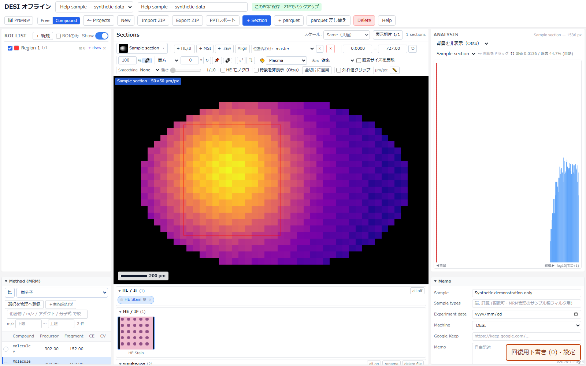

Backup and note controls

**Effect on results**

Saving, ZIP and publication do not replace source signals with display colours. Sources, ROI information and ratio definitions remain distinct.

**Save and share**

Local saving uses this browser; Export ZIP creates a file you save; Publish updates shared server content. These are separate destinations.

✓ 公開版 vN を保存済み identifies the publication revision saved as this PC's baseline. It does not guarantee that this copy matches the latest changes published from another PC. Use 共有の最新版を確認 to retrieve shared content.

Auto-publish sends local edits from a published project to its share. It stops when the shared revision conflicts or the baseline is unknown. Local saving alone does not resume publication; explicitly compare and republish. Review the effect on the share and monitor large uploads until completion.

Local data remains separate on each PC and browser, even with the same Google account. On another PC, import through the server list with Open (master), or open the shared URL for viewing. Transfer unpublished work with Export ZIP / Import.

Shared display settings and personal ratio changes do not save back to the published source. Shared ROI, alignment and overlay saves follow their permissions and locks. Shared-view Memo edits are temporary and discarded on reload.

### MRM library and .exp editing

Organise MRM transitions by compound and tag, and review acquisition history and .exp files.

1. **Open MRM management** — Open MRM management from Projects. Switch between the validated library and usage archive, then search and filter.
2. **Register transitions** — Add compounds, enter or paste table rows, or bulk import Excel. Check precursor / product, CE / CV, tags and provenance.
3. **Organise history and method sets** — Reconcile unregistered acquisition history. Save or load method sets and select transitions for output.
4. **Review and export .exp** — Export selected transitions using a template, or open an existing .exp for editing. Review changes and validation, then save a separate output file.

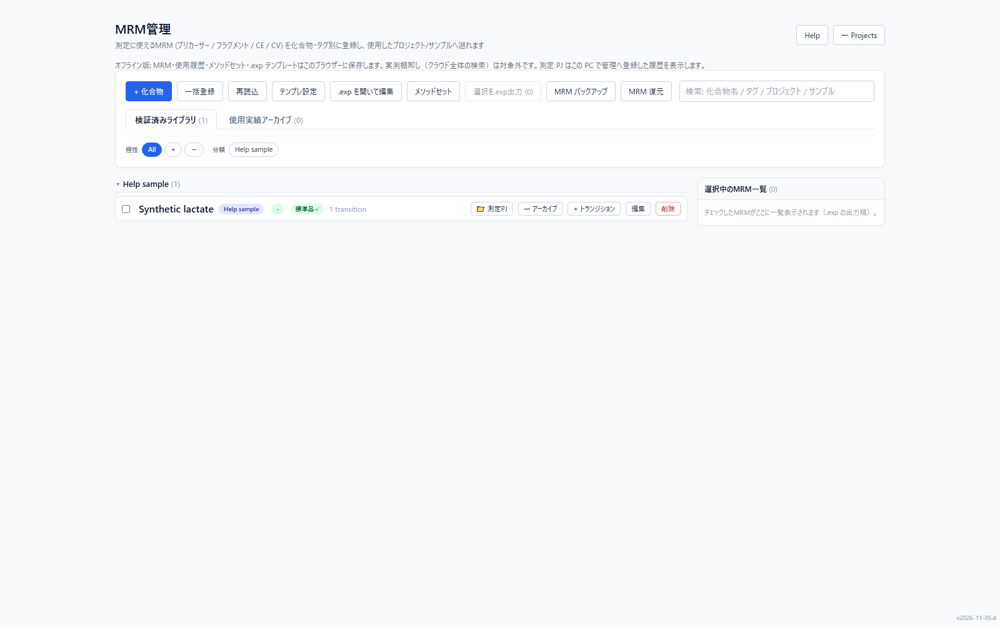

MRM library

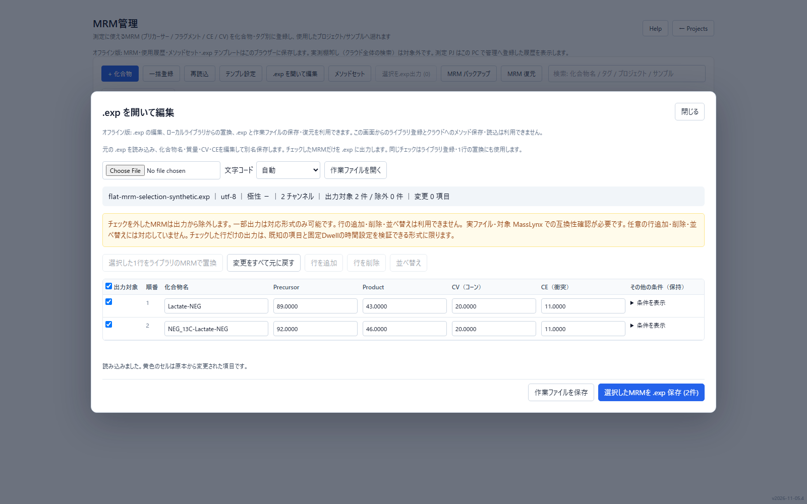

Review exp content and changes

**Effect on results**

Editing the MRM library does not rewrite imported MSI signals or ROI statistics. Acquisition method management and image analysis are separate operations.

**Save and share**

The offline library is local. For an online shared library, check the destination and permissions.

.exp output does not directly overwrite the source file. Review the saved file on the instrument side, including unsupported settings and validation messages.

### Troubleshooting and shortcuts

Diagnose display issues, missing sources, storage problems, sharing and offline startup.

1. **Check the current view** — If an image is missing, check the section, Method / Compound, layer toggles, Opacity, Range and ROI-only display.
2. **Check numerical sources** — If ratio or ROI calculations are unavailable, check source availability, X / Y correspondence and whether the denominator threshold excludes all positions.
3. **Check storage and permissions** — Read storage conflict, capacity and shared-lock messages. Preserve unsaved work with ZIP or recovery drafts before reloading.
4. **Retry with the recorded conditions** — In the Method table, ↑ / ↓ moves between molecules. During ROI drawing, Enter finishes and Esc cancels. For support, record build version, action, input format and error text.

Project manager

**Effect on results**

Do not interpret an unavailable result as zero. Check missing values, denominator conditions and unsupported data, and distinguish them from valid measurements.

**Save and share**

Fully extract the offline ZIP and run START_OFFLINE.bat. Closing its window stops the local server. Browser data and ZIP backups are separate.

Print / PDF prints all chapters for the current audience and language. Click a screenshot to enlarge it.

<!-- GUIDED_HELP_END -->
