# DESI Data Share — プロジェクト管理ガイド

このガイドは **DESI Data Share の管理画面 (`/`)** の基本操作と、後半の実画面付き全機能ガイドを収録しています。Help 右上の読者選択で「作成者」「共有・閲覧者」の説明へ切り替えられます。

---

## 目次

1. [この画面でできること](#1-この画面でできること)
2. [ログイン (パスワード)](#2-ログイン-パスワード)
3. [画面構成](#3-画面構成)
4. [新規プロジェクトを作成する](#4-新規プロジェクトを作成する)
5. [プロジェクトを開く・削除する](#5-プロジェクトを開く削除する)
6. [サーバから一覧取得 (別 PC でも見る)](#6-サーバから一覧取得-別-pc-でも見る)
7. [URL のコピー](#7-url-のコピー)
8. [データの保存先](#8-データの保存先)
9. [ビルドタグ (右下バッジ)](#9-ビルドタグ-右下バッジ)
10. [困ったときは](#10-困ったときは)

---

## 1. この画面でできること

- 自分が作成したプロジェクトの一覧表示 (ローカル + サーバ)
- 新規プロジェクトの作成 (実験日 / 装置 / Matrix / Google Keep / Memo を一括入力)
- 既存プロジェクトを開く / 削除する
- 公開済みプロジェクトの **共有 URL を 1 クリックでコピー**
- サーバから過去公開したプロジェクトを呼び出す (別 PC からでも一覧可)

データの登録 (HE/IF, MSI) や `Publish to share` は、ここから `Open` してビューアに入った後の操作です (詳細は「データ共有 (admin)」)。

---

## 2. ログイン (パスワード)

管理画面の入口で admin password を要求されます。

- 既定値は `MSIadomine` (Publish モーダルの admin password 欄に pre-fill されるもの)
- 認証が通ると **12 時間** sessionStorage に保持され、再入力不要
- タブを閉じれば失効
- Supabase が接続できる場合は `list_projects(pw)` を呼んで bcrypt 照合
- オフライン時は SHA-256 でローカル比較に fallback

> このゲートは shoulder-surfing 防止レベルです。本格的な秘匿は Supabase 側 (bcrypt) で実現されています。

---

## 3. 画面構成

- **ヘッダ**: タイトル + Help ボタン
- **アクション行**: `+ 新規プロジェクト` / `サーバから一覧取得`
- **プロジェクト一覧**: 各行は以下の情報とアクション
  - 名前 + バッジ (`Local` / `Local + Server` / `Server only`)
  - 実験日 / 装置 / Matrix / Google Keep / Memo の冒頭
  - `Open` / `Copy URL` / `Delete`

### バッジの意味

| バッジ | 意味 |
| --- | --- |
| **Local** | このブラウザの IndexedDB にだけある (未 publish、または別 PC で作成等) |
| **Local + Server** | ローカルにもサーバにもある (この PC で publish したもの) |
| **Server only** | サーバのみ (別 PC で publish した、ローカルから削除済み等) |
| **空** | このローカル記録に切片が 1 つもない (作成しただけの状態)。開いても「レイヤーがありません」にしかなりません |

同じ共有 slug を持つローカルコピーも、ローカル ID ごとに表示します。名前が同じだけのプロジェクトを自動で共有先へ結び付けることはありません。サーバからの取込は新しいコピーを作り、既存コピーは削除しません。Local + Server は共有先との関連を表し、内容一致を保証する表示ではありません。

---

## 4. 新規プロジェクトを作成する

1. `+ 新規プロジェクト` ボタンを押す
2. メタ情報フォーム:
   - **プロジェクト名** (必須)
   - **実験日時**: `<input type="date">`
   - **装置**: DESI / TIMS / LTQ / Other
   - **Matrix**: 装置が DESI 以外の場合のみ表示
   - **Google Keep**: 関連ノートの URL (任意)
   - **Memo**: 自由記述
3. `Create` でビューアに遷移、すぐに HE/IF/MSI を登録できる状態に

ここで入力した値はビューア右下の Memo パネルにそのまま反映されます。

---

## 5. プロジェクトを開く・削除する

行ごとのバッジに応じて出るボタンが変わります。**Open**・**Open (master)**・**Share view** は新しいタブで開き、管理画面の検索やフォルダーの開閉状態を保ちます。管理画面へ戻るとローカル一覧だけを更新し、別タブで取り込んだプロジェクトも表示します。この更新ではサーバのフォルダー情報を取得・再公開しません。編集ダイアログや処理が進行中の場合は、終了後に更新します。

| 行のバッジ | 出るボタン | 用途 |
| --- | --- | --- |
| Local / Local + Server | `Open` / `Copy URL` / `Delete` | この PC で編集 / 共有 URL コピー / IDB から削除 |
| **Server only** | **`Open (master)` / `Share view` / `Delete (server)`** | 別 PC で publish した project をこの PC で master 編集 / share recipient として閲覧 / **サーバから完全削除** |

### 5-1. Server only 行のボタン詳細

- **Open (master)**: 新しいタブの viewer を `?import=<slug>` 付きで開き、**master password** (この管理画面に入るときと同じもの) で認証して Storage から blob をダウンロードし、master 画面が起動します。
  - 管理画面の有効なmaster認証だけを元の期限のまま引き継ぎます。期限切れの場合は、新しいタブで認証後、選んだプロジェクトを開きます。
  - parquet (TIMS ノンターゲット) は**ダウンロードせず Storage から直接読みます** (数百 MB を IndexedDB に置くと容量超過で壊れるため)。
  - 取り込んだ直後は共有パスワード (viewer / admin) が引き継がれません。編集すると同期インジケータが **🔑 共有パスワード未設定** になるので、1 回だけクリック → `Publish to share` でパスワードを設定してください。以降は通常の auto-publish フローに乗ります。
- **Share view**: 新しいタブに普通の `#share=<slug>` リンクで viewer を開きます（viewer pw 入力 → 受け手と同じ画面）。元のタブのAdmin認証は引き継ぎません。CE・CVを含めるには、この共有タブでAdminに入り、PPTレポートの出力項目を選びます。
- **Delete (server)**: master pw を要求 → 確認ダイアログ → サーバの `projects` 行 + 関連子テーブル (sections / rois / project_credentials / session_tokens / roi_locks) + Storage 配下 `<slug>/...` のオブジェクトをすべて削除。**復旧手段なし** なので注意。

### 5-2. Local / Local + Server 行の Delete

- ローカル IndexedDB のみから削除
- サーバに publish 済みなら **サーバ側のデータは残る** (`Server only` に変わる)
- サーバ側も消したいときは Server only 行に切替えて `Delete (server)` か、Supabase ダッシュボードから手動削除

---

## 6. サーバから一覧取得 (別 PC でも見る)

別 PC で publish したプロジェクトをこの PC でも一覧したいときに使います。

1. `サーバから一覧取得` ボタンを押す
2. **admin password** を入力 (既定 `MSIadomine`)
3. その admin pw が登録されているプロジェクトがすべて表示される
4. 入力した pw は sessionStorage に 12 時間キャッシュ (次回はプロンプトなし)
5. ローカルに無い project には **`Server only`** バッジが付き、`Open (master)` / `Share view` / `Delete (server)` ボタンが出ます

> 共通 admin pw を運用していれば、どの PC でも同じパスワードで全プロジェクトを呼び出せます。
> 1 人で複数 PC を順番に使う運用では、Phase 1 で publish → Phase 2 PC で `Open (master)` (= `?import=<slug>`) → 続きの編集 → auto-publish → 次の PC で `Open (master)` … が標準フローです。

---

## 7. URL のコピー

Publish 済みのプロジェクトには `Copy URL` ボタンが出ます。

- クリックでクリップボードに `https://.../viewer/index.html#share=<slug>` をコピー
- ボタンが `Copied ✓` に一瞬切替わる
- viewer password と admin password は **別チャネル** (Slack / メール) で受け手に渡してください

未 publish のプロジェクトは `URL なし` (disabled) が表示されます。`Open` → ビューアで `Publish to share` してから戻ると `Copy URL` が現れます。

---

## 8. データの保存先

| 場所 | 何が入る | 範囲 |
| --- | --- | --- |
| **ローカル IndexedDB** (`desi-projects` DB) | プロジェクトメタ + 切片構造 + ROI + Memo + 登録ファイル本体 (TIFF/xlsx/txt/parquet/.raw.zip) | このブラウザのこのプロファイル限定 |
| **Supabase** (publish 済のみ) | 切片構造 / ROI / Memo / 圧縮バイナリ / bcrypt パスワード | サーバ全体 |
| **localStorage** | 最後に開いたプロジェクト ID、レイアウト寸法 | このブラウザのこのプロファイル |
| **sessionStorage** | admin pw キャッシュ、master 解錠フラグ | このタブのみ |

> 重要: ローカル IndexedDB の容量は無制限ではありません。ブラウザのストレージ逼迫時に削除されることがあるので、**重要なプロジェクトは必ず Publish to share でサーバに退避**してください。

---

## 9. ビルドタグ (右下バッジ)

画面右下に **`v:YYYY-MM-DD-rN`** という小さなビルドタグが常時出ています。

- ファイル更新後にハードリロード (Ctrl+F5) すれば必ず最新版になります — タグの値が変わっていれば適用済の確認になります
- バグ報告時に「v:2026-05-08-r15」のようにタグを添えていただけると再現確認が早くなります
- share recipient 画面 / master 画面 / 管理画面すべてに同じタグが出ます

---

## 10. 困ったときは

| 症状 | 対処 |
| --- | --- |
| `Init failed: The requested version (X) is less than the existing version (Y)` | DB スキーマのバージョン不整合。最新コードに更新してハードリロード (Ctrl+F5) |
| サーバ一覧取得でエラー | admin pw が違う、または Supabase が接続できない |
| URL コピーボタンが出ない | まだ Publish to share していない。`Open` → ビューアで Publish |
| パスワードを入力しても先に進めない | キャッシュをクリア + 再ロード。それでもダメなら admin pw を変更した可能性 |
| 別 PC からプロジェクトが見えない | `サーバから一覧取得` で admin pw を入力し直してください |
| `Delete (server)` で「失敗: N 件」 | Storage の publish-token DELETE policy が未適用。`supabase/share_locks.sql` の §4 を再実行してください |
| `Open (master)` で master pw を聞かれる | `?import=<slug>` 経由の初回オープンには master password が必要です (管理画面に入るときと同じもの) |
| `Open (master)` でパスワードを入れると一覧に戻ってしまう | 古いビルドはプロジェクト個別の **admin password** を要求していました。admin password を設定せずに publish したプロジェクトには正解が存在しないため、何を入れても戻ります。ページを更新して最新版で開き直すか、`🔑 パスワード` で admin を設定してください |
| 開いたら「レイヤーがありません」と出る | 一覧で **空** バッジが付いていないか確認してください (作成しただけのプロジェクト)。データのある方を開いてください |
| 同じ名前・共有先のプロジェクトが複数行ある | ローカル ID が違う場合は別コピーです。全コピーを表示します。ID と内容を確認してから整理してください |
| 別 PC で開くとフォルダが空で、中身がルートに出ている | 古いビルドは、フォルダの `＋プロジェクト` で作ったプロジェクトを**そのブラウザの中でしか意味を持たない ID** でフォルダに結びつけていました。最新版を**そのプロジェクトを登録した PC** で開くと、公開済みの slug が自動で書き込まれて直り、以後はどの PC でも正しくフォルダの中に出ます。別 PC 側だけでは直せません |
| 別 PC でフォルダを共有すると「この PC では解決できない N 件があります」と出る | 上と同じ原因です。そのまま共有すると、その N 件は公開済みでも受け手の一覧から抜け落ちます。**そのプロジェクトを登録した PC で管理画面を一度開いてから**共有し直してください |

## 11. 保存競合・回復用下書き

画面右下の **回復用下書き (件数)・設定** から、**自動作成する／自動作成しない** を選べます。0 件でも設定を開けます。初期設定は「自動作成する」で、このブラウザーの全ローカルプロジェクトに共通です。再読み込み後も保持し、別タブの次回保存にも適用します。既存の下書きは、設定をオフにしても削除しません。

同じローカルプロジェクトを複数タブで編集した場合、先に保存した版を守ります。古い版からの保存は上書きせず、自動作成が ON の場合は今回の編集を **回復用下書き** に保存します。OFF の場合は退避せず保存エラーとなるため、その編集はタブを閉じた後にこの機能で復元できません。通常保存・共有更新・競合防止は設定にかかわらず有効です。自動的な内容マージは行いません。**別コピーとして復元** で、共有先・共有パスワードを引き継がない独立コピーを作れます。容量不足で下書き自体を保存できない場合も保存エラーになります。

別タブでプロジェクトを削除しても、編集中タブ・下書き・処理中ジョブが参照する原本は保持します。正常保存が確認できる終了タブの重複データは、下書き件数に加えません。回復対象の保持データは **別コピーとして復元**、または **下書き・保持を破棄** できます。破棄は他のプロジェクトや処理に必要な原本を削除しません。使用中タブの保持は破棄できません。OFF で作られた回復コピーのない保持データは、タブの終了と参照先を確認して解放します。期限だけでは削除しません。

DB v6 への更新前に旧タブで保存を完了し、重要なプロジェクトを Export ZIP で退避して、旧タブを閉じてください。更新後は全画面を再読み込みします。旧版の書込は停止します。データベース削除で解決しないでください。運用・ロールバックの注意は [ローカル保存の更新手順](docs/LOCAL_STORAGE_UPGRADE.md) を参照してください。

<!-- GUIDED_HELP_START -->

## 実画面でたどる操作ガイド

[手順型 Help を開く](help.html?role=manage&lang=ja&mode=online)

以下の画像は合成データを使って実アプリから撮影しています。画像内のボタン名はアプリの表示言語に従います。

### はじめに・画面の見方

プロジェクトを開き、切片・分子・ROI の関係を確認します。画面写真は説明用の合成データを使っています。

1. **利用する画面を開く** — 作成者は Projects からローカルプロジェクトを開きます。共有された URL では、求められた閲覧パスワードを入力します。
2. **切片と分子を選ぶ** — 左側で切片、上部の Method / Compound で測定法と分子を選びます。Main view が選んだ切片を表示します。
3. **画像を確認する** — 拡大・移動して分布を確認します。HE / IF / MSI のチェックと透明度を変えると、重なりを見比べられます。
4. **目的の章へ進む** — 左の目次または検索から操作を選びます。「集計への影響」「保存と共有」で、画像表示と数値・保存先の違いを確認できます。

**集計への影響**

色の見た目と測定値は区別します。Range・カラーマップ・Median・Linear は表示調整です。ROI の数値は元データから計算します。

**保存と共有**

ローカル編集は、このブラウザーの保存領域に保存されます。別 PC へ渡すときは Export ZIP または Publish を使います。

共有リンクの閲覧権限と管理権限は異なります。画面に出ない編集操作を、Help から有効にすることはできません。

### プロジェクトを管理する

新規作成、フォルダー整理、ローカルとサーバーの区別、保存状態を確認します。

1. **新規プロジェクトを作る** — Projects の New project を押し、名前と説明を入力します。作成後に Viewer を開きます。
2. **一覧を整理する** — フォルダーを作成し、プロジェクトを移動します。Local / Server の表示で保存先を区別します。未公開のプロジェクトの保存状態は「このPCのみ・未公開」です。
3. **必要なコピーを開く** — ローカルデータは Open で編集します。初めて使う別 PC では「サーバから一覧取得」→ Open (master) で公開済みの内容を取り込みます。閲覧するだけなら共有 URL を開きます。
4. **共有の最新版を確認する** — 共有先のあるローカルプロジェクトで「共有の最新版を確認」を押し、この PC とサーバーの公開版番号・切片数を比較します。「このプロジェクトに反映」または「別コピーで取得」を選びます。未公開の変更や公開結果の確認待ちがある場合は、別コピーでの取得だけが利用できます。
5. **削除前にバックアップする** — Export ZIP を保存し、確認ダイアログで削除対象を読みます。ローカル削除とサーバー側の削除は別の操作です。

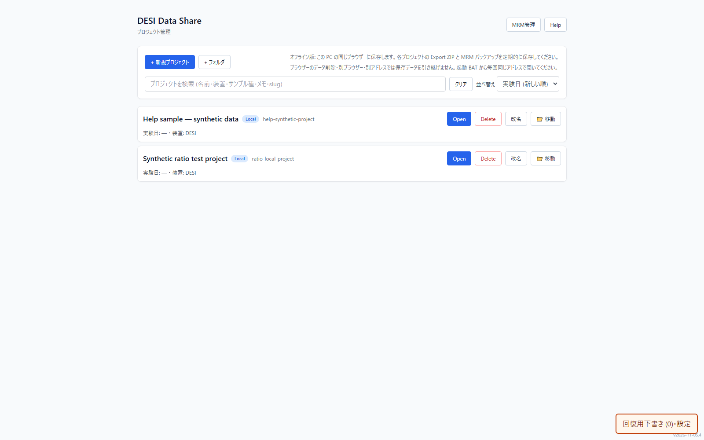

**集計への影響**

フォルダー整理や名前の変更は測定値を変更しません。複数 PC のローカルコピーは、それぞれ独立しています。

**保存と共有**

保存競合が出たら、編集を続ける前に再読み込みまたは回復用下書きの内容を確認します。回復用下書きの自動作成は設定で選べます。

ブラウザーデータの削除・端末故障に備え、ZIP を別の保存場所へ定期的に書き出します。

既存プロジェクトへの反映が成功すると、同じプロジェクトの内容を更新し、直前の版を Projects に「サーバー版取り込み前 ...」という別のローカルコピーとして残します。このコピーは共有先との関連を外して保存され、回復用下書きの自動作成が OFF でも作られます。

原本や ROI を取得できない場合、取得中に別タブの内容やサーバーの公開版番号が変わった場合は、既存版への反映を中止します。同じ Google アカウントでログインしても、PC やブラウザー間のローカルプロジェクトは自動同期されません。

### 切片とデータを登録する

HE / IF 画像と MSI の数値データを、対応する切片へ登録します。

1. **切片を用意する** — 切片を追加し、名前・順番を確認します。切片名や分子名は作成者の編集画面で変更できます。
2. **HE / IF 画像を選ぶ** — 対応する切片の画像登録操作から画像を読み込みます。MSI と重ねる画像の位置は、登録後に Align で調整します。
3. **MSI の列と形式を確認する** — xlsx / txt・CSV などの数値データでは、X 座標・Y 座標・信号列を指定します。Waters .raw は対応する変換環境で読み込みます。
4. **読み込み結果を点検する** — Method / Compound、向き、MSI pixel size を確認します。Parquet の追加・置換では確認画面の対象切片と分子を必ず確認します。

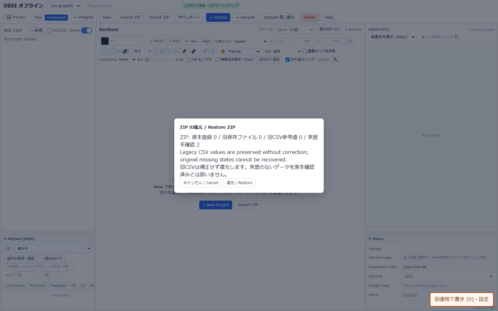

**集計への影響**

比や ROI を計算するには元の数値データが必要です。色付きの MSI 画像だけでは、信号値を復元して計算することはできません。

元データの座標と行の対応を保ちます。異なる測定座標や互換性のない入力は、確認せずに同じ画素として扱わないでください。

**保存と共有**

インポート後はローカルプロジェクトを保存し、Export ZIP で数値ソースと画像を含むバックアップを作ります。

### 切片と分子を見比べる

Free / Compound、表示切片、レイヤーを組み合わせて、同じ条件で画像を見比べます。

1. **View を選ぶ** — Free は切片ごとに分子を選びます。Compound は選んだ分子を切片間で揃えて比較します。
2. **表示する切片を絞る** — 表示切片の選択で必要な切片を残します。非表示は削除ではありません。再表示して比較を続けられます。
3. **レイヤーを組み合わせる** — HE / IF / MSI のチェックを切り替え、歯車から透明度・Grayscale・Apply opacity を調整します。HE 未登録時は TIC 背景が使われる場合があります。
4. **向きと尺度を確認する** — 拡大・移動・Rotation とスケールバーを確認します。作成者は切片の Flip H / V を変更できます。
5. **KMD 図で系列を探す** — ANALYSIS で KMD図を選び、CH₂・H₂・O の単位を切り替えます。点のクリックで分子を表示、ドラッグで囲むと Method 表を絞ります。系列の「重ねる」で色分けし、⟲ または Method 表の「KMD 選択」で解除します。

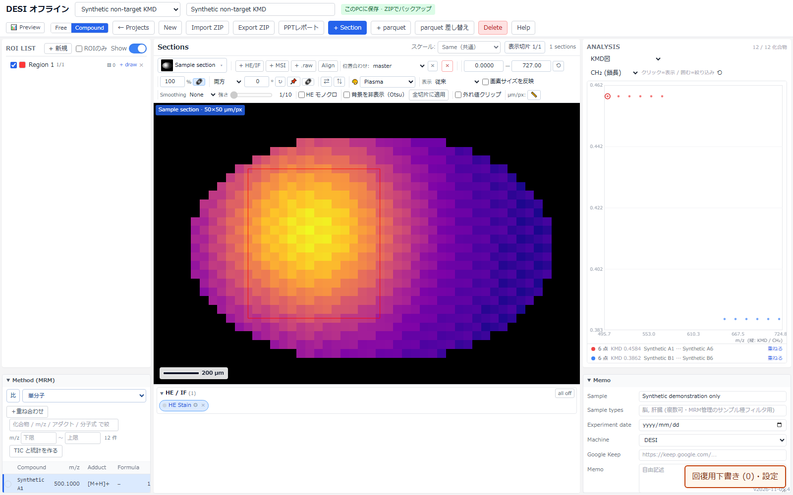

**集計への影響**

レイヤーの表示、透明度、ズーム、表示切片の選択だけでは元の信号値は変わりません。非表示の切片が出力対象に含まれるかは出力画面で確認します。

KMD は m/z から Kendrick 質量欠損を計算する図です。MRM では precursor を使い、m/z のない候補は件数を示して除外します。比（X / Y）とは別の見方で、元信号や ROI 集計は変えません。

ノンターゲット表には m/z・Adduct・Formula・Mean・Max が表示されます。検索や m/z 範囲、列見出しで候補を絞り、並べ替えられます。Mean が未計算なら「TIC と統計を作る」を使います。source 別の TIC と表示用の TIC backdrop は用途が異なります。

**保存と共有**

表示操作の保存範囲は操作と権限によって異なります。共有画面で行う一時的な見え方の調整を、公開元データの変更と混同しないでください。

KMD の選択・Method 表の絞り込み・系列の「重ねる」は一時的です。プロジェクトの比定義や保存済み重ね合わせには追加されません。別プロジェクトへ移動すると選択を解除します。

### 色・Range・滑らかさを調整する

表示だけを調整して分布を読み取りやすくします。Median と Linear の強さは、それぞれ 1～10 で選べます。

1. **表示スタイルと色を選ぶ** — MSI style とカラーマップを選びます。物理縦横比の表示を使うと、MSI pixel size に基づいた見え方になります。 背景を非表示（Otsu）と外れ値クリップも、必要に応じて表示を整えるために使います。
2. **Range を合わせる** — 表示する強度範囲を調整します。Same は比較対象の尺度を揃え、Individual は各画像に合わせます。白飛びしたら上限を見直します。
3. **Smoothing と強さを選ぶ** — None は平滑化なし。Median は近傍の中央値を使う表示用フィルターです。Linear は補間なしに近い 1 から、従来の Linear と同じ 10 まで選べます。
4. **ROI の範囲を見やすくする** — ROIのみ表示では表示対象の ROI に絞って確認できます。自動 Range の対象が変わるため、全体表示と明るさが変わることがあります。

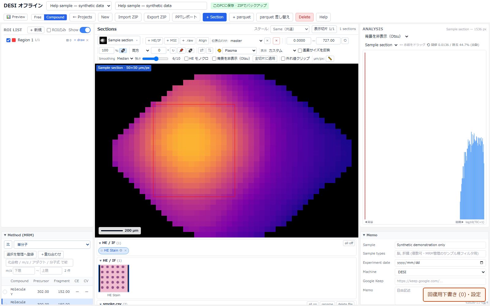

**集計への影響**

Median・Linear・Range・カラーマップ・物理縦横比は、元データや ROI 集計値を変更しません。集計は平滑化前の数値を使います。

Median の段階は表示の滑らかさを選ぶためのものです。異なる装置やアプリの同じ番号と同一処理を保証する尺度ではありません。

ROIのみ表示で自動 Range が変わっても、ROI の形や集計対象の元データは変わりません。

背景を非表示（Otsu）は TIC のヒストグラムで背景を判定する表示機能です。ANALYSIS で閾値を調整し、必要なら全切片に適用します。元の強度・座標・ROI 定量・数値出力は変えません。

**保存と共有**

作成者の表示設定はプロジェクトの保存・ZIP・公開に引き継がれます。共有画面の MSI style・色・Median / Linear はこのタブの個人設定で、再読み込み後も保持します。viewer と Admin は別設定です。公開元は変更しません。

Range はプロジェクトごとの一時的な表示設定です。固定条件で比較したいときは範囲と Same / Individual を記録してください。

### 比（X / Y）を表示する

同じ切片の 2 分子から比画像を作ります。酸化分子 / 非酸化分子など、任意の X / Y に使えます。

1. **「比」を開く** — 数値データを含むプロジェクトで「比」を開きます。作成済みの比は一覧から選べます。
2. **分子 X と分子 Y を選ぶ** — 分子側（X）と分母側（Y）を切片ごとに選び、名前を付けます。検索で候補を絞り、同名ならファイル・列・測定条件で区別します。別ファイルでは座標の単位と原点が同じことを確認します。
3. **分母の下限を確認する** — Y の下限は初期値 0 です。下限以下の Y、欠損、負の信号は有効な比として扱いません。無効部分は 0 に置き換えず、計算対象から除きます。
4. **比画像を表示して比較する** — 「保存して表示」で比画像と ROI 集計を確認します。「ROI集計CSV」は指標を、「測定点CSV」は測定点ごとの値・有効性・除外理由を保存します。

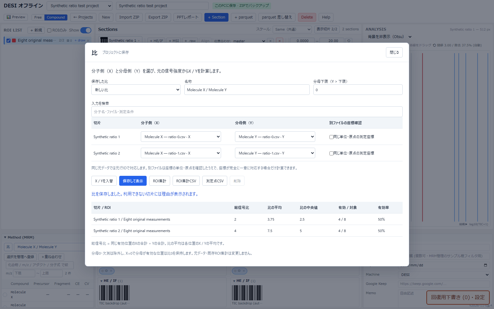

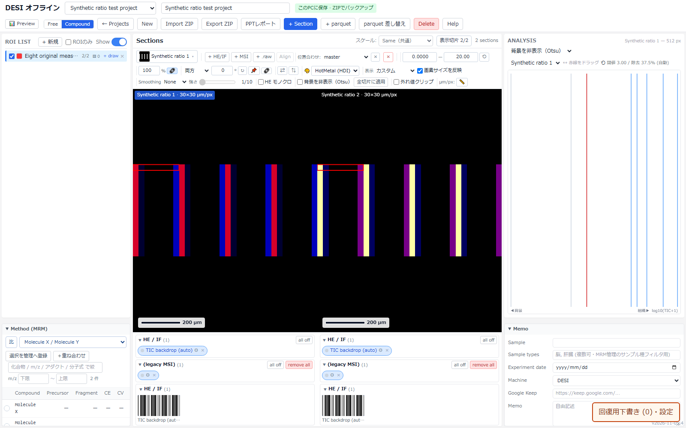

**集計への影響**

比は対応する元データの値から計算します。表示済みの色や、Median / Linear をかけた画像から計算しません。X = 0、Y > 下限の位置は有効な 0 です。

ROI総信号比 = 有効な位置の X の合計 / 同じ位置の Y の合計。個別比の平均 = 各位置の X / Y の平均。個別比の中央値 = 各位置の X / Y の中央値。これらは異なる指標です。

例：X が 2, 8、Y が 1, 2 のとき、ROI総信号比は 10 / 3 ≈ 3.33、個別比の平均は (2 + 4) / 2 = 3 です。

結果には有効数・有効率・除外理由・分母下限を添えて判断します。元の分子別 ROI 集計と比の集計は別の結果です。

**保存と共有**

作成者が保存した比の定義は、プロジェクト・ZIP・公開に含まれます。定義は X / Y と分母下限を記録し、元の信号値を書き換えません。

共有の閲覧者・管理者が編集した比は、このタブの個人用設定です。同じタブの再読み込み後も保持し、タブを閉じると失われます。公開元の比定義や他の閲覧者の設定を上書きしません。

比の ROI 結果は専用出力で保存します。画像や PPT に表示する比と、数値結果の指標・条件を対応させて記録します。

### HE / IF と MSI を位置合わせする

Align で同じ組織の位置を揃え、重ね合わせて確認します。

1. **切片から Align を開く** — 対象の切片を選び、Align を開きます。HE / IF、Source、比較する MSI を選びます。
2. **尺度と手動位置を調整する** — MSI pixel size を確認し、移動・回転・拡大縮小などの手動スライダーでおおまかに揃えます。
3. **対応点または自動整合を使う** — Landmark では両画像の同じ位置を対応させます。シルエットによる自動整合も結果を目視確認してから採用します。
4. **重ね合わせを確認して保存する** — 重ね合わせ表示と MSI の濃さを使ってずれを点検します。Save で確定、Cancel で今回の変更を破棄します。

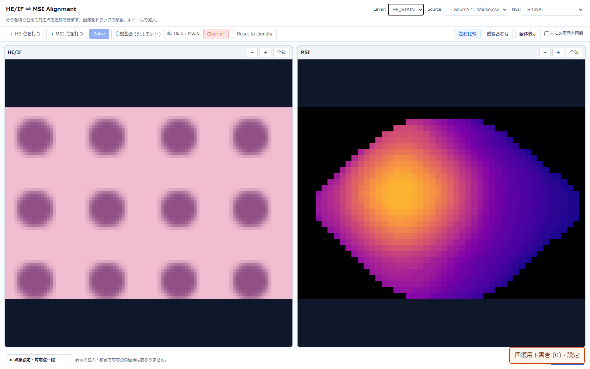

**集計への影響**

位置合わせは表示座標の対応です。元の MSI 信号値を書き換えません。ROI はどの座標系で描かれたかを保って扱います。

**保存と共有**

作成者の Save はプロジェクトへ保存します。共有画面では必要な書き込み権限・ロックを確認します。Cancel では確定しません。

### ROI を描いて集計する

関心領域を描き、元の信号値を集計します。比の集計では、分子単独の値と区別します。

1. **ROI と編集権限を確認する** — ROI 一覧で名前・色・表示状態を確認します。共有画面で描画や削除をするときは、必要な書き込みロックを取得します。
2. **領域を描く** — ROI の描画操作を選び、画像上で領域を囲みます。同じ ROI を別切片へ描く場合も、切片ごとに対応する位置を確認します。
3. **表示と対象を点検する** — ROI の表示切替・ROIのみ表示を使い、意図した範囲か確認します。削除は確認画面で対象 ROI を確認してから行います。
4. **集計を確認して出力する** — 元信号の集計を確認します。比の場合は専用結果の指標名、有効数、除外理由、分母下限も合わせて確認します。

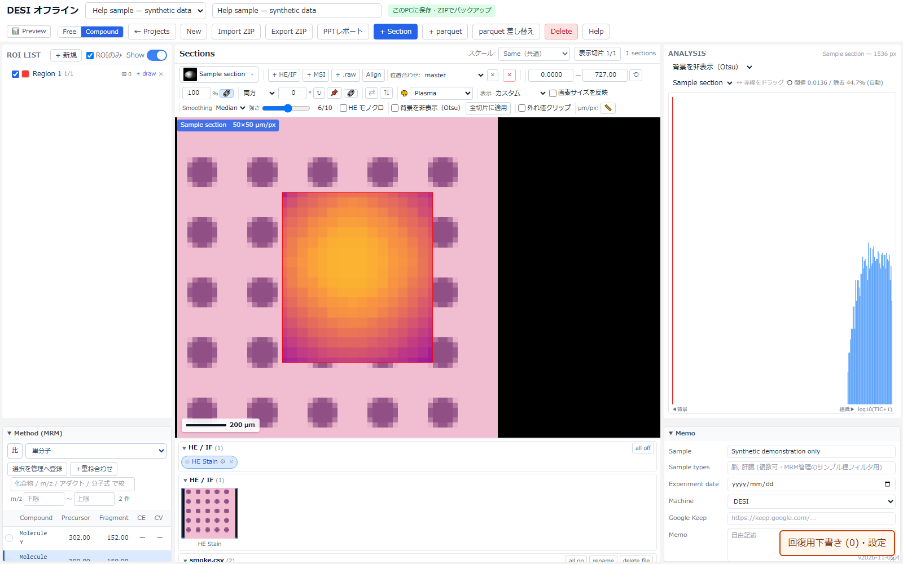

**集計への影響**

ROI 集計は元の数値データを対象とします。Median / Linear・色・Range を変更しても集計値は変わりません。

比の「ROI総信号比」と「個別比の平均」は異なります。比の章の式を確認し、結果に記載された指標を使って比較してください。

**保存と共有**

作成者の ROI はプロジェクト・ZIP に保存します。共有 ROI の書き込みは共有権限とロックに従います。非表示は削除ではありません。

ZIP では元データと ROI 情報を分けて保存します。比の専用出力も、測定条件が分かる名前で保存してください。

### ROI に顕微鏡画像を付ける

ROI に対応する顕微鏡画像を登録し、MSI と一緒に確認します。

1. **対象 ROI の画像画面を開く** — ROI の画像操作を開き、対象の切片と ROI を確認します。複数の顕微鏡画像を同じ ROI に関連付けられます。
2. **画像と説明を登録する** — 画像ファイルを選び、タイトルや説明を入力します。位置・倍率など、読み手が対応関係を判断できる情報を残します。
3. **MSI と見比べる** — 顕微鏡画像を拡大して確認し、ROI の MSI 表示と見比べます。分子または比の選択・表示条件も確認します。
4. **順番・説明を整えて保存する** — 画像の順序や説明を整え、不要な画像は確認して削除します。共有時は画像を含めた公開・書き出し結果を確認します。

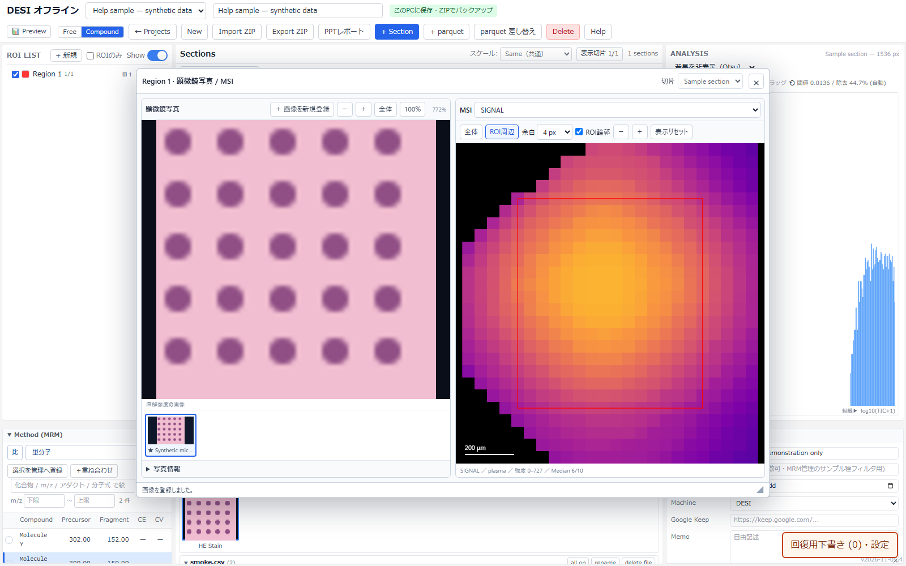

**集計への影響**

顕微鏡画像は ROI の説明資料です。画像を追加しても MSI の元信号や ROI の集計値は変わりません。

**保存と共有**

画像と説明は ROI に関連付けて保存し、ZIP・共有に含めます。編集の可否はローカル / 共有の権限に従います。

### Preview・重ね合わせ・PPT

画像一覧で比較し、複数分子のカラー合成や PPT レポートを作ります。

1. **Preview を開く** — Preview で分子や比、切片の画像を一覧表示します。公開前には、受け手の見え方を確認します。
2. **比較条件を揃える** — 表示切片と分子を選び、Range・Same / Individual・色・ROI の表示を確認します。
3. **複数分子を重ね合わせる** — 重ね合わせで複数分子に色を割り当てます。明るさを揃える設定の意味を確認して分布を比較します。比の多色重ね合わせは対象外です。
4. **PPT レポートを作る** — PPTレポートを開き、出力する切片・分子・比と画像条件を確認して書き出します。分子・測定条件が未登録の切片は、分子別ページの対象から外れます。一覧では切片の列を保ち、未登録の組み合わせの表示を省きます。登録済みデータの読み込み失敗は表示に残ります。出力後に各スライドの見出しと尺度を確認します。

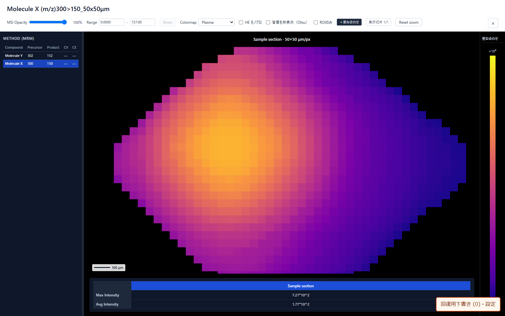

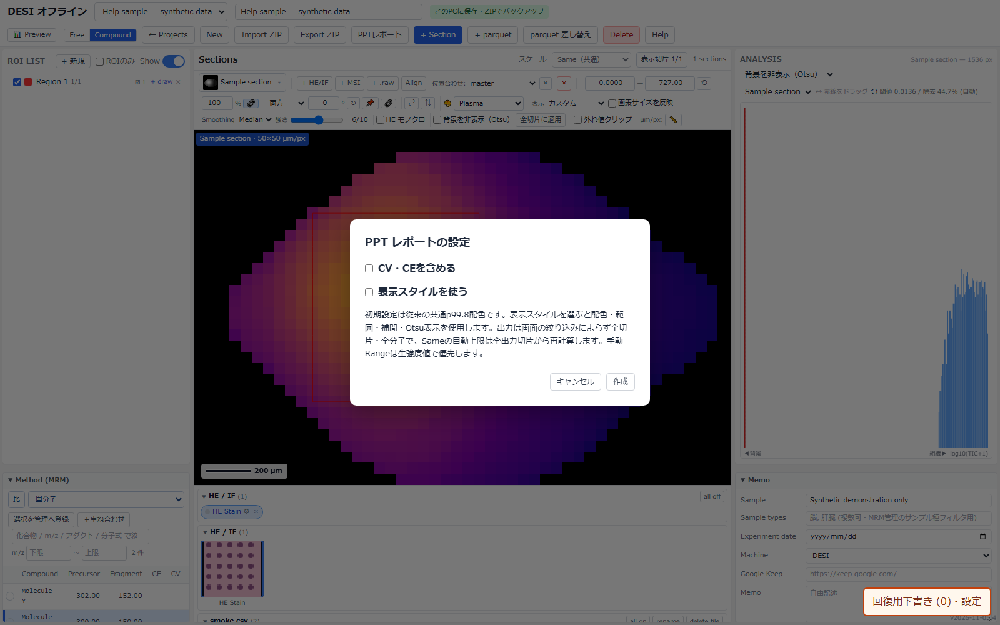

**集計への影響**

重ね合わせの色や明るさは表示条件です。色の混ざり方から、比や元信号の集計値を読み替えないでください。

**保存と共有**

PPT は書き出した時点の画像を保存します。プロジェクトを編集しても、既存の PPT は自動更新されません。

共有画面で個人設定を使った場合は、その条件を資料にも記録します。

共有先で作った重ね合わせは、対応する共有環境では同じ URL の利用者に共有されます。作成者が公開した重ね合わせは読み取り専用です。保存できない環境では画面の通知に従います。

### 保存・ZIP・共有・Memo

ローカル保存、ファイルバックアップ、サーバー公開を目的に応じて使い分けます。

1. **Memo と保存状態を確認する** — 実験条件や気付きを Memo に残し、保存状態を確認します。「このPCのみ・未公開」はブラウザー内の保存、「このPCに保存・公開待ち」は共有先への反映待ちです。保存エラーがあるときは内容を確認してから閉じてください。
2. **Export ZIP でバックアップする** — Export ZIP を選び、元データ・ROI・顕微鏡画像・比の定義を含むアーカイブを保存します。ZIP は公開とは独立しています。
3. **Import で復元する** — 保存した ZIP を読み込み、復元内容を確認して確定します。別 PC でも対応するアプリから復元できます。
4. **公開内容を確認して共有する** — 作成者は Preview の後に Publish to share を実行します。完了と Sync 状態を確認し、共有 URL と必要なパスワードを渡します。

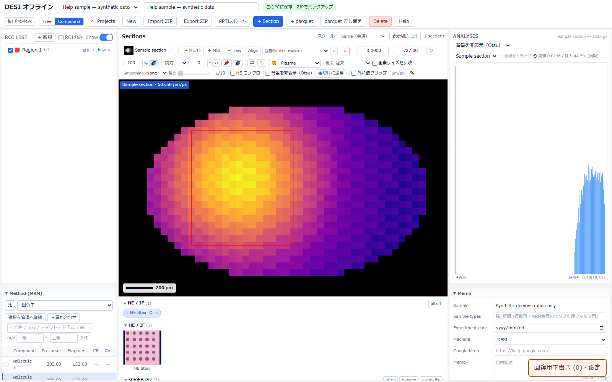

**集計への影響**

保存・ZIP・公開は、表示用の色を元信号に置き換える操作ではありません。元データと ROI・比の定義を区別して保持します。

**保存と共有**

ローカル保存はこのブラウザー内、Export ZIP は自分で保存したファイル、Publish はサーバー上の共有内容です。それぞれ別の保存先です。

「✓ 公開版 vN を保存済み」は、この PC が保存した公開版の基準番号です。別 PC の変更まで含めた最新版との一致を保証する表示ではありません。他 PC の公開内容を取り込むときは「共有の最新版を確認」を使います。

Auto-publish は公開済みプロジェクトのローカル変更を共有先へ送る処理です。共有版との競合や基準番号が未確認のときは停止します。比較・再公開を明示するまで、ローカル保存だけで自動再公開は再開しません。再 Publish は共有側への影響を確認し、大容量アップロードは完了まで進捗を確認します。

同じ Google アカウントでもローカルデータは PC ごと・ブラウザーごとに独立しています。初回の別 PC ではサーバー一覧から Open (master) で取り込むか、閲覧用の共有 URL を開きます。未公開の内容は Export ZIP / Import で移せます。

共有の表示設定と比の個人変更は、公開元への保存ではありません。共有 ROI・位置合わせ・重ね合わせの保存は各機能の権限とロックに従います。共有画面の Memo 編集は一時的で、再読み込みで破棄されます。

### MRM ライブラリと .exp 編集

MRM を化合物・タグで管理し、測定履歴や .exp ファイルを確認します。

1. **MRM 管理を開く** — Projects の MRM 管理から移動します。検証済みライブラリと使用実績アーカイブを切り替え、検索とフィルターで絞ります。
2. **MRM を登録する** — 化合物追加、表への入力・貼り付け、Excel 一括登録を使います。precursor / product・CE / CV、タグ、出典を確認します。
3. **履歴とメソッドセットを整理する** — 実測棚卸しで未登録の測定履歴を確認します。メソッドセットを保存・読み込み、出力するトランジションを選びます。
4. **.exp を確認して書き出す** — テンプレートから選択を .exp 出力するか、「.exp を開いて編集」で既存ファイルを確認します。変更点と検証結果を読み、別名で保存します。

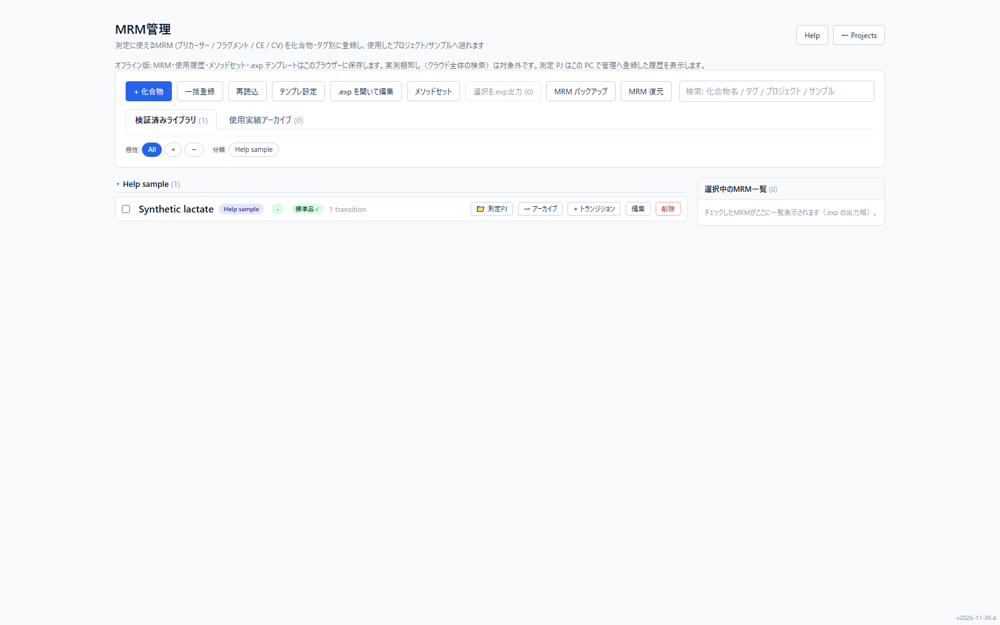

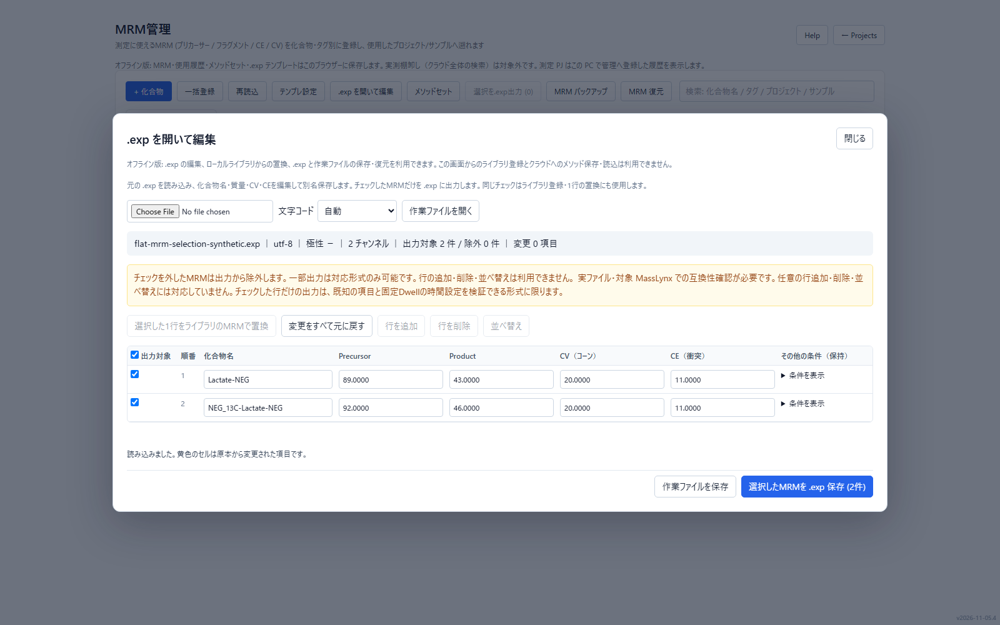

**集計への影響**

MRM ライブラリの編集は、読み込み済み MSI の信号値や ROI 集計値を書き換えません。測定条件の管理と画像解析は別の操作です。

**保存と共有**

オフライン版のライブラリはローカルに保存します。オンラインの共有ライブラリを操作するときは保存先と権限を確認します。

.exp 出力は元ファイルを直接上書きせず、保存したファイルを装置側で点検します。未対応の設定や検証メッセージを確認してください。

### 困ったとき・ショートカット

表示、データ不足、保存、共有、オフライン起動の問題を切り分けます。

1. **画面の状態を確認する** — 画像が見えないときは、切片・Method / Compound・レイヤーのチェック・Opacity・Range・ROIのみ表示を確認します。
2. **数値データの有無を確認する** — 比や ROI が計算できないときは、元ソースがあるか、X / Y が同じ位置に対応するか、分母下限で全て除外していないかを確認します。
3. **保存先と権限を確認する** — 保存競合・容量不足・共有ロックの通知を読みます。未保存の作業は ZIP や回復用下書きで確保してから再読み込みします。
4. **操作をやり直す** — Method 表では ↑ / ↓ で分子を移動します。ROI 描画は Enter で確定、Esc で中止します。問い合わせ時はビルド番号・操作・入力形式・エラー文を記録します。

**集計への影響**

計算できない領域を 0 と解釈しないでください。欠損・分母条件・非対応データなどの理由を確認し、有効データと区別します。

**保存と共有**

オフライン版は ZIP を完全に展開して START_OFFLINE.bat を起動します。起動用ウィンドウを閉じるとローカルサーバーも終了します。保存済みブラウザーデータと ZIP バックアップは別です。

Help の印刷 / PDF から、現在の権限・言語の全章を紙面にできます。画像をクリックすると実画面を拡大できます。

<!-- GUIDED_HELP_END -->
