# DESI Data Share — 管理者ガイド (データ共有)

このガイドは **DESI Data Share のローカル作成者（master）** 向けです。共有 URL 側の Admin 権限とは操作範囲が異なります。プロジェクトの棚卸しだけなら「プロジェクト管理」、共有 URL を受け取った閲覧者には「データ共有 (受け手)」を参照してください。

---

## 目次

1. [全体フロー](#1-全体フロー)
2. [プロジェクトを開く](#2-プロジェクトを開く)
3. [HE / IF レイヤーを登録](#3-he--if-レイヤーを登録)
4. [MSI レイヤーを登録](#4-msi-レイヤーを登録)
5. [Align — HE/IF を MSI に重ねる](#5-align--heif-を-msi-に重ねる)
6. [レイヤー個別の表示設定 (歯車 ⚙)](#6-レイヤー個別の表示設定-歯車-)
7. [ROI を引く](#7-roi-を引く)
8. [Memo の入力](#8-memo-の入力)
9. [Section / Compound 名の変更](#9-section--compound-名の変更)
10. [Export ZIP — 手元バックアップと配布](#10-export-zip--手元バックアップと配布)
10-report. [PPTレポート](#pptレポート)
10-bis. [Preview — 公開前に「相手の見え方」を確かめる](#10-bis-preview--公開前に相手の見え方を確かめる)
10-ter. [重ね合わせ (複数分子のカラー合成)](#10-ter-重ね合わせ-複数分子のカラー合成)
10-quater. [Range の初期値 (白飛びについて)](#10-quater-range-の初期値-白飛びについて)
11. [Publish to share / Auto-publish / Sync インジケータ](#11-publish-to-share--auto-publish--sync-インジケータ)
12. [共有 URL とパスワードの渡し方](#12-共有-url-とパスワードの渡し方)
13. [再 publish の挙動](#13-再-publish-の挙動)
14. [別 PC からの取り込み (`?import=<slug>`)](#14-別-pc-からの取り込み-importslug)
15. [永続化の信頼性 (IndexedDB)](#15-永続化の信頼性-indexeddb)
16. [アップロード進捗 / 大ファイル対策](#16-アップロード進捗--大ファイル対策)
17. [Storage 容量の目安](#17-storage-容量の目安)
18. [困ったときは](#18-困ったときは)
19. [MRM 管理ライブラリ (mrm.html)](#19-mrm-管理ライブラリ-mrmhtml)

---

## 1. 全体フロー

```
[管理画面 /]
   │ + 新規プロジェクト or Open
   ▼
[ビューア /viewer/]
   │ HE/IF/MSI 登録 → ROI → Memo
   ▼
[Publish to share]
   │ slug + viewer pw + admin pw
   ▼
[Share URL + Passwords]
   ▼
共同研究者に渡す (URL と viewer pw を別チャネルで)
```

---

## 2. プロジェクトを開く

- **新規**: 管理画面で `+ 新規プロジェクト` → メタ情報入力 → `Create` → ビューア
- **既存**: 管理画面のプロジェクト一覧で `Open`

ビューアの `← Projects` ボタンで管理画面に戻れます。

## PPTレポート

プロジェクトを開き、上部の **Export ZIP** 横にある **PPTレポート** を押すと、出力前の設定画面が開きます。**CV・CEを含める** は毎回初期OFFです。必要な場合だけチェックし、**作成** を押して `.pptx` をダウンロードします。**キャンセル** では作成を開始しません。オンライン版・オフライン版のローカルプロジェクトで利用できます。

登録済みのプロジェクト名、切片名、分子名、precursor/productなどを使い、黒背景の切片×分子の画像一覧と白背景の分子別詳細だけを作成します。Project informationページは作成せず、Memoや詳細な装置取得条件、ソースファイル名は出力しません。分子別詳細は上部に最大・平均強度表、下部に最大2切片の画像、右側に縦のカラーバーを配置します。切片や分子が多い場合はページを分割します。画面の切片非表示やMethodフィルターにかかわらず、プロジェクト全体を出力します。文字と強度表はPowerPointで編集できます。

通常の共有viewerにも表示スタイルを選ぶ設定画面が開きますが、CV・CEの選択肢は表示しません。CV・CEを選んで出力する場合は、共有画面上部の既存 **🔑 Admin** からプロジェクトのAdmin passwordでログインしてください。ログイン後はローカルmasterと同じ **CV・CEを含める** を選んで **作成** を押します。毎回初期OFFで、PPT作成時の追加パスワード入力はありません。**キャンセル** では出力しません。

公開ビュー／viewer権限ではCV・CEを省きます。共有adminとローカルmasterは、ONを選ぶと分子別詳細の字幕に登録済みトランジションのCV・CEを含めます。パスワードや認証トークンはPPTに含めません。

初期設定では、同じ分子・測定条件の全切片で共通の表示用p99.8を上限とし、従来の黒→青→紫→赤→黄で表示します。**表示スタイルを使う**（毎回初期OFF）を選ぶと、作成開始時の配色、Same／Individual、手動Range、生強度上限の方針、Smoothingの方式・強さ、利用可能なOtsuマスクを使います。出力対象は常に全切片・全分子で、Sameの自動上限は画面の絞り込みによらず全出力切片から再計算します。HDI風の最大値表示では元測定行の最大値を優先し、手動Rangeを指定した端点はそれより優先します。Individualでは画像ごとの範囲を記載し、同じページで範囲が異なる場合の色バーは0–100%を示します。

どちらの配色でも、開始時の回転・反転と縦横比の設定を固定します。物理比率ONなら登録pitch X/Yと元画像の範囲を反映し、OFFなら従来のラスター比率を保ちます。校正できる詳細画像には個別のスケールバーを付け、不明な場合は省きます。画面のズーム・パンは出力しません。作成中に表示設定を変えても、そのレポートには反映しません。

最大・平均強度はアプリの元測定行に基づく値です。画像用の画素値から逆算しません。表示用p99.8は画像ラスタから計算するため、同一座標の重複測定を平均する表示処理の影響を受けます。画像や元データを取得できない場合は欠測として記載し、ゼロで補いません。ROI別の統計グラフはこのレポートに含みません。

作成中は進捗を表示し、キャンセルできます。元ファイルやプロジェクトの登録内容は書き換えません。

---

## 3. HE / IF レイヤーを登録

各切片パネル右上の `+ HE/IF` ボタンから:

1. レイヤー名 (`HE Stain` / `IF Stain` / 任意 custom) を選択
2. **画像ファイル** (TIFF / PNG / JPEG) を選択
   - TIFF は UTIF.js で自動デコード
3. **変換 JSON** (任意) を選択。フォーマット:
   ```json
   {
     "T_he_to_msi": [
       [-0.283, -0.0005,  87.87],
       [ 0.0005, -0.283, 115.64],
       [ 0.0,    0.0,    1.0  ]
     ],
     "he_um_per_px":  { "x": 0.25, "y": 0.25 },
     "msi_um_per_px": { "x": 50.0, "y": 50.0 }
   }
   ```
4. `Register` で確定 → MSI 座標系に整合してキャンバスに重なる

> 変換 JSON を省略すると HE/IF はそのキャンバスサイズで表示 (位置整合なし)。後から **`Align` ボタン**(各切片パネル上部)で対話的にアライメントできます — 詳細は §5。

---

## 4. MSI レイヤーを登録

各切片パネルの `+ MSI` ボタンから:

### 4-1. xlsx 形式
1. ソースファイル (`.xlsx`) を選択
2. シート名 (既定 `MSI_Data`) と **ヘッダ行** (既定 4) を確認
3. `Reload columns` で列ラベルを再読込
4. **X 列** / **Y 列** (既定 `Image_X`, `Image_Y`) を選択
5. **強度列** を Ctrl/Cmd で複数選択 (各列が独立した MSI レイヤーになる)
6. **Data start row** (既定 5) を確認
7. `Register` で各列ごとに `MSI_<列名>` のレイヤーが作成される

### 4-2. txt 形式
- Analyte (`Analyte (converted from imzML)`) または一般 TSV/CSV
- レイヤー名 (例 `MSI_DA`) と value column 番号を指定して登録

> **化合物名の行が無いファイル**(`.raw` 同梱の `imaging/Analyte N.txt` など)では、名前を m/z から `mz146.1_87.1` のように仮に付けます。該当行は名前欄が琥珀色になり、仮の名前のまま登録しようとすると確認が出ます。この名前は **MRM ライブラリに登録するとそのまま化合物名になり、化合物名は全体で一意**なので、別の実験の仮名と同じ行に合流してしまいます。登録前に正しい名前を入れてください (`.raw` フォルダごと登録すれば化合物名も読み取れます)。

### 4-3. Waters `.raw` 形式 (DESI-TQ-MSI / Xevo TQ Absolute)

`+ .raw` ボタンから、装置が出力した `.raw` **フォルダ**をそのまま登録します。xlsx / txt と違い、**測定条件を手で入力する必要がありません**。

1. `.raw` フォルダを**ドラッグ & ドロップ** (フォルダ選択ボタン、または `.raw.zip` でも可)
2. 読み取った内容が表示される
   - 試料名 / スキャン数 / 画素数 / ピッチ
   - **装置** … `DESI` を自動選択 (プルダウンで変更可)。装置の実名 (`XEVO-TQAbs#WDA0428` 等) も併記
   - **測定日** … `.raw` に装置が記録した測定日を採用。無ければファイル名先頭の 6/8 桁 (`260904_...` → 2026-09-04)。どちらも読めなければ空欄
   - **チャンネル一覧** … 化合物名 / Precursor > Product / CV / CE / dwell。既定で全チェック
3. 不要なチャンネルのチェックを外して `登録`

登録されるもの:

| 項目 | 出典 |
| --- | --- |
| Precursor / Product | `_FUNCTNS.INF` |
| **CV (コーン電圧) / CE (衝突エネルギー)** | `_FUNCnnn.EE` — 化合物名の末尾 `_45_14` に頼らなくてよくなります |
| 極性 | `_extern.inf` の `Polarity` (推定ではなく実値。読めなければ空欄にして従来の `_POS`/`_NEG` 推定に委ねます) |
| ピクセルピッチ (μm/px) | ステージ座標 (`_FUNCnnn.STS`) — §5 の手入力が不要になります |
| dwell / ソース条件 / DESI ステージ設定 / メソッドファイル名 | `section.meta.raw` に保存 (表示のみ) |

登録後は `Method (MRM)` 表に実測の Precursor / Fragment / CE / CV が並び、**`選択を管理へ登録`** でそのまま MRM ライブラリへ送れます。

> **生データの保存**: `.raw` フォルダは登録時にブラウザ内で zip 1 本にまとめられ、レイヤーのソースとして保存されます。展開すれば元の `.raw` フォルダに戻るので MassLynx でそのまま開けます。Publish でも Export ZIP (`Source/`) でも原本ごと持ち出せます。表示・ROI 統計・CSV はすべてこの原本を読み直して作られるので、画面の数値と原本が食い違うことはありません。

> **ピッチについて**: `_extern.inf` の `DesiXStep` は画素間隔**ではなく** MRM 1 チャンネル分の移動距離です (X ピッチ = `DesiXStep` × チャンネル数)。アプリはステージ座標から実測して使い、`DesiXStep` とは照合のみ行います。食い違うと警告を出します。

> **ファンクションの種別について**: `.raw` の中には「この測定は MRM だ」という種別コードが 1 バイトで記録されています。同じ MRM でも取得モードによってこのバイトに目印のビットが足され、`9` ではなく `41` などになることがあります (実機で確認済み)。アプリは種別コードの部分だけを取り出して判定するので、どちらでも登録できます。それでも想定外の種別だった場合は、**Precursor と Product が揃っていれば MRM と同じ構造とみなして警告つきで登録**し、無言で取りこぼすことはしません。

> **32 チャンネルを超える場合**: 1 つの `.raw` (1 ファンクション) に入るのは最大 32 チャンネルです。超える測定は `.raw` を分けて取得し、**同じ切片に続けて登録**してください。格子ずれやレイヤー名の重複は警告を出しますが登録は止めません。名前が重複したレイヤーは自動で改名されるので、先に登録したものが消えることはありません。

---

## 5. Align — HE/IF を MSI に重ねる

各切片パネル上部の **`Align`** ボタンを押すと、ブラウザ内いっぱいの位置合わせ専用画面が開きます。通常の一覧・解析パネルは操作対象から外れ、HE/IF と MSI を大きく表示します。`+ HE/IF` 登録時に変換 JSON を渡していない場合や、再アライメントしたい場合に使います。

> **共有先も位置合わせをやり直せます (master の分は消えません)。** 共有 URL を開いた人は `Align` で HE/IF を合わせ直せます。結果はサーバの `share_alignments` テーブル (切片ごと 1 行) に入り、**その共有 URL を開いた全員**に届きます。master が登録した位置合わせは `sections.meta` に残ったままなので、共有先はツールバーの `位置合わせ:` で **master / 共有** を行き来できます。
>
> - `Align` は ROI と同じ**書き込みロック**を取ります (同時に 1 名のみ)
> - **master が再 publish しても共有先の合わせ直しは消えません**。逆に、共有先の結果が publish のペイロードへ混ざることもありません
> - 同じ切片を同時に直したときは、あとから保存した側に「他の人が先に更新しました」と出ます (楽観ロック)
> - 共有先は `×` でその切片の共有位置合わせを削除でき、master の位置合わせに戻ります
> - **共有先は自分の HE/IF 画像を持ち込めます** (`+ HE/IF`)。実体は Storage の `<slug>/shared/` 配下、目録は `share_images` テーブルで、**あなたが登録した画像 (`<slug>/blobs/`) には一切触りません**。共有先が `位置合わせ: master` に戻すと、共有先が足した画像はレイヤーごと画面から降ります
> - Storage の書き込みは **`<slug>/shared/` の下だけ**を共有トークンで開けています (`x-share-token`)。master 用の publish token ポリシーはそのままです
> - **この機能には SQL の適用が必要です。** [`supabase/share_locks.sql`](../supabase/share_locks.sql) を SQL Editor で**再実行**してください (冪等)。未適用のデータベースでは、合わせ直しても他の人には届かず、画像の登録もできません (その旨が画面に出ます)

> **重ねたときの HE の解像度**: MSI が登録されている切片では、表示キャンバスを **MSI の格子に合わせて**焼きます (ROI 座標や μm/px がそこで決まるため)。倍率は **MSI 格子の 8 倍**か、**キャンバス長辺 2048px** のどちらか大きい方までで、HE の実解像度は決して超えません。スキャナで数千 px 取った HE はこの範囲まで縮小されますが、縮小は**面積平均**で行うので、核の粒が飛んで粗く見えることはありません。HE を実寸で見たいときは、MSI レイヤーを消した HE 単独表示にしてください (そのときはキャンバスが HE の実寸で作られます)。

> **補足: 主画面ツールバーの「片側回転」**: 主画面の **Rotation** には対象セレクタ **(両方 / HEのみ / MSIのみ)** があります。HE と MSI が別の向きで取り込まれて重ならないとき、**片方だけ**を回して重ね合わせの向きを揃えられます。角度は `section.meta.viewerTransform.rotHE / rotMSI` に保存され、**公開時に Viewer にも反映**されます。これは表示上の重ね合わせ補正で、**Align の HE/IF→MSI 位置合わせ変換とは別系統**です。座標精度が必要な整合は引き続き Align モーダルで行ってください。

| 領域・操作 | 内容 |
| --- | --- |
| 上部 | HE/IF の Layer、Source、MSI 分子を選択 |
| 左右比較 | 左に HE/IF、右に MSI を大きく表示。点の追加ボタンを選んでクリック |
| 重ね合わせ | 専用画面内で合成結果と透明度を確認 |
| 表示操作 | ドラッグで移動、ホイールまたは ± で拡大縮小、**全体表示**で画像を枠内に収める |
| 左右の表示を同期 | 対応する座標系が確認できる場合に、左右の表示位置・倍率を連動 |
| 詳細設定・対応点一覧 | Manual、物理ピクセルサイズの確認、点の削除・残差の確認 |
| 下部 | **Save / Cancel** を常時表示 |

画面の拡大・移動は表示だけの操作です。対応点や MSI 元座標を変更しません。HE の位置合わせ倍率を変更する場合は、詳細設定の **Manual → Scale** を使います。

### 5-1. MSI セレクタ

- 化合物名のドロップダウンで MSI 画像を切り替えます。**同じ測定・座標系の分子では、対応点の座標・番号・組み合わせ、調整中の変換、表示位置・倍率を保持**します。化合物 A で打った点を残して B で追加し、全点をまとめて `Solve` に使用できます。分子切り替えだけでは再計算しません。
- **TIC (合成)** … MRM トランジションを多数登録していて `MSI_TIC` レイヤーが無いとき、先頭に自動で挿入されます。全 MSI 系列の輝度を加算した擬似 TIC で、ランドマーク picking 用に使うのが目的です。
- **Source 別 TIC** … 同一切片に複数 source (xlsx / txt 等) を登録している場合、`TIC_<file名>` のように source ごとの TIC を別行で挿入します。1st Scan のみ TIC を見て位置決めしたい、といった用途向け。
- MSI は選択中のカラーマップで表示します。合成 TIC は、寄与する分子すべての座標系が一致すると確認できる場合に使用できます。

### 5-1-bis. Source ドロップダウン (Per-source T_he_to_msi)

MSI source が登録されている切片では、Align 上部に **Source** ドロップダウンが表示されます。各 source 名の頭に **整列状態アイコン** が付きます:

- **✓** = 対応点(ランドマーク)で整列済み
- **⊙** = シルエット自動整合済み (対応点なし。暫定ではありません)
- **△** = スライダーのみの暫定値 (ランドマークなし)
- **−** = 未整列

| 値 | 効果 |
| --- | --- |
| **全ソース共通** | 座標系が一致すると確認できる測定に共通の位置合わせを使用 |
| 個別 Source | その測定・座標系の対応点と変換を個別に編集 |

新規の作業では測定ごとの個別設定を既定にします。保存済みの共通設定は引き継ぎます。座標系の一致は同じ物理スキャンである証明ではないため、共通設定の適用は明示的に選択してください。

測定データや HE/IF 画像を切り替えると、対象ごとの作業状態を保持します。戻ったときに保存前の点と調整値を復元します。同じファイルでも sheet・function・座標指定が異なれば、別の座標系として扱います。画像の縦横サイズが同じだけでは、点を流用しません。

- **「全ソースへ反映」**は、現在の位置合わせを、座標系が一致すると確認できる全ソースへ明示的にコピーして保存する操作です。共通設定と個別設定を両方編集した場合、同じ対象への変更は最後の編集を優先します。
- 古い対応点の座標系や HE/IF 画像との対応を確認できない場合、記録は保持しますが別画像へ自動的に流用しません。座標系を確認できない画像では、点の追加・保存を停止して理由を表示します。

### 5-2. MSI pixel size

Align 内の `X / Y` (μm/px) は、登録済みの物理ピクセルサイズの**確認専用**です。変更は既存の **MSI pixel size** 設定画面から行います。表示の拡大率や位置合わせの Manual Scale を操作しても、物理ピクセルサイズは変更しません。

**MSI pixel size** に保存した値を、元のMSI画像の1画素の物理サイズとして優先します。30×30 µmなら、TXT座標の小数丸めにかかわらず30×30 µmを採用します。旧データの数値文字列も読み取れます。保存後は主画面のラベル・バーと、開いているPreviewを更新します。原本座標・強度、ROI、保存済みHE位置合わせは変更しません。RAW登録時の座標からの推定は、値が未設定の場合だけ行います。スケール表示の校正と、HE自動位置合わせで使う座標の対応確認は独立しています。

### 5-3. Manual セクション (リアルタイムスライダー)

| 項目 | 範囲 | 効果 |
|---|---|---|
| Flip Horizontal / Vertical | チェック | HE を左右 / 上下反転 |
| Scale | 5–500 % | HE の拡大縮小 |
| Rotate | -180°–180° | HE の回転 |
| Offset X / Y | -2000–2000 px | HE の平行移動 |

**スライダーまたは数値 input** どちらでも編集できます。専用画面内の HE/IF 画像と「重ね合わせ」表示で結果を確認しながら調整します。保存するまで通常画面の設定には反映しません。

### 5-4. Landmark モード

両パネルに対応点をクリックして打ち、**`Solve`** を押すと complex-LSE の similarity transform (回転 + 等方スケール + 並進) を解いて Manual のスライダーに反映します。

| ボタン | 動作 |
|---|---|
| `Reset to identity` | Manual の値をすべて初期値に戻す |
| `Clear all` | 打ったランドマーク両側を全消去 |
| `Solve` | ランドマークから similarity を推定して Manual に反映 |
| `自動整合 (シルエット)` | 組織の輪郭から自動推定 (§5-4-bis) |

#### 何点打てばよいか

対応表の **`Δ` 列** に各点の残差が、その上に **RMSE と最大値** が µm で出ます。点数と分布で精度が大きく変わります (合成データでの実測、MSI クリック誤差 1 px、200 試行):

| 点の配置 | 点数 | 中央値 | 最悪 |
|---|---|---|---|
| 広く分散 | 2 | 105 µm | **1647 µm** |
| 広く分散 | 3 | 66 µm | 225 µm |
| 広く分散 | 6 | 44 µm | 103 µm |
| 広く分散 | 8 | **36 µm** | 89 µm |
| 中央に集中 | 3 | 113 µm | **830 µm** |
| 中央に集中 | 8 | 53 µm | 151 µm |

- **2 点は危険です**。similarity は 4 自由度なので 2 点なら必ず残差 0 で通りますが、真の誤差は残っています (`Δ` が全部 0 でも安心材料になりません)。
- **推奨は広く分散した 6–8 点**。中央に固まると最悪誤差が約 4 倍になるため、周辺部にも打ってください。
- 点数不足・偏りがあると QC 行に警告バッジが出ます。
- 残差が RMSE の 2.5 倍を超える点は表で赤く表示されます。打ち直しの目安にしてください。

### 5-4-bis. 自動整合 (シルエット)

**`自動整合 (シルエット)`** は、HE の組織領域 (彩度しきい値) と MSI の組織領域 (既存の Otsu 表示マスク、無ければその場で算出) の輪郭を突き合わせ、位置合わせを自動推定します。

処理は「モーメント初期化 (重心・主軸・面積、**回転角は連続値**) → 主軸の 180° 不定性 × 鏡映の 4 分岐を Dice で選択 → 粗密の座標降下で精緻化」です。約 50 回の評価で収束するため数十 ms で終わります。

- **押しても即座には適用されません。** Dice・推定パラメータ・いまの合わせとの差・見込み誤差が出てから `適用` を選びます。適用してもスライダーに入るだけなので、**モーダルの `Cancel` でそのまま巻き戻せます**。
- **対応点があるときは既定でハイブリッド合成**します。自動解と対応点フィットを逆分散で重み付け平均するもので、実測では対応点のみより常に良くなります (2 点 92→33 µm、8 点 36→25 µm)。純粋な自動解だけを使うことも選べます。
- 自動解と対応点フィットが合成不確かさの 3 倍以上食い違うときは、**合成せず両方を提示**します。どちらかが誤っている可能性があるためです。
- `he_um_per_px` と `msi_um_per_px` が両方分かっている場合は**スケールを物理比に固定**します (推定パラメータが 1 つ減るぶん安定します)。このとき組織面積から出るスケールが固定値と 5% 以上ずれていれば警告します — µm/px 設定の誤りに気づけます。

#### 限界 (必ず読んでください)

- **Dice は精度保証ではありません。** Dice 0.95 でも実際には 120–190 µm ずれていることがあります。必ず `Δ` 列と RMSE を併せて見てください。
- **組織が回転対称に近いと回転角が決まりません。** 真円のシルエットには回転の情報が原理的に存在せず、しかも Dice は 0.997 と最高値を出すため検出できません。これだけは事前に異方性から判定して赤い警告を出します。警告が出たら対応点を打ってください。
- **精度の上限は MSI 1 ピクセル** (50 µm/px なら 50 µm) です。それ以下の議論は測定原理上意味がありません。実測の見込み誤差は、きれいな条件で 5–30 µm、HE と MSI の組織抽出が 1 MSI px ずれた条件で最大 60 µm 程度です。
- **similarity (4 自由度) のままなので、剪断や非線形歪みは補正できません。** 同一切片の post-MSI H&E なら通常これで足りますが、強い引き伸ばしがある場合は対応点で追ってください。
- **隣接切片 (IF / 4HNE など) では内部構造が本当に違います。** シルエットを合わせても意味的な整合は保証されないため、broad-domain 比較の目安としてのみ使ってください。

> **開発者向け**: ブラウザのコンソールで `__alignSelfTest()` を実行すると、合成グラウンドトゥルースに対する検証が走ります。回転 0–35°・鏡映あり/なしの全ケースで RMS < 1 MSI px、分解式の厳密一致、真円での異方性ガード発火を確認します。

### 5-5. Cancel / Save

- **Cancel / Esc / 閉じる**: 今回の画面内で行った未保存の編集をすべて破棄します。共有編集のロックも解放します。
- **Save**: この画面内で変更した測定・HE/IF の作業状態をまとめて保存します。元プロジェクトではローカル保存の成功後に通常の同期を開始します。共有先では編集開始時のバージョンを照合し、競合時は上書きしません。保存失敗時は画面を開いたまま作業状態を保持します。
- MSI の元強度・元座標・欠測・行順、既存 MSI 座標で定義した ROI の定量値、数値出力、物理ピクセルサイズは変更しません。更新するのは対応点と HE/IF→MSI の位置合わせ設定です。

> **Align 内の画像は主画面の回転・反転設定を反映します。** 点と画像には同じ表示変換を適用し、クリック位置は保存座標へ逆変換します。HE 点は HE 画像のピクセル座標、MSI 点は既存の MSI ラスタの画素境界座標に保持します。画面の拡大・回転で保存済みの点を移し替えることはありません。

> **メイン画面の下のサムネ一覧にも反映**: 主画面で Rotation / Flip H・V を変えると、レイヤーバー (中央下) の **MSI サムネ一覧** も主画面と同じ向きで再描画されます (Align モーダル内のサムネだけでなく、メイン画面のサムネ一覧も追従します)。

> Save 後にメイン canvas を見ると、HE が MSI の下、MSI が上に乗った状態で描画され、左下に **スケールバー** が出ます。バーは round な値 (10/20/50/100/200/500 μm, 1/2/5/10 mm) を自動選択し、**マウスホイールで拡大すると刻みが細かく** なります。

> Save 後、各切片パネル左上の **section 名ラベル** に `Section 1 · 20×20 μm/px` のように **Pixel pitch (X×Y)** が併記されます (X==Y でも常に両方を表記して軸を曖昧にしません)。これは share recipient の閲覧画面と Preview の cell title でも同じ書式で表示されます (受け手が解像度を確認できるようにするため)。

---

## 6. レイヤー個別の表示設定 (歯車 ⚙)

各レイヤーのチップ右端の **歯車 ⚙** をクリックすると、そのレイヤー専用の小ポップオーバーが開きます。サムネイル画像を **右クリック** しても同じ設定ポップオーバーが出ます。

> **Compound モードのサムネ左クリック**: Compound モードでは、レイヤーバーの **MSI サムネを左クリック** するとフォーカス化合物が切替わり全切片に反映されます (Method テーブル行クリックと同じ)。設定ポップオーバーを開くときは **右クリック (または歯車 ⚙)** を使ってください。

<div style="border:1px solid #cbd5e1;border-radius:6px;padding:10px;background:#fff;margin:10px 0;font-size:12px;display:grid;grid-template-columns:1fr 1fr;gap:10px;">
  <div style="border:1px solid #94a3b8;border-radius:4px;padding:8px;background:#f8fafc;">
    <div style="font-weight:600;color:#0f172a;margin-bottom:4px;">MSI レイヤーの場合</div>
    <ul style="margin:4px 0 0 1.2em;padding:0;color:#475569;font-size:11px;line-height:1.6;">
      <li><b>Apply opacity</b> ✓ (既定 ON)</li>
      <li>Opacity (0–100%)</li>
      <li>Intensity range (vmin / vmax)</li>
      <li>外れ値クリップの状態 (表示のみ — 切替は Toolbar)</li>
    </ul>
  </div>
  <div style="border:1px solid #2563eb;border-radius:4px;padding:8px;background:#eff6ff;">
    <div style="font-weight:600;color:#1d4ed8;margin-bottom:4px;">HE / IF レイヤーの場合</div>
    <ul style="margin:4px 0 0 1.2em;padding:0;color:#475569;font-size:11px;line-height:1.6;">
      <li><b>Apply opacity</b> ☐ (既定 OFF — 常時不透明)</li>
      <li>Opacity (チェック OFF 時はグレーアウト)</li>
      <li><b>Grayscale (モノクロ表示)</b></li>
    </ul>
  </div>
</div>

### 6-1. Apply opacity (透明化を反映するか)

- **チェック ON**: Opacity スライダーの値が描画に反映される。
- **チェック OFF**: スライダー値を無視して常時 100% で描画。スライダーは見えるがグレーアウト。
- **既定**: HE/IF は OFF、MSI は ON。これにより HE は常に不透明な「下地」として残り、MSI ヒートマップだけ Opacity で薄められる体験が標準になります。
- 状態は `sec.meta.layerDisplay[key].applyOpacity` に永続化。リロード後も保持。

> ツールバー上部の Opacity 入力もこの設定と連動します。アクティブ MSI で Apply opacity OFF なら、ツールバーの Opacity がグレーアウトして「このレイヤーは Apply opacity が OFF です」とツールチップが出ます。

### 6-2. Grayscale (HE/IF のみ)

- HE/IF レイヤーをモノクロ化して描画。MSI の Plasma 色を最大コントラストで見せたいときに有用。
- BT.601 luma で R/G/B → 単色化(透明度はそのまま)。
- 状態は `sec.meta.layerDisplay[key].grayscale` に永続化。

### 6-3. レイヤー描画順 (HE → 他 → MSI)

メイン canvas は常に **HE/IF が下、MSI が上(加算合成)** の順で描画されます。これは表示状態 (visibleLayers) の登録順に依存しない仕様で、HE が MSI を覆い隠さないようにする目的の挙動です。

### 6-4. TIC 背景の自動付与 (HE 未登録切片)

**HE (`HE_STAIN`) が登録されていない**切片で、かつ MSI が **2 種類以上**ある場合、Viewer 側 (Master 自身もこの挙動になります) は自動的に合成 TIC 画像 (`HE_STAIN_TIC` キー) を背景として注入します。

| 条件 | 挙動 |
| --- | --- |
| HE 登録あり | 通常通り HE が背景 |
| HE なし & IF/IHC のみ登録 | **TIC を最下層、IF/IHC を中間、MSI を最上層**として重ねる |
| HE なし & IF/IHC もなし & MSI 2 種類以上 | TIC が背景になる |
| HE なし & MSI 1 種類のみ | TIC は作らない (1 種類だけだと TIC = その 1 種類で意味なし) |

- TIC 画像は全 MSI レイヤーのピクセル輝度を平均し、0–255 にグレースケール正規化したものです。データなしのピクセルは透明のまま残ります。
- Layer 一覧に **`TIC backdrop (auto)`** チップが現れ、クリックで表示 ON/OFF が可能。状態は `sec.meta.visibleLayers` に永続化。
- 既存のプロジェクト (この機能リリース前に作成) では、初回ロード時に TIC がレイヤー一覧に出ますが visibleLayers 初期値には入りません。Master 側で一度手動でクリックして ON にし、保存しておけば、その状態が公開時に Viewer 側へ引き継がれます。
- **発動条件は HE のみ判定**: IF/IHC を登録していても、HE がなければ TIC が作成されます (IF/IHC は分子マーカーオーバーレイで解剖学的リファレンスとしては機能しない、という前提)。

### 6-5. MSI Range はプロジェクトごとの一時設定

Toolbar / 歯車 ⚙ の MSI Range は、このタブ内のプロジェクトごとに保持する一時表示設定です。Range の変更だけでは保存・公開されず、Viewer の初期値にもなりません。リロードすると元データから計算した自動 Range に戻ります。

- 同じプロジェクトで同じ MSI キーを表示している切片には、手入力した上下限を共通に適用します。未入力の側は自動です。
- 全体表示用と「ROIのみ」表示用の手動 Range は別に保持します。ROI 表示中の調整は全体表示用の値を置き換えず、OFF にすると元の全体表示用 Range に戻ります。`Reset` は現在の表示モードの手動値を解除します。
- A → B → A と切り替えると A の Range と Same / Individual を復元します。B へは持ち越しません。別の測定へ置き換えた MSI は自動 Range に戻ります。
- 共有 URL と Admin / 閲覧者の表示設定も分離されます。選択切片や Preview の開閉だけでは手動 Range を消しません。
- 旧版の 0–255 表示窓は保持しますが、現在の生強度へ推定換算しません。Range は ROI 統計や原本測定値を変えません。

---

## 7. ROI を引く

1. アクティブにしたい切片パネルをクリック
2. ROI LIST 上の `+ 新規` をクリック (描画モード ON)
3. キャンバス上を順にクリックして 3 点以上の頂点
4. 確定: 始点クリック / ダブルクリック / **Enter**
5. ROI 名を入力

別切片に同じ ROI を描くには各行の `+ draw` ボタン。

> 描画途中で **Escape** → 中止。複数切片で `polysBySection` に蓄積されます。

> **ROIのみ表示**: ROI LIST ヘッダの **「ROIのみ」** チェックを ON にすると、Show が ON の ROI を合わせた領域に **MSI レイヤーだけ** を切り抜き、**ROI 内の値から自動 Range を再計算**します (HE / 背景は全体表示)。重なる領域は一度だけ数え、対象 ROI が無い切片は MSI 非表示です。**Same** は表示中切片の ROI 内の上限を共通化し、**Individual** は各切片の ROI 内から範囲を求めます。最大値／分位点、Smoothing の設定は維持します。ROI の形や Show の変更に追従し、**OFF で全体表示と元の全体表示用 Range に戻ります**。ROI 定量、全体統計、元データ、数値 CSV は変更しません。

---

## 8. Memo の入力

ビューア右下の Memo パネル:

| 項目 | 内容 |
| --- | --- |
| Sample | サンプル名 |
| Experiment date | 実験日 |
| Machine | DESI / TIMS / LTQ / Other |
| Matrix | 装置が DESI 以外の場合のみ表示 |
| Google Keep | 関連ノート URL |
| Memo | 自由記述 |
| Derivatization | 誘導体化処理 |

入力値は IndexedDB に約 400ms で自動保存。Publish 時にサーバの `projects.meta.memo` にも送られます。

> Method (MRM) テーブルの **Precursor / Fragment** は通常の閲覧者にも表示されます。**CE / CV** は **管理者のみ表示** (admin password で開いた閲覧者にも見える) で、通常の viewer pw だけで開いた閲覧者には隠されます。

> **Colormap dropdown**: ツールバー右側の **Colormap** で MSI ヒートマップの色 (Plasma / Viridis / Inferno / Hot / HotMetal (HDI) / Jet / Grayscale) を選べます。masterの選択は保存・公開され、共有先の初期表示色になります。共有先では自分のタブだけで色を変更できます。Preview内の配色変更は閉じると戻ります。

**表示 → HDIに近い表示** は、HotMetal配色、線形の0〜元測定の最大強度、Same（分子ごとに表示切片共通の上限）、補間None、Otsu OFFを選びます。TIC/BPI正規化は行いません。**従来** はPlasma・p99.9・従来の縦横比へ戻します。プリセット切替時は手動Rangeを解除します。その後の手入力は自動Rangeより優先されます。

**画素サイズを反映** は縦横比だけを切り替えます。100×100画素・30×60 µmなら3×6 mmとして表示し、同じ変換をROI・HE・Preview・Align・サムネイル・PPTへ適用します。回転はその後に行い、原本の座標・強度、ROI頂点、HE位置合わせの保存値は変更しません。画素サイズ・元の寸法が未確定なら従来形状を使います。手入力の画素サイズを優先し、未登録時のRAW自動推定も維持します。

新規作成はHDIに近い表示・画素サイズ反映が初期値です。過去のプロジェクトは開くだけでは切り替えません。masterで選んだ設定は保存・公開・ZIPへ引き継ぎます。共有画面の変更はviewer/Adminごとのタブ内設定です。

> **列クリックでソート**: Method テーブルの列ヘッダ (Compound / Precursor / Fragment / CE / CV / Mean / Max) をクリックすると並び替えできます。1 回目で既定方向 (Compound = A→Z / 数値 = High→Low)、2 回目で逆方向、3 回目で sourceFile→name の既定順に戻ります。空セル (`—`) は方向に依らず末尾固定。並びはセッション中のみ保持され、Share Preview 側の Method パネルにも同じソートが反映されます。↑/↓ キーの focus 移動も表示順に従います。

ツールバーの **Smoothing** から **None／Linear／Median** を選び、**強さ** を1〜10の10段階で調整できます。

- **None**：補間・メディアン処理を行いません。各方式の強さを保持したままスライダーを無効にします。
- **Linear**：補間なしに近い表示から従来のLinearまでを調整します。**10は従来のLinearと同じ**です。拡大・再配置時の補間量を変えるため、等倍では段階の差が見えない場合があります。
- **Median**：表示用の強度にメディアンフィルターを適用し、輪郭を保ちながら粒状ノイズを抑えます。1は3×3画素、2は5×5画素、10は21×21画素です。SCiLSのメディアン方式を参考にした独自の10段階であり、SCiLSと同一の数値処理を再現するものではありません。欠測・透明・Otsuで非表示の画素は参照対象から除きます。

LinearとMedianの強さは別々に保持されます。大きな画像ではスライダーを離すと反映します。元データ・ROIの範囲や集計値・数値CSVは変わりません。masterの設定は保存・共有公開・ZIPで引き継がれ、共有閲覧者の変更はタブと役割ごとに保持されます。PPTは **表示スタイルを使う** を選んだ場合に反映します。表示プリセットを選び直すとNone、Median 1、Linear 10へ戻ります。

旧版で追加の平滑化を使っていた設定は、その強さに応じてMedianの1〜10へ移行します。旧版で追加の平滑化が0だったLinearは、従来と同じLinear 10になります。

---

## 9. Section / Compound 名の変更

### 9-1. Section 名 (master のみ)

各切片パネル左上の **canvas-label** (例: `Section 1`) を **ダブルクリック** すると prompt が開き、任意の名前 (例: `260504_Killifish_Sec1`) に rename できます。

- master 画面のみ有効 (share recipient 画面ではダブルクリックを無視)
- 重複名は弾かれます (同 project 内で displayName ユニーク)
- 変更内容は `_flushSave` + IDB 読み戻しで **永続化を確認** してから「変更しました」を表示
- 変更後の名前は Toolbar の section picker / Preview cell title / 統計テーブル列ヘッダ / Pixel pitch ラベルすべてで即時反映

### 9-2. Compound 名 (master のみ)

中央下の **Method (MRM) テーブルの Compound セル** をダブルクリックすると、化合物表示名を変更できます。precursor / product は変わりません。

CE / CV は出典によって扱いが分かれます。

- **`.raw` から登録した化合物** … 装置の実測値なので**変わりません**。新しい名前が `_45_14` のような形でも上書きされません (`.raw` に `_FUNCnnn.EE` が無く CE/CV が空の場合だけ、名前から補われます)
- **xlsx / txt から登録した化合物** … 従来どおり、新しい名前の末尾 `_<CE>_<CV>` から**再導出されます**。この経路では名前が CE/CV の出典そのものなので、名前を直すことが値を直す手段になっています

- 変更名は project 全切片に broadcast (同じ compound key を持つ全 section に反映)
- IDB 永続化 + verify 後に確定。失敗すれば赤エラーバナーで通知。

### 9-3. 表示切片を選ぶ

Sections ヘッダの **「表示切片」** を押すと、臓器ごとに整理されたフローティング一覧が開きます。1 臓器だけのプロジェクトでも使え、臓器未指定の切片も一覧に含まれます。

- 各切片のチェックで、複数臓器をまたいで任意に選択できます。臓器見出しのチェックは検索結果に関係なくその臓器の全切片を一括操作し、一部選択中なら中間状態になります。
- 名前検索は一覧だけを絞り込みます。「すべて表示」で戻せ、最低 1 切片は表示されます。外側クリック／Esc で閉じます。
- 臓器は `section.meta.organ` を優先し、未設定なら切片名から推定します。これは表示上の分類で、生物学的アノテーションの確定ではありません。
- 主画面と Preview は同じ選択を使います。選択は section ID で保持するため、同名・改名・並べ替えで入れ替わりません。追加切片は表示、削除済み ID は除去されます。
- 選択は同じタブのプロジェクト／共有 URL ごとの閲覧状態です。選択だけで保存・自動公開は行わず、他の閲覧者や解析対象を変えません。描画途中の切片の非表示は、ROI 完了／中止まで保留します。
- 切片を隠しても、手動 Range や各切片の視点・回転を初期化しません。自動 Same は表示中切片、Individual は各切片から表示範囲を求めます。ROI 統計と標準数値出力は表示選択に連動しません。

> rename 後に表示が古いままなら **F5 でリロード**。永続化済みなら新しい名前で復元されます。

### 9-3. Section の Flip H / V (master のみ)

ツールバーの **Flip グループ** に `⇄` (左右反転) と `⇅` (上下反転) ボタンがあります。
切片取り込み後に「MSI が左右逆 / 上下逆だった」と気づいた時にやり直し用として使えます。

- ボタンをクリックすると **操作時の画面の左右／上下を基準に MSI と HE/IF が反転** (HE は再 align 不要)
- ROI の表示位置も自動追従。新規 ROI 描画も反転後の見た目通りに頂点を打てる
- 状態は `sec.meta.flip = { lr, ud }` に保存され IDB / publish 経由で recipient へも継承
- もう一度同じボタンを押せば元に戻る (toggle)
- share recipient 画面ではボタンが非表示で、master の選択がそのまま表示される

新規・未調整の MSI はラスタ本来の向き（X は右、ラスタの Y は下）で表示します。主画面・サムネイル・Align・Preview は同じ表示変換を使い、ROI も追従します。回転や反転は表示変換で、元 X/Y・強度・ROI・保存済み HE 位置合わせを変更しません。回転のリセットはこの MSI 初期方向に戻し、反転設定は保持します。

旧版で回転角がすべて 0 と自動保存され、反転・鏡映・共有 Preview 角度の指定もない場合は、初期表示の余分な 180° 回転を除きます。この状態は意図的に 0 を保存したケースと区別できません。保存済みの非 0 回転、反転・鏡映、共有 Preview 角度（0 を含む）がある場合は従来の見え方を保持します。修正後の初期方向で行った表示調整は、その基準も保存し、再読込後に維持します。元ソフト画像との一致は別途照合が必要です。

旧 ROI の格子座標は元データとの対応が確認できる場合にのみ移行します。対応を復元できない ROI や、旧版の MSI 単独回転後に描いた ROI は元の保存値を保持し、画像との確認が必要です。PNG から元座標や定量値を推定しません。技術的な条件は [MSI の表示・定量契約](docs/MSI_DISPLAY_CONTRACT.md) を参照してください。

---

## 10. Export ZIP — 手元バックアップと配布

ヘッダの **Export ZIP** で、現在のプロジェクト全体(画像・MSI 数値・ROI・Memo・Align など)を 1 つの ZIP にまとめてダウンロードできます。Publish と違ってサーバを介さず、後日 `Import ZIP` で同じビューア(あるいは別環境)に復元できます。

### 9-1. ファイル構造(新形式)

| ZIP 内 | 内容 |
| --- | --- |
| `<プロジェクト名>.json` | プロジェクト、全切片、ROI、Memo、座標系・ソース対応などのメタデータ |
| `HE_IF/` | HE/IF 原本と位置合わせ済み PNG |
| `Data/` | 元測定行に対応する数値 CSV。対応が確実なソースのみ結合し、必要なら複数ファイルに分けます |
| `Source/` | 登録元ソースの原本。同じ blob は重複排除します |

原本は書き換えず保存します。Parquet は元 Parquet を同梱し、今回の出力で巨大な全化合物 CSV は作りません。`.raw.zip` は派生 CSV と別に原本も含めます。元ソースがある場合は原本を基準に復元します。CSV 単体で小数の元の文字列表現や空白・null・不正値をすべて表現できるわけではないため、原本と付随メタデータも保管してください。

各 CSV に `.source-cells.json` が付き、元行 ID、元座標、セルの型・状態・元トークンなどを記録します。正確な復元は `Source/` と元ソース定義を含む ZIP 全体を前提にします。安全な計算精度を保証できない INT64／DECIMAL 等は、原本・型を保持して理由を示し、丸めた数値を定量結果にしません。

### 9-2. ルート JSON 名がプロジェクト名

`<プロジェクト名>.json` というファイル名で出力されます (ASCII 英数字 + `_` `-` 以外は `_` に置換)。Import 時はルート直下の任意の `*.json` を `format` フィールドで判別して読むので、リネームしても問題ありません。

### 9-3. 元行の対応を確認して CSV を作る

同じソースの各化合物は元の測定行で対応づけます。異なるソースを横に結合できるのは、同一の測定行または一意座標の完全対応を確認できる場合だけです。**同じ切片・同じ行数だけでは結合しません**。重複座標などで対応が曖昧ならソースごとに別 CSV にします。ソート順で対応を推定することはありません。

CSV は元の X/Y・強度・行順・重複行を保持します。表示 Range、クリップ、回転、切片の非表示、Otsu によって行や値は変更しません。Otsu による背景行削除／フラグ付けの出力選択はありません。

### 9-4. 原本と ROI 情報は分ける

ROI の保存形状はルート JSON の `polysBySection` と座標系情報に保持します。派生 CSV に ROI 列を付ける場合も、元ソースのセルや行を置き換えません。無効な座標や未確認の旧 ROI は、正常な ROI 外と区別して扱います。元 XLSX に ROI 列を書き足して原本として保存することはありません。

### 9-5. ZIP 内のパス共有

切片の定義はルート JSON の `sections[]` に入っています (切片ごとの `atlas.json` は旧形式)。元行の対応が確かな複数の化合物は同じ CSV を参照できます。対応が曖昧なソースは別パスです。Import はパス／blobId をキーに同じファイルを重複復元せず、原本への参照がある場合は原本を使用します。

### 9-6. Import (= 復元)

ヘッダの **Import ZIP** で取り込み:
- ZIP ルート直下の `*.json` を探索し、`format` フィールドで形式を判別 (`desi_data_share_v2` / 旧 `v1`)
- ルート JSON の `sections[]` から各切片を再構築 (旧 `v1` の ZIP は `sections/<id>/atlas.json` から)
- 同じパスを指す MSI 化合物は **1 つの blob に集約** されて IDB に格納
- `Source/` に元ソースがあればそちらを正として復元し、無ければ対応する `Data/` の CSV を使用。古い CSV に既に失われた精度・欠測状態は復元できません
- 新しい id を採番(元プロジェクトと衝突しない)

> **さらに古い形式の ZIP**(`msi_<layerKey>__` の個別ファイル)は **非対応**。Import すると「旧形式の ZIP は非対応です」エラーが出ます。最新版で再 Export してください。

### 9-7. ZIP は Publish とは独立

- Export ZIP は **手元保存と他者への配布専用**(共有 URL は生成されない)
- 受け手は viewer の **Import ZIP** から取り込めば同等のビューアで閲覧可能
- 共有モードでも **Export ZIP / PPTレポート** で手元に保存できます。**Publish to share** による再公開はできません (共有モードではボタン非表示)
- ZIP は self-contained。サーバ不要で完結

### 9-8. サイズ目安

- 切片 1 つあたり: HE TIFF 50–300 MB / MSI xlsx 50–500 MB
- ソース単位重複排除のため、新形式は旧形式比で **同一ソース複数化合物登録時の ZIP サイズが 1 / N に縮小**(N = 化合物数)
- 1 GB 超のケースは Publish to share でなく ZIP 配布が現実的(帯域節約)

---

---

## 10-bis. Preview — 公開前に「相手の見え方」を確かめる

ヘッダの **`Preview`** ボタンで、共有用のプレビュー画面を master でも開けます。表示中切片を 1 つの化合物で並べた画像グリッドで、スライド資料の見栄え確認や切片間比較に向いています。表示切片の選択は閲覧者ごとに独立します。

master で開いた場合は admin 相当なので、Method 表に **CE / CV** も出ます (共有相手の viewer には伏せられます)。

| 領域 | 役割 |
| --- | --- |
| **Method (MRM) パネル (左)** | 化合物テーブル。↑↓ キー / クリックで表示化合物を切替。右端のスプリッタで幅を変更できます |
| **画像グリッド (中央)** | 表示中切片 × 選択中の化合物。各セルにスケールバーと Section 名 + Pixel pitch。ドラッグでパン、ホイールでズーム |
| **表示切片** | 主画面と共通のフローティング選択一覧。非表示画像はグリッドから外れます。再表示はこの一覧から行います |
| **Range (上部)** | 主画面と共通。手動値は切片選択／開閉でも保持します。自動 Same は表示中切片を対象にし、`Reset` で自動へ戻します (§10-quater) |
| **背景を非表示（Otsu）(上部)** | 主画面と同じ表示マスク設定。プレビューを開いたまま背景を非表示にできます |
| **`＋重ね合わせ` (上部)** | 複数分子のカラー重ね合わせを**新しく登録**します (詳細は §10-ter) |
| **重ね合わせの一覧 (右端)** | 登録済みのセットが色見本つきで**右端にまとまって**並びます。クリックで表示切替、**`✎` で編集 / `×` で削除**。重ね合わせ表示中は下に「単一表示へ戻る」が出ます |
| **Stats / カラーバー (右)** | 選択中化合物の統計とカラーバー。重ね合わせ中は「分子 = 色」の凡例に変わります |

> **Otsu は表示専用です**。プレビューと主画面は同じ設定を使い、閉じても保持します。総信号量から背景表示マスクを作りますが、ROI 抽出・Mean/SD/Max・測定行数・CSV 行の削除には使いません。閾値の微調整は主画面の Otsu ヒストグラムで行います。

> 切片数が多いと、初回の ON で全切片のマスク計算に数秒かかります。計算中はチェックボックスが押せなくなり、進捗がトーストで出ます。

---

## 10-ter. 重ね合わせ (複数分子のカラー合成)

Method (MRM) パネルの **`＋重ね合わせ`**、またはプレビュー上部の同名ボタンから、**2 つ以上の分子を色分けして 1 枚に重ねた像**を登録できます。

> **共有相手 (URL を開いた側) も重ね合わせを作れます。** 保存先はサーバの `share_overlays` テーブルで、**その共有 URL を開いた全員の一覧に並びます** (ROI と同じ 12 秒のポーリングで伝わります)。したがって:
> - master が登録したセットは、共有相手からは**読み取り専用** (クリックで切り替えるだけ。✎ / × は出ません)
> - 共有相手が作ったセットは**共有先の全員**に見え、誰でも編集・削除できます (ROI と同じ方針。作った人が居なくなっても片づけられます)
> - 同じセットを同時に直したときは、あとから保存した側に「他の人が先に更新しました」と出ます (楽観ロック)
> - master が再 publish しても消えません。逆に、再 publish のペイロードにも載らないので、共有相手が作ったセットが master のプロジェクトへ混ざることもありません
>
> **この機能には SQL の適用が必要です。** [`supabase/share_locks.sql`](../supabase/share_locks.sql) を SQL Editor で**再実行**してください (冪等)。未適用のデータベースでは、共有相手が作った重ね合わせは**その人の端末 (localStorage) だけ**に保存され、その旨が画面に出ます。

**セットは何組でも登録できます。** 「Lactate + Citrate」「Glucose + HVA」のように目的別のセットを並べておき、一覧のクリックで見比べてください。`＋重ね合わせ` は押すたびに**新しいセット**を作ります。

登録済みのセットは**プレビュー右端の一覧**にまとまっています。行をクリックすると表示が切り替わり、**`✎` で編集、`×` で削除**できます (主画面では Method パネルのチップの `✎` / `×` が同じ役割です)。重ね合わせを解除して単一化合物の表示に戻すには、一覧の下の **`単一表示へ戻る`** を押してください。

> 名前を入れずに保存すると、**選んだ分子名をつないだ名前**が自動で付きます (`NEG_Lactate + NEG_Citrate` など)。セットを何組も作ったときに一覧で見分けられるようにするためです。

合成は**光の足し算 (加算合成)** です。したがって

- ある色だけの場所 = その分子だけがある
- **白い場所 = 重ねた分子が同じ場所にある (共局在)**

と読めます。

### 既定の配色

| 何番目 | 色 | ねらい |
| --- | --- | --- |
| 1 | マゼンタ | 赤と青の成分 |
| 2 | 緑 | 緑の成分 |
| 3 | シアン | 緑と青の成分 |
| 4 以降 | 黄 → 橙 → 淡紫 | (下記の注意を参照) |

**1 番目と 2 番目 (マゼンタ + 緑) は光の成分が重ならない**ので、単独の場所と共局在 (白) を色だけで区別できます。赤 + 緑は最も多い色覚型で区別できないため既定にしていません (顕微鏡分野で赤緑をこの組に置き換えるのは定石です)。

**色は 1 分子ずつ自由に変更できます** — 変わるのは初期値だけです。登録画面の各行にあるカラーピッカーで選び直してください。

> **真っ黒 (`#000000`) は選ばないでください**: 加算合成では真っ黒は「何も足さない」
> ことになるので、**その分子は画面にまったく出ません**。選ぶと登録画面に注意が出ます
> (登録は止めません)。「明るさを揃える」の ON/OFF とは無関係です。

> **3 分子までを推奨**: 加算合成では 4 色以上を重ねるとどの色も白に近づき、どこに何があるのか原理的に読み取れなくなります。4 分子以上を選ぶと登録画面に注意が出ますが、**登録は止めません**。

> **注意**: 重ね合わせに対応しているのは主画面のキャンバスと Preview の画像グリッドです。Method 表のサムネイルと Align モーダルは常に単一化合物のカラーマップで描かれます。

### 明るさを揃える (量を見比べる用)

同じ信号量でも、**緑はマゼンタより約 2.5 倍明るく見えます**。人間の目の感度差 (Rec.709 相対輝度で緑 0.715 / マゼンタ 0.285) によるもので、そのままだと「緑の分子のほうが多い」と誤読してしまいます。

登録画面の **「明るさを揃える」** にチェックを入れると、**いちばん暗い色に合わせて他の色を落とし**、同じ信号量なら同じ明るさに見えるようにします。既定のマゼンタ + 緑なら緑を約 0.40 倍にします (実測: 揃える前 2.51 倍 → 揃えた後 1.00 倍)。

- **設定はセットごとに保存されます。** 「このセットは量を見比べる用」と決めておけば、**共有相手にも同じ見え方で届きます**
- **既定は OFF です。** ON にすると明るい側の階調が狭くなるので、「どこにあるか」を見るいつもの用途では OFF のほうが見やすいためです
- 明るさは**落とす方向にだけ**調整します (上げると白飛びするため)。いちばん暗い色はそのままです
- ON のあいだは**凡例の色見本も実際の見え方に合わせて**表示され、注記も「共局在は淡い色 (純白にはなりません)」に変わります。どの色も上端が 100% 未満になるため、足し合わせても純白には届きません

> **透明度も揃います**: 「明るさを揃える」が ON のセットでは、重ねた分子すべてが
> **同じ透明度**で描かれます (いちばん低い実効透明度に合わせます)。歯車 ⚙ の
> 「Apply opacity」を分子ごとに切り替えていると、色を揃えても画面では揃わなく
> なるためです。ツールバーの **MSI Opacity** は従来どおり効きます。

> **極端に暗い色を混ぜたとき**: 濃紺 (`#000080`) のように輝度が極端に低い色を 1 つ入れると、そこへ揃えた他の色が黒に潰れてしまいます。倍率には **下限 0.25 倍**を設けてあり、下限に当たると登録画面に注意が出ます。**登録は止めません**が、その場合は明るさが完全には揃っていません。

> 揃えても **Stats の数値と ROI 統計は一切変わりません**。変わるのは画面の明暗だけです。量を厳密に比べるときは引き続き数値を見てください。

## 10-quater. Range の初期値 (白飛びについて)

外れ値クリップが ON の自動 Range は **p99.9 (99.9 パーセンタイル)** を上限の基準にします。強い外れ値で画像全体が暗くなるのを抑える表示処理です。上限を超えた位置は同じ上限色になりますが、その件数は同値の数・標本数・現在の Range に依存し、常にちょうど 0.1% とは限りません。

- **暗く感じたら Range の上限を手で下げてください。** 手入力した値は自動レンジより常に優先されます
- `Reset` を押すと、その手入力を捨てて上の自動レンジへ戻ります
- ツールバーの **外れ値クリップを OFF** にすると、従来どおり**真の最大値**が上限になります
- 自動 Same は表示中切片の範囲を共通化し、Individual は切片ごとに決めます。手動 Range は切片選択や Preview の開閉で消えません
- 「ROIのみ」が ON の間は表示中の ROI 内から自動 Range を求めます。全体表示用と ROI 表示用の手動値は別々で、OFF にすると全体表示用の Range に戻ります
- クリップ、色、Range、スムージング、Otsu は MSI の見え方だけを変えます。通常の表示調整に「加工」警告は出しません。重複や無効座標などは具体的なデータ情報として確認します
- Method／Preview の全体統計と ROI 統計は元測定行から別に計算します。重複座標も全行を数え、n は有効な測定行数、一意座標数とは別です。SD は分母 n、全欠測は n=0・Mean/SD/Max 未算出です
- 旧版の重複平均、欠測の 0 化、Otsu 除外、精度低下を修正した結果、旧集計から値が変わる場合があります。同一入力・同一 ROI で表示操作を変えた際の数値不変性とは区別して確認します

## 11. Publish to share / Auto-publish / Sync インジケータ

ヘッダの `Publish to share` ボタン:

| 項目 | 内容 |
| --- | --- |
| **Project slug** | URL の識別子 (英数字 / `_` / `-`)。初回のみ編集でき、2 回目以降は固定されます |
| **Viewer password** | 受け手が入力するパスワード (4 文字以上、必須) |
| **Admin password** | 管理者ビュー (Method の CE / CV まで見える) 用。**任意**で、空なら設定されません |

> **slug の注意**: 初期値はプロジェクト名を英数字化したものです。**プロジェクト名が日本語だけだと英数字が残らない**ため、`p<YYMMDD>_<4文字>` の形で自動生成します (以前はこの場合すべて `project` になり、2 件目を publish すると 1 件目を上書きしていました)。分かりやすい名前に付け替えて構いません。初回 publish のときは、その slug が既にサーバで使われていないかを確認し、使われていたら相手のプロジェクト名を添えて確認します。

> **Admin password は空でも publish できます**が、その場合は**別 PC からの `Open (master)` に admin password は使えません** (正解が存在しないため)。現行版は master password で取り込むので問題ありませんが、古いビルドと混在する環境では管理画面の `🔑 パスワード` で admin を設定しておくと確実です。

`Publish` を押すと:

1. **Master password の確認** — 管理画面のゲートで通したパスワードがそのまま使われます (キャッシュなしの場合のみ再入力プロンプト)
2. サーバから 1 時間有効な **publish session token** を取得
3. 全 blob (TIFF / xlsx / txt / parquet / .raw.zip) を Supabase Storage に並列 (4 同時) アップロード — token をヘッダで送り、サーバ側 RLS で検証
   - 既に同じパスに在るオブジェクトは HEAD で確認して送り直しません。**ローカルの blob を失っていても、サーバに在れば参照だけ書けるので公開内容は欠けません。**
   - 必要な原本を端末にもサーバにも確認できない場合は、**公開を中止して不足した原本を表示します**。不足したまま共有内容を更新しません。
4. 進捗モーダルで `X / N files (Y MB / Z MB)` をライブ表示
5. 各ファイルは最大 3 回までリトライ (exponential backoff)
6. 確認した公開版番号を照合し、公開内容と完了記録をまとめて保存
7. 完了後、Share URL モーダルが開く (URL + viewer/admin pw を一覧表示)

> Master password を知らない第三者は、たとえ Supabase の anon key を取得していても publish も Storage 書き込みもできません。サーバ側 (Supabase) の bcrypt 照合で守られています。

> 再 publish の挙動は「13. 再 publish の挙動」を必ずご確認ください。

### 11-1. Auto-publish on save

一度 publish し、基準の公開版番号が分かるプロジェクトでは、ローカル保存後に ROI / Memo / Align / 名前などの変更を **自動で再 publish** します。これはこの PC の編集を共有先へ送る処理です。他 PC の変更を自動で取り込む処理ではありません。

共有版との競合や基準番号が未確認のときは自動公開を停止します。ローカル保存だけでは再開せず、公開版を比較して再公開を明示する必要があります。

- 初回 publish 時に master pw が記憶されます (sessionStorage)。同セッション中は再入力不要。
- 別タブ / 別 session で開いた場合は次回 publish 時に master pw を再要求 (sync indicator が `needs-master-pw` になる)。

### 11-2. Sync インジケータ

ヘッダ右側に小さな **同期状態バッジ** が出ます。色とラベルで現在の auto-publish 状態が分かります。

| 状態 | ラベル | 意味 |
| --- | --- | --- |
| `local-only` | このPCのみ・未公開 | この PC のブラウザーに保存済み。共有先には未公開。 |
| `synced` (緑) | ✓ 公開版 vN を保存済み | この PC が保存した公開版の基準番号。別 PC の変更を含む最新版との一致は保証しない。 |
| `uploading` (青) | ⬆ アップロード中 | 共有先への公開処理中。完了後に保存した公開版番号を表示。 |
| `local-saved` (灰) | 💾 このPCに保存・公開待ち | ローカル保存済みで、共有先への反映待ち。 |
| `conflict` (赤) | 公開版の比較が必要 | ローカルの基準公開版が未記録、または共有版が更新されています。クリックで比較画面を開きます。 |
| `needs-baseline` | 公開版が未確認 | 旧ローカル版などで基準の公開番号がありません。クリックで共有版を確認します。 |
| `needs-master-pw` (紫) | 🔑 Master pw 期限切れ | 有効な master pw がない。クリックで再入力モーダル。 |
| `needs-share-pw` (紫) | 共有パスワード未設定 | 取り込んだプロジェクトは viewer / admin パスワードを引き継がない。クリックで `Publish to share` を開き、1 回だけ設定する。 |
| `no-server` | ⚠ サーバに接続できません | この PC の変更を共有先へ公開できていない。接続状況を確認して再試行。 |
| `error` (赤) | ⚠ Sync 失敗 | publish に失敗。表示された理由を確認。 |

「✓ 公開版 vN を保存済み」は、共有先を常時監視して最新であると確認した表示ではありません。他 PC の公開内容を取得するには、次の **共有の最新版を確認** を使います。

### 11-3. 共有の最新版を既存プロジェクトに反映する

1. 共有先のあるローカルプロジェクトを開き、**共有の最新版を確認** を押します。
2. この PC とサーバーの **公開版番号・切片数**、追加される切片や共有版にない切片を確認します。件数が同じでも、全データの一致を保証する比較ではありません。
3. **このプロジェクトに反映** は、同じローカルプロジェクトを取得した共有版の内容に更新します。**別コピーで取得** は、現在のプロジェクトを変更せず別のローカルプロジェクトとして取り込みます。
4. 未公開の変更や公開結果の確認待ちがある場合は、既存版への反映はできず、別コピーでの取得だけを選べます。公開処理中は、その処理が終わってから確認します。
5. 既存版への反映が成功すると、直前の内容を Projects に **「サーバー版取り込み前 ...」** という別コピーとして残します。このバックアップは共有先との関連を外したローカルプロジェクトです。**回復用下書きの自動作成が OFF でも必ず作られます。**

原本や ROI を取得できない場合、取得中にこの PC・別タブで内容が変わった場合、サーバーの公開版番号が変わった場合は、既存版への反映を中止します。取得画面の **中断** でも既存版は保持します。完了前に既存版を削除する必要はありません。

---

## 12. 共有 URL とパスワードの渡し方

- URL: `https://.../viewer/index.html#share=<slug>`
- viewer password を **別チャネル** (Slack / メール) で
- admin password を渡すのは「相手にも管理者ビュー (Method 全列) を見せたい」ときのみ

> URL は `Share info` ボタン (Publish 後) または管理画面の `Copy URL` で再表示できます。

### 別 PC で開く場合

同じ Google アカウントでログインしても、ローカルプロジェクトは PC・ブラウザーごとに独立しており、自動同期されません。

- 初めて使う PC で編集を続ける場合は、管理画面の **サーバから一覧取得 → Open (master)** で公開済みの内容を取り込みます。未公開の内容を移す場合は **Export ZIP / Import** を使います。
- 閲覧する場合は共有 URL を開き、求められたパスワードを入力します。
- その PC に既存のローカルコピーがある場合は、**共有の最新版を確認** で比較してから反映するか、別コピーで取得します。ローカル一覧の Open だけでは共有版の取得は行いません。

---

## 13. 再 publish の挙動

**同じ共有URLを更新すると、公開する切片・画像・分子データ・masterのROI・Memoは、現在のローカル版の内容になります。** ローカルの基準公開版と共有版が一致しないときは、自動で上書きせず比較画面を開きます。旧版で登録したローカルデータは、ROIを追加しただけでも基準公開版が未記録のため、この画面になることがあります。

現在のローカル版を採用する場合は、比較画面の **このローカル版で共有を上書き** を押します。同じ共有URLと、そこで確認した公開番号に対して更新します。比較後に別のpublishがあった場合は停止するため、もう一度比較してください。通常の自動同期が競合を無視する設定にはなりません。公開成功後にローカルの公開番号を更新します。

比較画面にはローカル・共有の公開番号、ROIなどの件数、共有側だけにある切片の削除予定を表示します。**原本参照の識別数**は内部の識別情報の数で、ファイルの内容比較ではありません。数の差だけで原本の欠落を判断しないでください。

**閉じる**は更新せず編集画面へ戻ります。**共有版を別コピーで取得**は共有側を別のローカルプロジェクトとして取得する操作で、現在のROIを共有へ送る操作ではありません。共有側で追加された共同編集情報をすべて復元できるバックアップでもありません。ローカルの編集を手元に残すには **Export ZIP** を使います。

原本やROIの取り込みに失敗した記録があるコピーは、共有内容を欠落させないため上書きを開始しません。完全に取得したコピーを使用してください。

| 対象 | 挙動 |
| --- | --- |
| `projects` 行 | display_name, anatomy_palette, meta が上書き |
| **viewer password** | 非公開リンクは入力値に更新。公開リンクは閲覧パスワード不要 |
| **admin password** | 入力欄が空でなければ上書き、空ならそのまま |
| **切片** | 同じ切片IDは維持。ローカルにないIDの切片を削除。同名でもIDが異なる場合は別切片 |
| **masterのROI** | ローカルのROIに更新 |
| **共有者のROI・画像・位置合わせ** | 同じIDで残る切片では維持。切片を削除すると、その切片に属する共同編集情報も削除 |
| **Storage原本** | 確認できた既存原本は再利用。新しい原本は新規パスへ保存し、既存原本は上書きしない |

注意点:

- 公開番号の検査は他のpublishとの競合を防ぐものです。共有者によるROI等の共同編集は公開番号を増やしません。
- パスワード変更時、12 時間以内の既存セッショントークンは有効のまま
- Storage 孤児が累積すると Supabase 容量を圧迫 (今後の課題: クリーンアップ機能)

---

## 14. 別 PC からの取り込み (`?import=<slug>`)

別 PC や別ブラウザプロファイルで **「サーバから一覧取得」** から server-only project を Open しようとすると、URL が `viewer/index.html?import=<slug>` 形式になり、初回オープン時に master pw を要求されます。

| ステップ | 動作 |
| --- | --- |
| 1 | 管理画面で `Open (master)` をクリック |
| 2 | viewer に `?import=<slug>` で遷移 |
| 3 | 「Master password を入力」モーダル — 管理画面に入るときと同じもの。既に入力済みならこの手順は飛びます |
| 4 | Storage からソースをダウンロードして IDB に書き戻す。**parquet だけはダウンロードせず Storage から直接読みます** (数百 MB を IndexedDB に置くと容量超過で壊れるため) |
| 5 | 通常の master 画面が表示される |
| 6 | 取り込んだ直後は共有パスワードが未設定なので、最初の編集で同期インジケータが **🔑 共有パスワード未設定** になります。クリック → `Publish to share` で viewer / admin パスワードを入れ直すと、以降は auto-publish が回ります |

> 取り込んだプロジェクトから再 publish しても、サーバ側の切片は作り直されません (切片の対応は `client_id` で取ります)。閲覧者が描いた ROI もそのまま残ります。
>
> ローカルの blob が失われた場合 (ブラウザによる退避、容量超過での巻き戻しなど) でも、publish 済みなら**表示のたびに Storage から自動で取り直します**。「共有画面は見えるのに master だけ真っ白」という状態にはなりません。

> 1 人が複数 PC を順番に使う運用では、Phase 1 で publish した内容を Phase 2 の PC で `?import=` 経由で取り込み、続きの編集 → auto-publish → 次の PC で取り込み… を繰り返すのが標準フロー。

---

## 15. 永続化の信頼性 (IndexedDB)

### 回復用下書きの自動作成を選ぶ

管理画面・master ビューアの右下 **回復用下書き (件数)・設定** から、**自動作成する／自動作成しない** を選べます。下書きが 0 件でも設定を開けます。初期設定は **自動作成する** です。設定はこのブラウザー内の全ローカルプロジェクトに共通で、再読み込み後も保持します。共有先や別のブラウザーには引き継ぎません。

データ更新のたびに下書きが増えるわけではありません。別タブの更新と保存が競合した編集や、終了したタブに残った回復対象の編集を保管します。正常保存が確認でき、追加の未保存原本もない終了タブの保持データは重複して表示しません。古い保持データなど、保存済みと確認できないものは残します。

- **自動作成する**: 保存競合時の編集を退避し、**別コピーとして復元** できます。復元先は共有先のない別プロジェクトです。
- **自動作成しない**: 今後の保存競合時の下書きと編集セッションの回復コピーを作りません。競合した編集は未保存となり、タブを閉じた後にこの機能で復元できません。通常保存・共有更新・競合する上書きの防止・編集中の原本保護は引き続き有効です。

設定をオフにしても、作成済みの下書きは削除しません。内容を確認したうえで、必要なら各項目の **下書き・保持を破棄** から削除してください。回復用下書きは共有版への更新完了を示すものではありません。

### 保存の保護

過去に「Section 2 が IDB から消えた」事象を踏まえ、保存系 (queueSave / _flushSave) には以下の 3 層対策が入っています。

| 対策 | 内容 |
| --- | --- |
| **Loud failure** | IDB put 失敗 (QuotaExceeded 等) を `console.warn` で握りつぶさず、ヘッダに赤エラーバナーを出す。`error` 状態で sync インジケータも赤化。 |
| **Verify after write** | put 直後に `getProject(id)` で読み戻し、section / compound 数 / 該当 displayName が一致するか確認。不一致なら `_showSaveError` でユーザに通知。 |
| **Quota 監視** | `navigator.storage.estimate()` で空き容量をプロアクティブにチェックし、80% 超で警告トースト。`navigator.storage.persist()` をリクエストして OS の自動クリーンアップから保護。 |
| **3 回リトライ + exp backoff** | put 系は 3 回まで自動リトライ (200ms → 400ms → 800ms)。永続化エラーは `_showSaveError` でユーザに通知。 |
| **beforeunload 警告** | 未保存 / sync エラー時にタブ閉じ確認ダイアログ。 |

---

## 16. アップロード進捗 / 大ファイル対策

実装済みの対策:

- **並列アップロード** (concurrency = 4)
- **自動リトライ** (1 ファイルあたり最大 3 回, backoff 800ms → 1.6s → 3.2s)
- **進捗モーダル** (パーセント / 完了ファイル数 / バイト数 / プログレスバー)

大ファイル (1.5 GB クラス) のアドバイス:

- 切片あたり MSI xlsx は 50–500 MB / HE TIFF は 50–300 MB が現実的目安
- 1 プロジェクト合計 1 GB を超える場合、Supabase Free Tier (1 GB) は不足 → **Pro プラン (100 GB)** を検討
- ネットワーク不安定な環境では安定回線で publish を実施

---

## 17. Storage 容量の目安

| プラン | Storage | 帯域 | 月額 |
| --- | --- | --- | --- |
| Free | 1 GB | 5 GB / 月 | $0 |
| **Pro** | **100 GB** | **250 GB / 月** | **$25** |

ファイルサイズ上限は Free / Pro どちらも標準 50 MB → ダッシュボード設定で 5 GB まで引き上げ可能。

> **このアプリは 1 ファイル 500 MB を前提にしています** (`STORAGE_FILE_LIMIT_MB`)。Waters `.raw` を原本ごと保存するため、既定の 50 MB では大きめの測定が入りません。Supabase ダッシュボード → Storage → Settings → Upload file size limit を 500 MB に設定してください。容量オーバー時のメッセージと、`.raw` 登録時の事前警告がこの値を見ています。

> 1.5 GB プロジェクトを想定するなら Pro プラン必須。Free 枠で進めると 1 つ目で容量も帯域も即破綻します。

---

## 18. 困ったときは

| 症状 | 対処 |
| --- | --- |
| Publish 中にエラー | 進捗モーダルが消えてアラート表示。Network タブで失敗 PUT を確認、再試行 |
| `new row violates row-level security policy` | `share_locks.sql` の Storage ポリシーを再実行 (`supabase/README.md` 参照) |
| 大量孤児ファイルで Storage 容量逼迫 | Supabase ダッシュボードの Storage 画面で `<slug>/<oldSectionId>/` 以下を手動削除 |
| 同じ slug で別プロジェクトを上書きしてしまった | 復元手段なし。命名は慎重に |
| パスワードを忘れた | Supabase SQL Editor で `select set_project_password('<slug>', 'admin', '<新>');` を直接実行 |
| 「サーバから一覧取得」で 0 件 | admin pw が一致するプロジェクトが無い (まだ Publish していない、または別 admin pw を使った) |

---

## 19. MRM 管理ライブラリ (mrm.html)

化合物・トランジション・使用履歴を一元管理する **admin 専用ページ** です。管理画面 (`/`) の **「MRM管理」** ボタンから開きます (**admin password 必須**)。

### 19-1. できること
- 化合物 (`+ 化合物`) とトランジション (`+ トランジション`) の手動追加・編集・削除。タグ (分類)・Polarity・通し番号・強度メモ・役割 (定量/確認)・推奨 ★ を管理。
- ビューアの Method (MRM) 表で行を選んで **「選択を管理へ登録」** すると、測定結果からこのライブラリへ登録できます (タグ・役割・サンプル種を付与)。
- 選択したトランジションを **`.exp` 出力** (Waters テンプレートへ差し込み)。

### 19-2. 2つの棚 — 検証済みライブラリ / 使用実績アーカイブ

一覧は画面上部のタブで **2つの独立した棚** に分かれています。片方を見ているとき、もう片方は混ざりません。

| 棚 | 意味 | 使い方 |
|---|---|---|
| **検証済みライブラリ** | 標準品で確認した、あるいは切片できれいに測定できた MRM。**そのまま測定に使ってよい**。 | 通常はこちらだけを見ます。`.exp` 出力もここから。 |
| **使用実績アーカイブ** | **過去に使ったことはあるが、最適化していない** MRM。CE/CV は暫定値。 | 「これ、誰か前に試したことある?」を調べる記録用。使う前に必ず再検証。 |

**アーカイブは捨て場ではなく「検証待ちの控え室」です。** 検証が済んだら
化合物の **`↑ 本登録へ昇格`** ボタンで検証済みライブラリへ移してください
(タグ・トランジション・使用履歴はそのまま引き継がれます)。
逆に、検証済みのものを後から降格させたい場合は **`→ アーカイブ`** ボタンを使います。

> **確認レベル (標準品✓ / 文献 / 未確認) は棚とは別物です。**
> 棚は「どちらの一覧に置くか」、確認レベルは「どこまで裏付けが取れているか」を表します。
> 過去の一括取り込みでは確認レベルが設定されないまま登録されていたため、
> **既存の登録の確認レベルは実態を反映していません**。棚の判定にはこの値を使っていないので、
> 既存の一覧は今まで通りのまま保たれます。確認レベルは今後、必要に応じて手で整えてください。

### 19-3. 過去に使った MRM をアーカイブへ登録する (実測棚卸し)

ツールバーの **`実測棚卸し`** から、**全プロジェクトで実際に測定された化合物のうち、
MRM管理に未登録のもの**を自動で洗い出せます。

1. `実測棚卸し` を開くと、未処理の化合物が一覧されます (Precursor / CE / CV は分かる範囲で自動補完)。
2. 各行の **`🔬 表示`** で、その化合物の **測定像をその場で確認**できます (組織像に信号を重ねて表示)。見てから判断できます。
   - プレビュー内の Method (MRM) 表では、**評価対象の行がオレンジ**で示され、その行まで自動でスクロールします。
   - 同じ測定PJに未処理の化合物が他にもあれば、**薄いオレンジの `要評価`** が付きます。1つ開けば、その切片で一緒に見るべきものが分かります。
   - 測定PJ の切替リストには、その PJ で他に何件評価できるかが出ます (例: `… — 他に未評価 3 件`)。
   - その測定PJ に対象のレイヤーが無い場合は通知が出ます。別の測定PJ に切り替えてください。
3. 残したいものにチェックし、必要ならタグ・確認レベルを指定します。
4. **`登録先`** は既定で **使用実績アーカイブ** です。そのまま **`選択を登録`**。
5. 今後いらないものは **`選択を無視`**。無視した判断は記憶され、次回から一覧に出ません。

> **既に登録済みの化合物は、棚卸しから再登録しても現在の棚から動きません。**
> 検証済みライブラリのものが誤ってアーカイブへ降格することはありません。

### 19-4. 表への入力 / 貼り付け / Excel から MRM をまとめて登録

ツールバーの **`一括登録`** ボタンを押すと、**表に入力 / 貼り付け** と **Excel ファイル** の 2 つのタブが出ます。

#### 表に入力 / 貼り付け

**表計算のようにセルへ直接入力**できます。列は左から
**化合物名 / Precursor / Product / CV / CE / タグ (分類) / 極性 / 確認レベル / 登録先** です。

Excel から持ってくる場合は、**範囲を選んでコピーし、貼り付けたい先頭のセルに貼り付ける**だけです。
複数セルはそのまま右下へ流し込まれ、**行が足りなければ自動で足されます**。

```
NAD-POS	664.1	428	20	26
NADH	666.1	649	20	17
```

- **4 列目が CV (コーン電圧)、5 列目が CE (衝突エネルギー)** です。
  **どちらの列に入ったかを必ず目で確かめてください。** どちらも小さい整数なので、
  入れ替わっていても一見それらしく見えてしまいます。
- **1 行目にヘッダ行ごと貼り付けた場合は、列名から対応を自動判別**します。
  `CE` と `CV` が逆順でも正しく入ります。`Compound` / `Q1` / `Q3` / `タグ` といった別名も解釈します。
- 途中のセル (例: `CV` 列) に貼り付ければ、そこから右へ流し込まれます。
  6 列目まで貼れば **タグ列も一緒に埋まります**。
- 区切りはタブのほか、カンマ / 2 個以上の空白でも読めます。途中の空行は行になりません。
- **極性・タグ・確認レベル・登録先は 1 行ずつ別々に指定できます。**
  NEG と POS、Amino acid と Lipid、検証済みとアーカイブを **混ぜて一度に登録**できます。
- 極性の **「— 自動」** は化合物名の `NEG` / `POS` から判定します (`NAD-POS` なら `+`)。
- タグは **カンマ区切り**で複数指定できます (`Amino acid, Lipid`)。
  空白では区切られないので、`Amino acid` のような 2 語のタグもそのまま入ります。
- 表の下の **一括設定** に入れて **`全行に適用`** を押すと、全行をまとめて上書きできます。
  「そのまま」を選んだ項目は触りません。
- 化合物名か m/z (Precursor / Product) が無い行は **赤く表示され、登録されません**。
  空の行は無視されるので、消さずにそのまま登録して構いません。
- **`登録する`** で登録します。

> **既存の登録を壊しません。** 既に登録済みの化合物は **タグが追記** され (置き換えではない)、
> **★推奨・役割 (定量/確認)・強度メモ・メモはそのまま残ります**。極性も既存の値が優先されます。
> 同じ内容を入れ直しても重複しません。
>
> **`確認レベル` の既定は「変更しない」** です。既存の「標準品✓」が「未確認」へ書き戻ることがないよう、
> 明示的に選んだときだけ上書きします。
>
> **`登録先` は新規に作られる化合物にのみ適用されます。**

#### Excel ファイル

既存の MRM リスト (xlsx) をシートごと解析して取り込めます。`Excel ファイル` タブの **`ファイルを選択…`** から:

1. `.xlsx` / `.xls` を選択。
2. シート全体を自動解析し、**カテゴリ見出し + `CompoundName / Precursor / Product / CV / CE` のヘッダ行を持つブロック**を検出します。
   - **複数ブロックが縦横に並んでいても** (例: 左右に複数レーン) まとめて検出します。
   - 列は **ヘッダ名で対応付け** るため、**CV と CE の順序が入れ替わっていても** 正しく読みます。
   - 見出し (例: `Amino acid`, `13C6-Glucose`) は **タグ (分類)** になります。
   - **極性** は見出し横の `+ / −` マーカー、無ければ化合物名の `NEG` / `POS` から推定します。
3. **プレビュー** で、取り込むブロック・タグ名・極性 (— = 名前から推定 / + / −) を確認・修正します。
4. プレビュー下部で **`登録先`** (検証済みライブラリ / 使用実績アーカイブ) と **`確認レベル`** を選びます。
5. **`取り込み実行`** で一括登録します。

> **冪等 (安全に再実行可)**: 同名化合物は更新、同一トランジション (precursor / product / CE / CV が同じ) はスキップされるため、取り込みを繰り返しても重複しません。
>
> **`登録先` は新規に作られる化合物にのみ適用されます。** 既に登録済みの化合物は現在の棚から動かないため、登録先を選び間違えたまま再取り込みしても、検証済みライブラリがまとめてアーカイブへ移ることはありません。
>
> 取り込みは本番 Supabase に書き込みます。初回は **小さな試験用ファイル** で結果を確認してから本番リストを取り込むことを推奨します。
>
> **Excel 取り込みは、貼り付け取り込みと違って既存化合物の「タグ」を*置き換え*ます。** 同じトランジションを
> 取り込み直すと、そこに付けていた **★推奨・役割・強度メモ・メモも消えます**。
> 既にあるライブラリへ数行足したいだけなら、**貼り付け**のほうを使ってください。

### 19-5. `.exp` 出力とAI (Custom GPT) から見える範囲

**過去の `.exp` を編集する**: MRM管理の「`.exp を開いて編集`」から化合物名・Precursor・Product・CV・CEを編集できます。チェックしたMRMだけを「選択したMRMを .exp 保存」でダウンロードします。部分選択は、既知の項目と固定Dwellを検証できる形式に限定し、それ以外は理由を表示して停止します。最小限の生成形式では元の時間合計が一致する場合に選択行の合計を計算し、確認済みのMassLynxセクション形式では元の測定時間設定を保持します。提供された実ファイルでローカル出力を検証しましたが、MassLynx・実機での読み込みは未確認です。出力後はMassLynxで時間設定を確認してください。全選択では原本の設定を保持した出力を利用できます。作業ファイル・原本付きメソッドには全行とチェック状態を保存します。編集表への行追加・削除・並べ替えと複数Functionは未対応です。詳細は [既存 .exp のMRM編集](docs/EXP_EDITOR.md) を参照してください。

**`.exp` 出力**: 検証済み・アーカイブのどちらからでもチェックして出力できます (アーカイブのものを実際に試すため)。
ただしアーカイブのものが混ざっている場合は、出力前に **件数と化合物名を挙げた確認**が出ます。
検証済みだけの選択なら、これまで通り確認は出ません。

**AIコネクタ (Custom GPT)**: 既定では **検証済みライブラリしか見えません**。

- MRM 検索は、明示的に指定しない限りアーカイブを返しません。返す場合も未検証である旨が必ず付きます。
- `.exp` の生成は **検証済みライブラリからのみ**行われます。アーカイブにしかない化合物を頼まれた場合、
  「見つからない」ではなく **「アーカイブにあるが未検証のため出力対象外」** と理由を返します
  (「見つからない」と伝えると、AI が代わりの化合物や CE/CV を推測で埋めてしまうため)。

つまり、アーカイブへどれだけ登録しても、**AI が未最適化の CE/CV を測定条件ファイルに書き出すことはありません**。

<!-- GUIDED_HELP_START -->

## 実画面でたどる操作ガイド

[手順型 Help を開く](help.html?role=master&lang=ja&mode=online)

MSI の説明には、同じ実測マウス脳データを使った再描画図と実アプリ画面を掲載しています。そのほかの操作画面は説明用の合成データで撮影しています。各図の出典・表示条件を確認してください。

### はじめに・画面の見方

プロジェクトを開き、切片・分子・ROI の関係を確認します。脳の実測データを使った比較図・実操作画面と、合成データを使った操作画面を区別して掲載しています。

1. **利用する画面を開く** — 作成者は Projects からローカルプロジェクトを開きます。共有された URL では、求められた閲覧パスワードを入力します。
2. **切片と分子を選ぶ** — 左側で切片、Method / Compound で測定法と分子を選びます。Main view が選んだ切片を表示します。この実画面では左下の Method に Malate-1 と Glutamate を表示しています。
3. **画像を確認する** — 拡大・移動して分布を確認します。HE / IF / MSI のチェックと透明度を変えると、重なりを見比べられます。
4. **目的の章へ進む** — 左の目次または検索から操作を選びます。「集計への影響」「保存と共有」で、画像表示と数値・保存先の違いを確認できます。

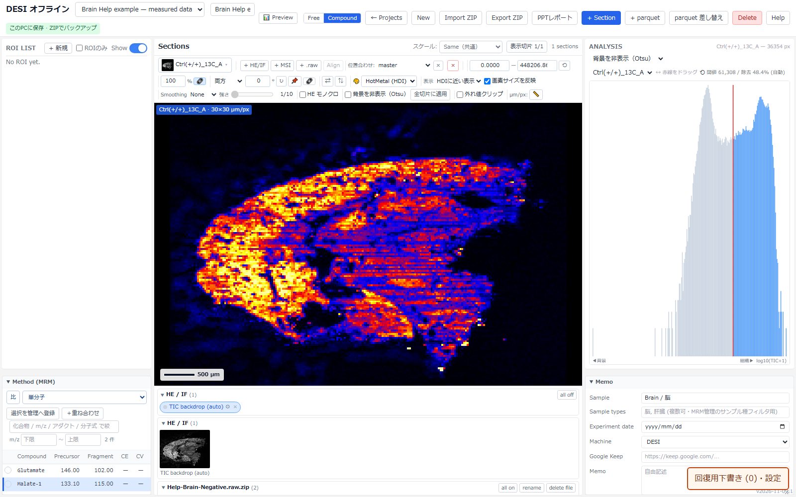

実操作画面：独立したローカル環境に原本を読み込み、2 分子を表示。共有データは変更していません。

**集計への影響**

色の見た目と測定値は区別します。Range・カラーマップ・Median・Linear は表示調整です。ROI の数値は元データから計算します。

**保存と共有**

ローカル編集は、このブラウザーの保存領域に保存されます。別 PC へ渡すときは Export ZIP または Publish を使います。

共有リンクの閲覧権限と管理権限は異なります。画面に出ない編集操作を、Help から有効にすることはできません。

### プロジェクトを管理する

新規作成、フォルダー整理、ローカルとサーバーの区別、保存状態を確認します。

1. **新規プロジェクトを作る** — Projects の New project を押し、名前と説明を入力します。作成後に Viewer を開きます。
2. **一覧を整理する** — フォルダーを作成し、プロジェクトを移動します。Local / Server の表示で保存先を区別します。未公開のプロジェクトの保存状態は「このPCのみ・未公開」です。
3. **必要なコピーを開く** — ローカルデータは Open で編集します。初めて使う別 PC では「サーバから一覧取得」→ Open (master) で公開済みの内容を取り込みます。閲覧するだけなら共有 URL を開きます。
4. **共有の最新版を確認する** — 共有先のあるローカルプロジェクトで「共有の最新版を確認」を押し、この PC とサーバーの公開版番号・切片数を比較します。「このプロジェクトに反映」または「別コピーで取得」を選びます。未公開の変更や公開結果の確認待ちがある場合は、別コピーでの取得だけが利用できます。
5. **削除前にバックアップする** — Export ZIP を保存し、確認ダイアログで削除対象を読みます。ローカル削除とサーバー側の削除は別の操作です。

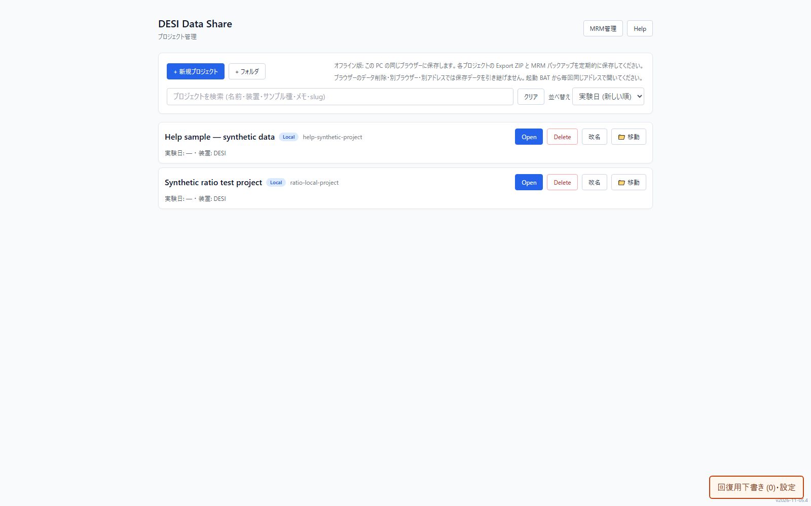

プロジェクト管理画面

**集計への影響**

フォルダー整理や名前の変更は測定値を変更しません。複数 PC のローカルコピーは、それぞれ独立しています。

**保存と共有**

保存競合が出たら、編集を続ける前に再読み込みまたは回復用下書きの内容を確認します。回復用下書きの自動作成は設定で選べます。

ブラウザーデータの削除・端末故障に備え、ZIP を別の保存場所へ定期的に書き出します。

既存プロジェクトへの反映が成功すると、同じプロジェクトの内容を更新し、直前の版を Projects に「サーバー版取り込み前 ...」という別のローカルコピーとして残します。このコピーは共有先との関連を外して保存され、回復用下書きの自動作成が OFF でも作られます。

原本や ROI を取得できない場合、取得中に別タブの内容やサーバーの公開版番号が変わった場合は、既存版への反映を中止します。同じ Google アカウントでログインしても、PC やブラウザー間のローカルプロジェクトは自動同期されません。

### 切片とデータを登録する

HE / IF 画像と MSI の数値データを、対応する切片へ登録します。

1. **切片を用意する** — 切片を追加し、名前・順番を確認します。切片名や分子名は作成者の編集画面で変更できます。
2. **HE / IF 画像を選ぶ** — 対応する切片の画像登録操作から画像を読み込みます。MSI と重ねる画像の位置は、登録後に Align で調整します。
3. **MSI の列と形式を確認する** — xlsx / txt・CSV などの数値データでは、X 座標・Y 座標・信号列を指定します。Waters .raw は対応する変換環境で読み込みます。
4. **読み込み結果を点検する** — Method / Compound、向き、MSI pixel size を確認します。Parquet の追加・置換では確認画面の対象切片と分子を必ず確認します。

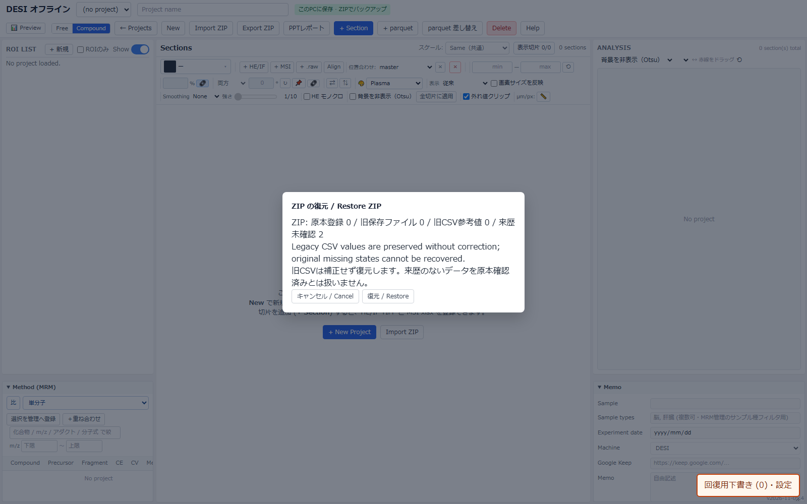

元データを含むプロジェクトの復元確認

**集計への影響**

比や ROI を計算するには元の数値データが必要です。色付きの MSI 画像だけでは、信号値を復元して計算することはできません。

元データの座標と行の対応を保ちます。異なる測定座標や互換性のない入力は、確認せずに同じ画素として扱わないでください。

**保存と共有**

インポート後はローカルプロジェクトを保存し、Export ZIP で数値ソースと画像を含むバックアップを作ります。

### 切片と分子を見比べる

Free / Compound、表示切片、レイヤーを組み合わせて、同じ条件で画像を見比べます。

1. **View を選ぶ** — Free は切片ごとに分子を選びます。Compound は選んだ分子を切片間で揃えて比較します。下の例では同じ切片の Malate-1 と Glutamate を切り替えます。
2. **表示する切片を絞る** — 表示切片の選択で必要な切片を残します。非表示は削除ではありません。再表示して比較を続けられます。
3. **レイヤーを組み合わせる** — HE / IF / MSI のチェックを切り替え、歯車から透明度・Grayscale・Apply opacity を調整します。HE 未登録時は TIC 背景が使われる場合があります。
4. **向きと尺度を確認する** — 拡大・移動・Rotation とスケールバーを確認します。作成者は切片の Flip H / V を変更できます。
5. **KMD 図で系列を探す** — ANALYSIS で KMD図を選び、CH₂・H₂・O の単位を切り替えます。点のクリックで分子を表示、ドラッグで囲むと Method 表を絞ります。系列の「重ねる」で色分けし、⟲ または Method 表の「KMD 選択」で解除します。

#### 分子を切り替えて、信号の分布を見比べる

Method の分子一覧で Malate-1、Glutamate を選びます。同じ切片でも、分子によって明るく見える場所が変わります。

**Malate-1**

MRM 133.101 → 115


Malate-1：登録原本からの再描画

**表示範囲: 0 - 448,206.855 信号強度**

**Glutamate**

MRM 146 → 102

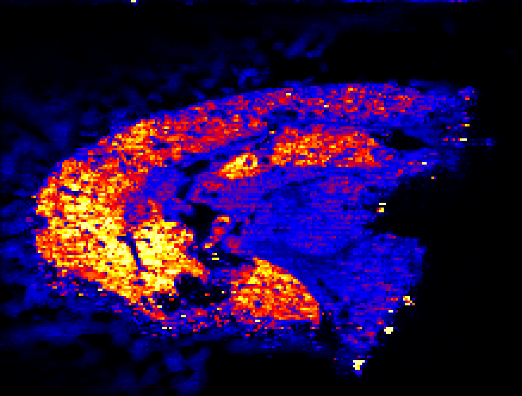

Glutamate：登録原本からの再描画

**表示範囲: 0 - 1,116,827.345 信号強度**

> HotMetal ／ Smoothing: None ／ 各分子の Range は 0 ～ 原信号の 99.5 パーセンタイル値。背景除外は使っていません。

> 色は信号強度を表します。この例は分子ごとに表示上限が異なるため、画像間の同じ色が同じ信号強度や濃度を意味するわけではありません。

**出典・条件**: 261030_Hirabayashi_13C_Brain ／ Ctrl(+/+)_13C_A。登録原本の同じ切片を再描画しています。登録画素サイズは 30 × 30 µm。

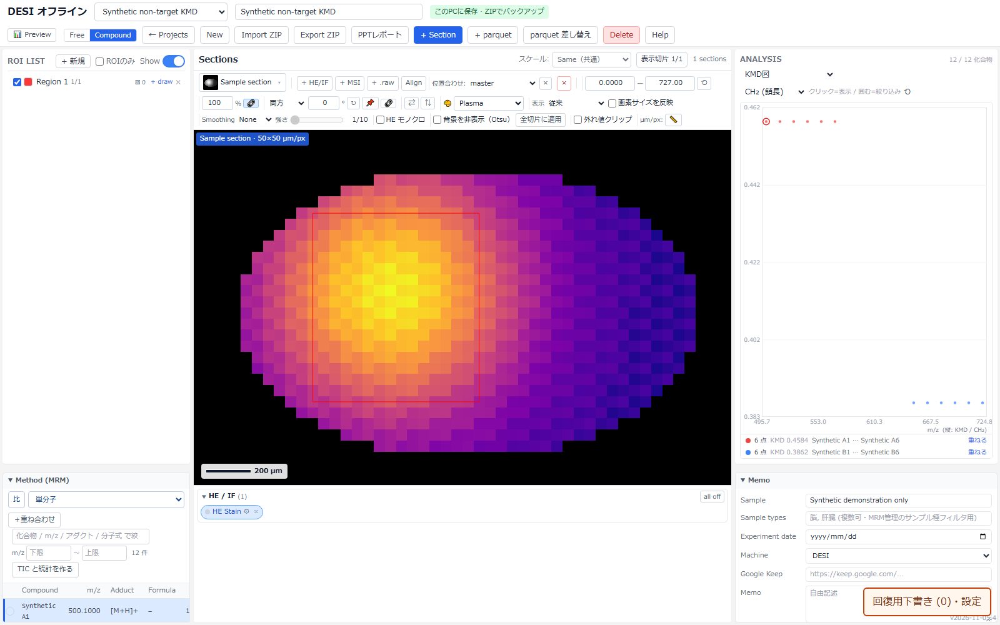

ANALYSIS の KMD図：単位選択、系列一覧、重ねる、選択解除

**集計への影響**

レイヤーの表示、透明度、ズーム、表示切片の選択だけでは元の信号値は変わりません。非表示の切片が出力対象に含まれるかは出力画面で確認します。

KMD は m/z から Kendrick 質量欠損を計算する図です。MRM では precursor を使い、m/z のない候補は件数を示して除外します。比（X / Y）とは別の見方で、元信号や ROI 集計は変えません。

ノンターゲット表には m/z・Adduct・Formula・Mean・Max が表示されます。検索や m/z 範囲、列見出しで候補を絞り、並べ替えられます。Mean が未計算なら「TIC と統計を作る」を使います。source 別の TIC と表示用の TIC backdrop は用途が異なります。

**保存と共有**

表示操作の保存範囲は操作と権限によって異なります。共有画面で行う一時的な見え方の調整を、公開元データの変更と混同しないでください。

KMD の選択・Method 表の絞り込み・系列の「重ねる」は一時的です。プロジェクトの比定義や保存済み重ね合わせには追加されません。別プロジェクトへ移動すると選択を解除します。

### 色・Range・滑らかさを調整する

表示だけを調整して分布を読み取りやすくします。Median と Linear の強さは、それぞれ 1～10 で選べます。

1. **表示スタイルと色を選ぶ** — MSI style とカラーマップを選びます。物理縦横比の表示を使うと、MSI pixel size に基づいた見え方になります。 背景を非表示（Otsu）と外れ値クリップも、必要に応じて表示を整えるために使います。
2. **Range を合わせる** — 表示する強度範囲を調整します。Same は比較対象の尺度を揃え、Individual は各画像に合わせます。下の Malate-1 の例では下限 0、上限 448206.855 を入力します。明るい領域が最大色になる場合は上限を見直します。
3. **Smoothing と強さを選ぶ** — None は平滑化なし。Median は近傍の中央値を使う表示用フィルターです。Linear は補間なしに近い 1 から、従来の Linear と同じ 10 まで選べます。
4. **ROI の範囲を見やすくする** — ROIのみ表示では表示対象の ROI に絞って確認できます。自動 Range の対象が変わるため、全体表示と明るさが変わることがあります。

#### Range の上限を下げて、弱い信号を見やすくする

同じ Malate-1 の画像で Range だけを変えます。上限 448206.855 を入力した例では、信号を色へ割り当てる範囲が変わります。

**全測定値が収まる上限**

上限 = 原信号の最大値

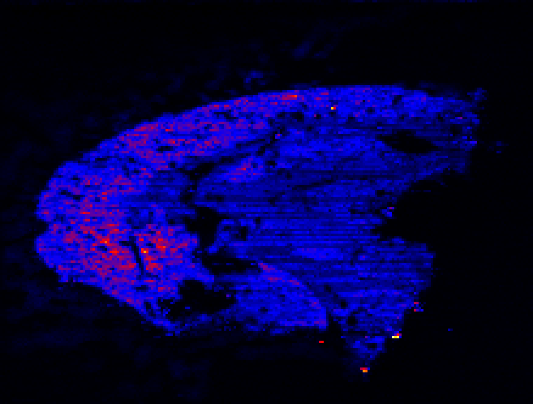

Range 0 ～ 1,026,290：原本からの再描画

**表示範囲: 0 - 1,026,290 信号強度**

**弱い信号を見やすくした例**

上限 = 原信号の 99.5 パーセンタイル値


Malate-1：登録原本からの再描画

**表示範囲: 0 - 448,206.855 信号強度**

> 元データ・ROI の集計値は変わりません。低い上限の図では、上限を超える 182 点が最大色になります。明るく見えたことだけで信号が増えたとは判断しません。

> 99.5 パーセンタイルは、この説明例のために原本から求めた値です。自動設定ボタンの紹介ではありません。配色・倍率・Smoothing: None は同一です。

**出典・条件**: 261030_Hirabayashi_13C_Brain ／ Ctrl(+/+)_13C_A。登録原本の同じ切片を再描画しています。登録画素サイズは 30 × 30 µm。

#### 同じ場所を拡大し、滑らかさと細部を確認する

Smoothing で種類を選び、強さスライダーを調整します。以下は同じ拡大範囲・同じ Range での比較です。

**None**

補間・メディアン処理なし

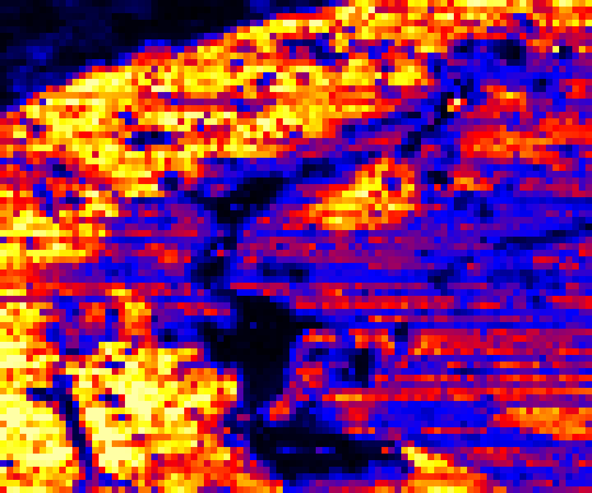

None：同じ範囲の拡大再描画

**表示範囲: 0 - 448,206.855 信号強度**

##### 比較する表示

**Linear 10 / 10**

Linear は画素間の色を補間します。1 は補間なしに近く、10 が従来の Linear と同じ強さです。

**Linear 10 / 10**

従来の Linear と同じ最大の補間量

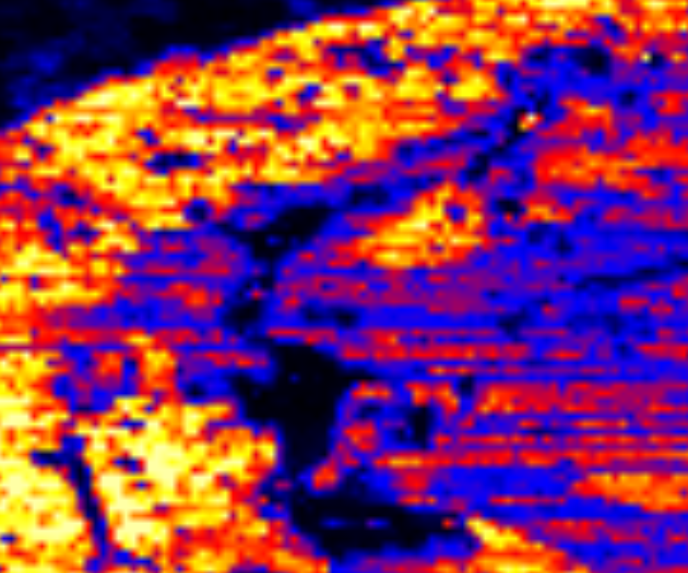

Linear 10 / 10：表示専用の補間

**表示範囲: 0 - 448,206.855 信号強度**

**Median 3 / 10**

Median は周囲の表示値の中央値を使います。この例は 3 / 10（7 × 7 画素）。細かい点や細い構造も変わるので、None と見比べて強さを選びます。

**Median 3 / 10**

近傍 7 × 7 画素の中央値を用いた表示

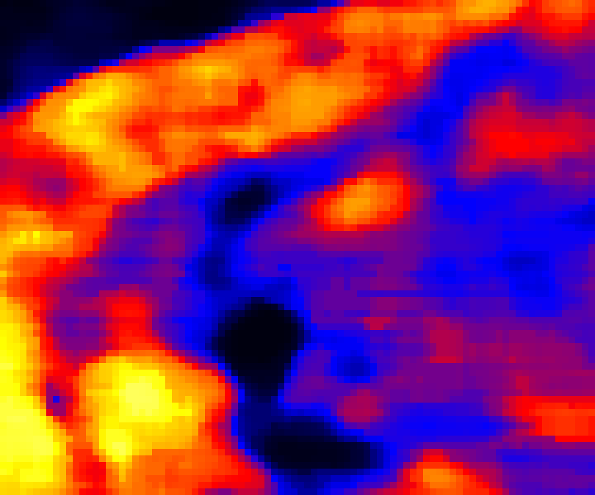

Median 3 / 10：表示専用のフィルター

**表示範囲: 0 - 448,206.855 信号強度**

> 元データ・ROI の集計値は変わりません。強くすると細い構造が見えにくくなることがあります。

> HotMetal、Range 0 ～ 448,206.855。拡大図は同じ 90 × 75 画素の範囲です。

**拡大した位置を確認**

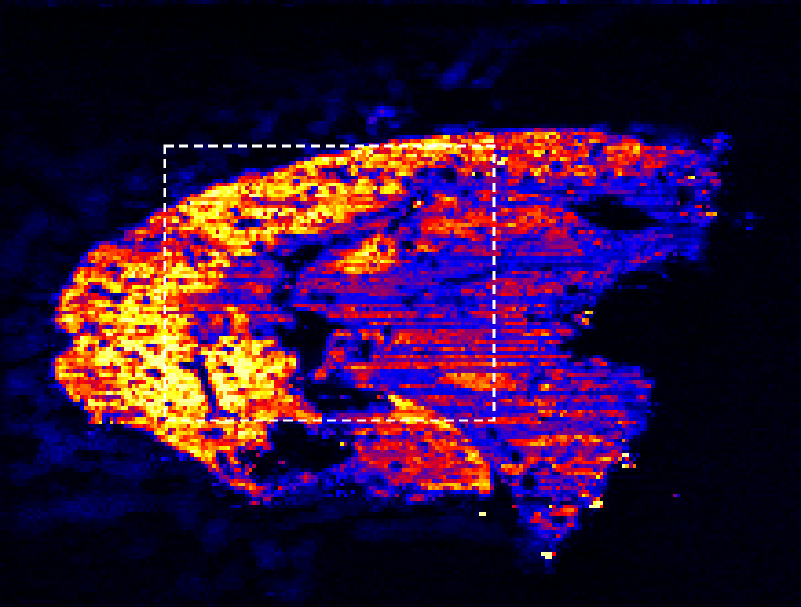

拡大した場所：原本からの再描画に範囲を追記

**出典・条件**: 261030_Hirabayashi_13C_Brain ／ Ctrl(+/+)_13C_A。登録原本の同じ切片を再描画しています。登録画素サイズは 30 × 30 µm。

**集計への影響**

Median・Linear・Range・カラーマップ・物理縦横比は、元データや ROI 集計値を変更しません。集計は平滑化前の数値を使います。

Median の段階は表示の滑らかさを選ぶためのものです。異なる装置やアプリの同じ番号と同一処理を保証する尺度ではありません。

ROIのみ表示で自動 Range が変わっても、ROI の形や集計対象の元データは変わりません。

背景を非表示（Otsu）は TIC のヒストグラムで背景を判定する表示機能です。ANALYSIS で閾値を調整し、必要なら全切片に適用します。元の強度・座標・ROI 定量・数値出力は変えません。

**保存と共有**

作成者の表示設定はプロジェクトの保存・ZIP・公開に引き継がれます。共有画面の MSI style・色・Median / Linear はこのタブの個人設定で、再読み込み後も保持します。viewer と Admin は別設定です。公開元は変更しません。

Range はプロジェクトごとの一時的な表示設定です。固定条件で比較したいときは範囲と Same / Individual を記録してください。

### 比（X / Y）を表示する

同じ切片の 2 分子から比画像を作ります。酸化分子 / 非酸化分子など、任意の X / Y に使えます。

1. **「比」を開く** — 数値データを含むプロジェクトで「比」を開きます。作成済みの比は一覧から選べます。
2. **分子 X と分子 Y を選ぶ** — 分子側（X）と分母側（Y）を切片ごとに選び、名前を付けます。この例は X = Malate-1、Y = Glutamate です。検索で候補を絞り、同名ならファイル・列・測定条件で区別します。別ファイルでは座標の単位と原点が同じことを確認します。
3. **分母の下限を確認する** — Y の下限は初期値 0 です。下限以下の Y、欠損、負の信号は有効な比として扱いません。無効部分は 0 に置き換えず、計算対象から除きます。
4. **比画像を表示して比較する** — 「保存して表示」で比画像と ROI 集計を確認します。「ROI集計CSV」は指標を、「測定点CSV」は測定点ごとの値・有効性・除外理由を保存します。

#### 分母が弱い場所を含めるかで、比の画像が変わる

「比」で X に Malate-1、Y に Glutamate を指定します。この例では同じ RAW ファイル・function 1 の同じ測定位置で、原信号 X ÷ Y を計算しています。

**分母の下限: 0**

Glutamate > 0 の点を採用

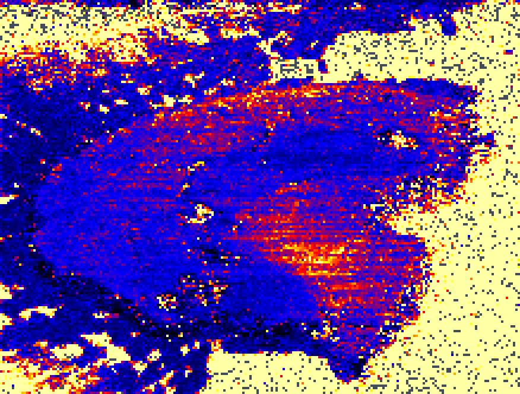

分母下限 0：原本からの信号比を再描画

**表示範囲: 0 - 1.5 信号比**

有効 35,267 / 36,354 点（97.0%）

**分母の下限: 10,000**

Glutamate > 10,000 の点を採用

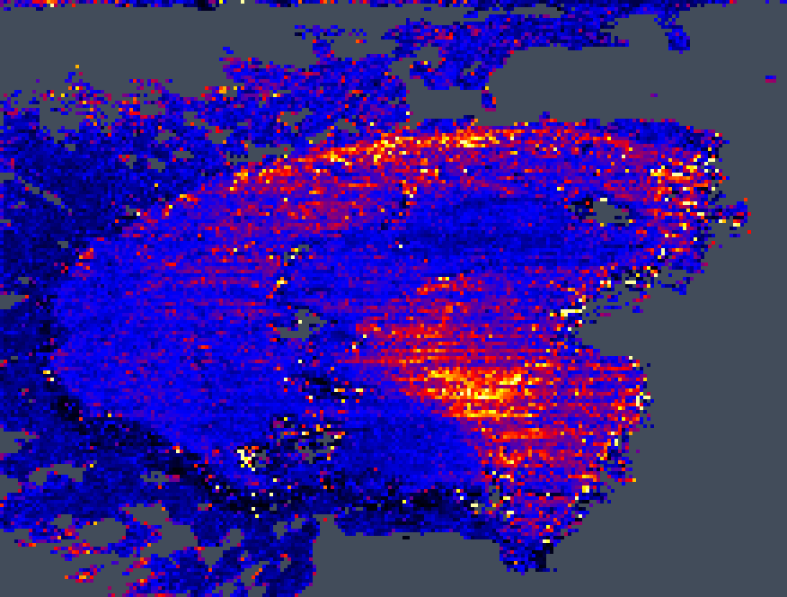

分母下限 10,000：原本からの信号比を再描画

**表示範囲: 0 - 1.5 信号比**

有効 23,512 / 36,354 点（64.7%）

> この比較図では無効点を灰色で表示しています。説明用に再描画した図であり、実際の Viewer の背景色は表示設定によって異なります。両図とも HotMetal、Range 0 ～ 1.5、None、Otsu なしです。

> 10,000 は操作説明用の任意の値で、検出限界や推奨基準ではありません。分母が 0 または下限以下の点は、比を 0 にせず表示・比の集計から除外します。下限 0 では 1,087 点、下限 10,000 では 12,842 点が除外されています。

> 表示上限の 1.5 を超える比は最大色です。下限 0 では 8,715 点、下限 10,000 では 99 点が該当します。表示 Range の変更は計算済みの比を変えません。

> これは測定信号の比です。濃度比や生物学的な差を、この画像だけから断定しません。分母下限は比の有効点と統計を変えますが、原本や元の分子別 ROI 集計は変えません。

**出典・条件**: 261030_Hirabayashi_13C_Brain ／ Ctrl(+/+)_13C_A。登録原本の同じ切片を再描画しています。登録画素サイズは 30 × 30 µm。

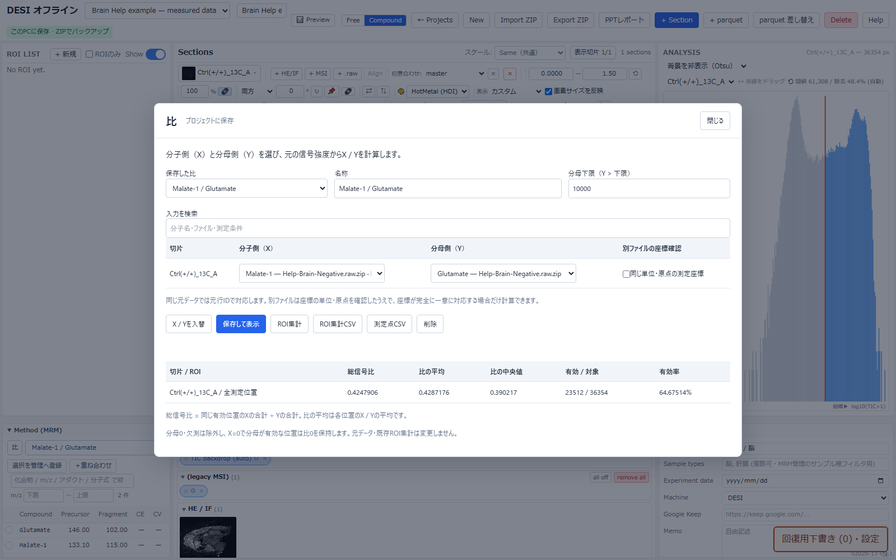

実操作画面：同じ測定ファイルの信号比を設定

**集計への影響**

比は対応する元データの値から計算します。表示済みの色や、Median / Linear をかけた画像から計算しません。X = 0、Y > 下限の位置は有効な 0 です。

ROI総信号比 = 有効な位置の X の合計 / 同じ位置の Y の合計。個別比の平均 = 各位置の X / Y の平均。個別比の中央値 = 各位置の X / Y の中央値。これらは異なる指標です。

例：X が 2, 8、Y が 1, 2 のとき、ROI総信号比は 10 / 3 ≈ 3.33、個別比の平均は (2 + 4) / 2 = 3 です。

結果には有効数・有効率・除外理由・分母下限を添えて判断します。元の分子別 ROI 集計と比の集計は別の結果です。

**保存と共有**

作成者が保存した比の定義は、プロジェクト・ZIP・公開に含まれます。定義は X / Y と分母下限を記録し、元の信号値を書き換えません。

共有の閲覧者・管理者が編集した比は、このタブの個人用設定です。同じタブの再読み込み後も保持し、タブを閉じると失われます。公開元の比定義や他の閲覧者の設定を上書きしません。

比の ROI 結果は専用出力で保存します。画像や PPT に表示する比と、数値結果の指標・条件を対応させて記録します。

### HE / IF と MSI を位置合わせする

Align で同じ組織の位置を揃え、重ね合わせて確認します。

1. **切片から Align を開く** — 対象の切片を選び、Align を開きます。HE / IF、Source、比較する MSI を選びます。
2. **尺度と手動位置を調整する** — MSI pixel size を確認し、移動・回転・拡大縮小などの手動スライダーでおおまかに揃えます。
3. **対応点または自動整合を使う** — Landmark では両画像の同じ位置を対応させます。シルエットによる自動整合も結果を目視確認してから採用します。
4. **重ね合わせを確認して保存する** — 重ね合わせ表示と MSI の濃さを使ってずれを点検します。Save で確定、Cancel で今回の変更を破棄します。

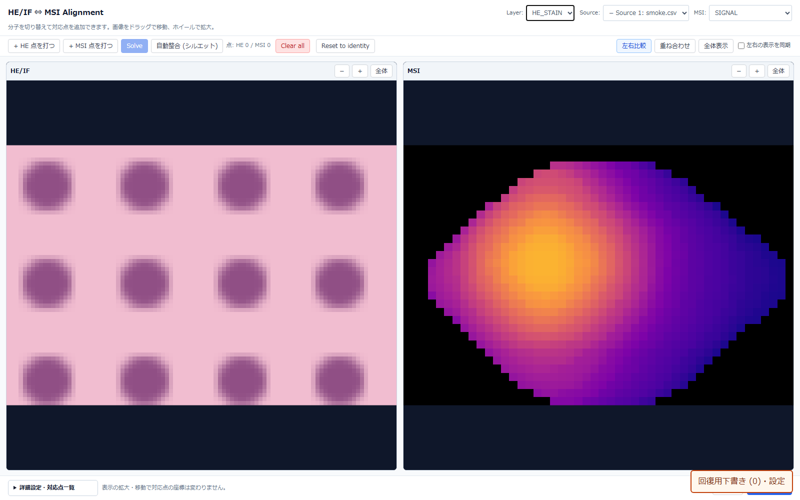

対象画像・尺度・対応点を確認

**集計への影響**

位置合わせは表示座標の対応です。元の MSI 信号値を書き換えません。ROI はどの座標系で描かれたかを保って扱います。

**保存と共有**

作成者の Save はプロジェクトへ保存します。共有画面では必要な書き込み権限・ロックを確認します。Cancel では確定しません。

### ROI を描いて集計する

関心領域を描き、元の信号値を集計します。比の集計では、分子単独の値と区別します。

1. **ROI と編集権限を確認する** — ROI 一覧で名前・色・表示状態を確認します。共有画面で描画や削除をするときは、必要な書き込みロックを取得します。
2. **領域を描く** — ROI の描画操作を選び、画像上で領域を囲みます。同じ ROI を別切片へ描く場合も、切片ごとに対応する位置を確認します。
3. **表示と対象を点検する** — ROI の表示切替・ROIのみ表示を使い、意図した範囲か確認します。削除は確認画面で対象 ROI を確認してから行います。
4. **集計を確認して出力する** — 元信号の集計を確認します。比の場合は専用結果の指標名、有効数、除外理由、分母下限も合わせて確認します。

#### ROI の数値を元の測定値から確認する

位置が分かるように、同じ大きさの仮 ROI A・B を重ねました。この説明用の ROI は、原本・プロジェクト・共有データには保存していません。

**Malate-1 と仮 ROI**

None ／ 各 ROI: 30 × 25 画素


仮 ROI A・B：原本からの再描画に説明用の枠を追加

**表示範囲: 0 - 448,206.855 信号強度**

ROI A・B は説明用の名称です。解剖学的な部位を意味しません。

**原本 Malate-1 の集計**

| 仮 ROI | 測定点数 | 平均信号 |
| --- | --- | --- |
| ROI A | 750 | 307,293.13 |
| ROI B | 750 | 177,911.67 |

> Range・Linear・Median を変更しても、この集計対象と元信号は同じです。画像の色ではなく、ROI 内の元の測定値を集計しています。

> 「比」の ROI 集計では、分母条件を満たす有効点だけが対象です。単分子の ROI 集計と区別し、ROI総信号比・個別比の平均などの指標名も確認します。

**出典・条件**: 261030_Hirabayashi_13C_Brain ／ Ctrl(+/+)_13C_A。登録原本の同じ切片を再描画しています。登録画素サイズは 30 × 30 µm。

**集計への影響**

ROI 集計は元の数値データを対象とします。Median / Linear・色・Range を変更しても集計値は変わりません。

比の「ROI総信号比」と「個別比の平均」は異なります。比の章の式を確認し、結果に記載された指標を使って比較してください。

**保存と共有**

作成者の ROI はプロジェクト・ZIP に保存します。共有 ROI の書き込みは共有権限とロックに従います。非表示は削除ではありません。

ZIP では元データと ROI 情報を分けて保存します。比の専用出力も、測定条件が分かる名前で保存してください。

### ROI に顕微鏡画像を付ける

ROI に対応する顕微鏡画像を登録し、MSI と一緒に確認します。

1. **対象 ROI の画像画面を開く** — ROI の画像操作を開き、対象の切片と ROI を確認します。複数の顕微鏡画像を同じ ROI に関連付けられます。
2. **画像と説明を登録する** — 画像ファイルを選び、タイトルや説明を入力します。位置・倍率など、読み手が対応関係を判断できる情報を残します。
3. **MSI と見比べる** — 顕微鏡画像を拡大して確認し、ROI の MSI 表示と見比べます。分子または比の選択・表示条件も確認します。
4. **順番・説明を整えて保存する** — 画像の順序や説明を整え、不要な画像は確認して削除します。共有時は画像を含めた公開・書き出し結果を確認します。

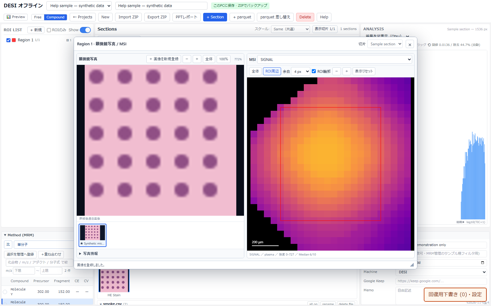

ROI に関連付ける顕微鏡画像

**集計への影響**

顕微鏡画像は ROI の説明資料です。画像を追加しても MSI の元信号や ROI の集計値は変わりません。

**保存と共有**

画像と説明は ROI に関連付けて保存し、ZIP・共有に含めます。編集の可否はローカル / 共有の権限に従います。

### Preview・重ね合わせ・PPT

画像一覧で比較し、複数分子のカラー合成や PPT レポートを作ります。

1. **Preview を開く** — Preview で分子や比、切片の画像を一覧表示します。公開前には、受け手の見え方を確認します。
2. **比較条件を揃える** — 表示切片と分子を選び、Range・Same / Individual・色・ROI の表示を確認します。
3. **複数分子を重ね合わせる** — 重ね合わせで複数分子に色を割り当てます。明るさを揃える設定の意味を確認して分布を比較します。比の多色重ね合わせは対象外です。
4. **PPT レポートを作る** — PPTレポートを開き、出力する切片・分子・比と画像条件を確認して書き出します。分子・測定条件が未登録の切片は、分子別ページの対象から外れます。一覧では切片の列を保ち、未登録の組み合わせの表示を省きます。登録済みデータの読み込み失敗は表示に残ります。出力後に各スライドの見出しと尺度を確認します。

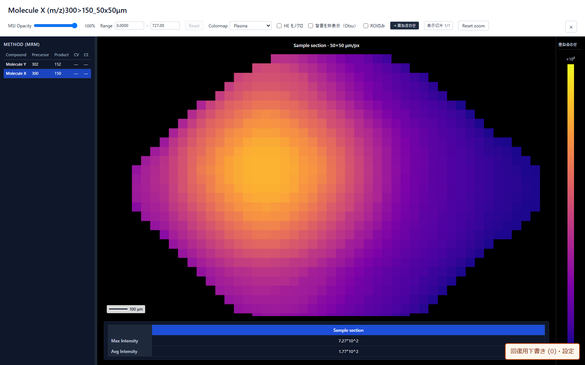

切片・分子を一覧で比較

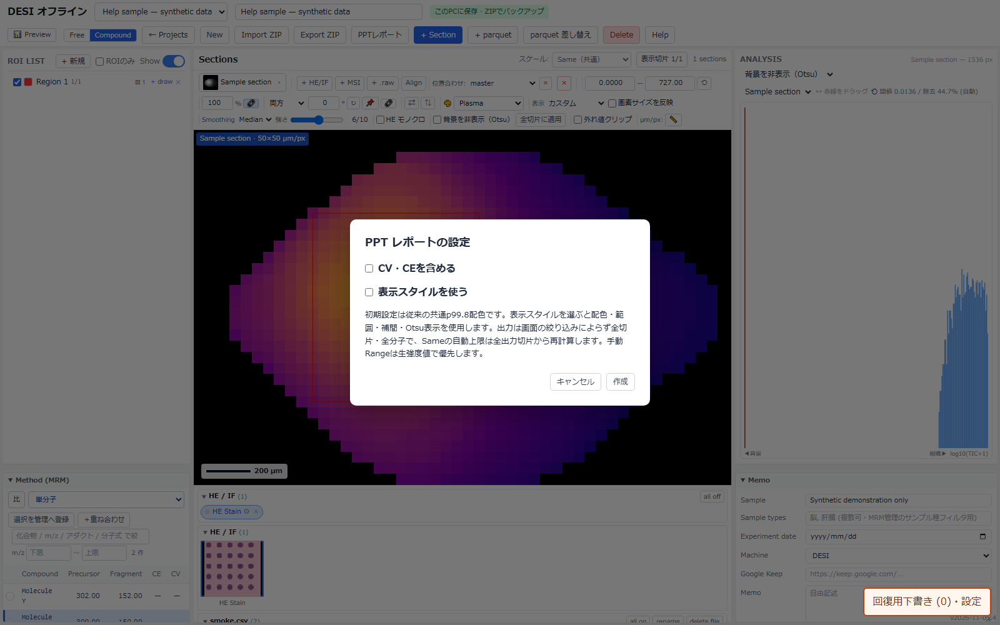

レポートの出力条件を確認

**集計への影響**

重ね合わせの色や明るさは表示条件です。色の混ざり方から、比や元信号の集計値を読み替えないでください。

**保存と共有**

PPT は書き出した時点の画像を保存します。プロジェクトを編集しても、既存の PPT は自動更新されません。

共有画面で個人設定を使った場合は、その条件を資料にも記録します。

共有先で作った重ね合わせは、対応する共有環境では同じ URL の利用者に共有されます。作成者が公開した重ね合わせは読み取り専用です。保存できない環境では画面の通知に従います。

### 保存・ZIP・共有・Memo

ローカル保存、ファイルバックアップ、サーバー公開を目的に応じて使い分けます。

1. **Memo と保存状態を確認する** — 実験条件や気付きを Memo に残し、保存状態を確認します。「このPCのみ・未公開」はブラウザー内の保存、「このPCに保存・公開待ち」は共有先への反映待ちです。保存エラーがあるときは内容を確認してから閉じてください。
2. **Export ZIP でバックアップする** — Export ZIP を選び、元データ・ROI・顕微鏡画像・比の定義を含むアーカイブを保存します。ZIP は公開とは独立しています。
3. **Import で復元する** — 保存した ZIP を読み込み、復元内容を確認して確定します。別 PC でも対応するアプリから復元できます。
4. **公開内容を確認して共有する** — 作成者は Preview の後に Publish to share を実行します。完了と Sync 状態を確認し、共有 URL と必要なパスワードを渡します。

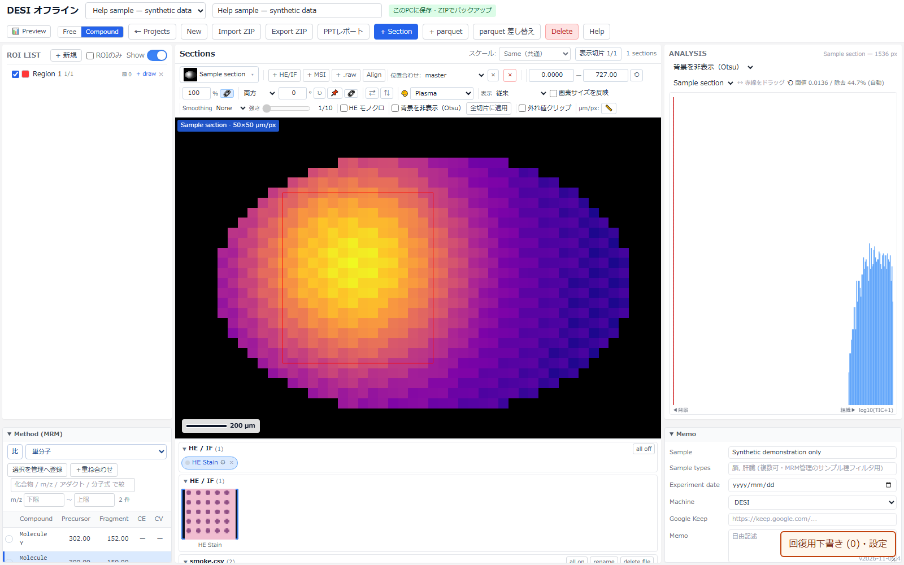

バックアップと記録の入口

**集計への影響**

保存・ZIP・公開は、表示用の色を元信号に置き換える操作ではありません。元データと ROI・比の定義を区別して保持します。

**保存と共有**

ローカル保存はこのブラウザー内、Export ZIP は自分で保存したファイル、Publish はサーバー上の共有内容です。それぞれ別の保存先です。

「✓ 公開版 vN を保存済み」は、この PC が保存した公開版の基準番号です。別 PC の変更まで含めた最新版との一致を保証する表示ではありません。他 PC の公開内容を取り込むときは「共有の最新版を確認」を使います。

Auto-publish は公開済みプロジェクトのローカル変更を共有先へ送る処理です。共有版との競合や基準番号が未確認のときは停止します。比較・再公開を明示するまで、ローカル保存だけで自動再公開は再開しません。再 Publish は共有側への影響を確認し、大容量アップロードは完了まで進捗を確認します。

同じ Google アカウントでもローカルデータは PC ごと・ブラウザーごとに独立しています。初回の別 PC ではサーバー一覧から Open (master) で取り込むか、閲覧用の共有 URL を開きます。未公開の内容は Export ZIP / Import で移せます。

共有の表示設定と比の個人変更は、公開元への保存ではありません。共有 ROI・位置合わせ・重ね合わせの保存は各機能の権限とロックに従います。共有画面の Memo 編集は一時的で、再読み込みで破棄されます。

### MRM ライブラリと .exp 編集

MRM を化合物・タグで管理し、測定履歴や .exp ファイルを確認します。

1. **MRM 管理を開く** — Projects の MRM 管理から移動します。検証済みライブラリと使用実績アーカイブを切り替え、検索とフィルターで絞ります。
2. **MRM を登録する** — 化合物追加、表への入力・貼り付け、Excel 一括登録を使います。precursor / product・CE / CV、タグ、出典を確認します。
3. **履歴とメソッドセットを整理する** — 実測棚卸しで未登録の測定履歴を確認します。メソッドセットを保存・読み込み、出力するトランジションを選びます。
4. **.exp を確認して書き出す** — テンプレートから選択を .exp 出力するか、「.exp を開いて編集」で既存ファイルを確認します。変更点と検証結果を読み、別名で保存します。

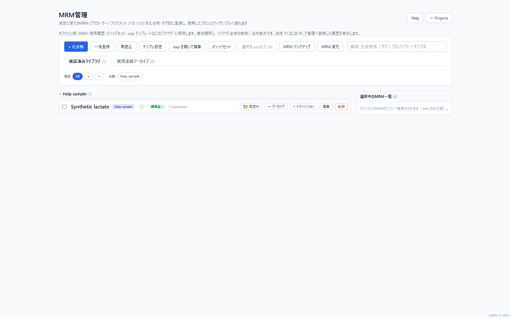

MRM ライブラリ

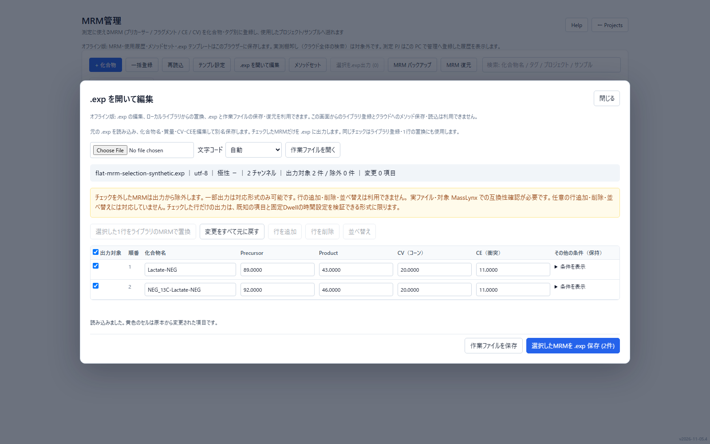

exp の内容と変更を確認

**集計への影響**

MRM ライブラリの編集は、読み込み済み MSI の信号値や ROI 集計値を書き換えません。測定条件の管理と画像解析は別の操作です。

**保存と共有**

オフライン版のライブラリはローカルに保存します。オンラインの共有ライブラリを操作するときは保存先と権限を確認します。

.exp 出力は元ファイルを直接上書きせず、保存したファイルを装置側で点検します。未対応の設定や検証メッセージを確認してください。

### 困ったとき・ショートカット

表示、データ不足、保存、共有、オフライン起動の問題を切り分けます。

1. **画面の状態を確認する** — 画像が見えないときは、切片・Method / Compound・レイヤーのチェック・Opacity・Range・ROIのみ表示を確認します。
2. **数値データの有無を確認する** — 比や ROI が計算できないときは、元ソースがあるか、X / Y が同じ位置に対応するか、分母下限で全て除外していないかを確認します。
3. **保存先と権限を確認する** — 保存競合・容量不足・共有ロックの通知を読みます。未保存の作業は ZIP や回復用下書きで確保してから再読み込みします。
4. **操作をやり直す** — Method 表では ↑ / ↓ で分子を移動します。ROI 描画は Enter で確定、Esc で中止します。問い合わせ時はビルド番号・操作・入力形式・エラー文を記録します。


プロジェクト管理画面

**集計への影響**

計算できない領域を 0 と解釈しないでください。欠損・分母条件・非対応データなどの理由を確認し、有効データと区別します。

**保存と共有**

オフライン版は ZIP を完全に展開して START_OFFLINE.bat を起動します。起動用ウィンドウを閉じるとローカルサーバーも終了します。保存済みブラウザーデータと ZIP バックアップは別です。

Help の印刷 / PDF から、現在の権限・言語の全章を紙面にできます。画像をクリックすると実画面を拡大できます。

<!-- GUIDED_HELP_END -->
