# DESI Data Share 閲覧者ガイド

このガイドは **共有 URL を受け取って DESI Data Share を閲覧している方** 向けの説明書です。
データ作成側 (Master) の操作 (新規プロジェクト作成、レイヤー登録、Publish to share など) はここでは扱いません。

> パスワードが必要な共有 URL では、発行者から受け取った **viewer password** を入力します。公開設定によってはパスワードなしで開けます。

---

## 目次

1. [このアプリで閲覧者ができること](#1-このアプリで閲覧者ができること)
2. [URL を開く・パスワード入力](#2-url-を開くパスワード入力)
3. [画面構成](#3-画面構成)
4. [ROI の表示と追加](#4-roi-の表示と追加)
5. [View モード: Free と Compound の使い分け](#5-view-モード-free-と-compound-の使い分け)
6. [Method (MRM) と化合物の切替](#6-method-mrm-と化合物の切替)
7. [Range / Opacity / Rotation の調整](#7-range--opacity--rotation-の調整) / [レイヤー個別設定 (歯車 ⚙)](#7-bis-レイヤー個別の表示設定-歯車-) / [MSI スケールバー](#7-tris-msi-スケールバー)
8. [Memo の編集](#8-memo-の編集)
9. [Preview overlay (画像グリッド)](#9-preview-overlay-画像グリッド)
10. [Export ZIP で手元に保存](#10-export-zip-で手元に保存)
10-report. [PPTレポート](#pptレポート)
11. [保存されること・破棄されること](#11-保存されること破棄されること)
12. [キーボードショートカット](#12-キーボードショートカット)

---

## 1. このアプリで閲覧者ができること

- 切片画像 (HE / IF / MSI) を化合物単位で重ねて閲覧
- 化合物の切替・比較 (Free / Compound モード)
- 既存 ROI の表示・非表示 / **表示中の ROI の形で MSI を切り抜き、ROI 内の値で Range を調整** (ROIのみ)
- **書き込みロック取得時** に新規 ROI の追加・既存 ROI の削除 (同時編集者は 1 名)
- ANALYSIS バーグラフで切片 × 化合物の Mean Intensity を比較
- **表示切片を自由に選択** (臓器ごとの一括選択・切片ごとのチェック・名前検索)
- 表示パラメタ (Range / Opacity / Rotation / Pan / Zoom) の **一時的な** 調整
- Memo の **一時的な** 編集
- プロジェクト全体を ZIP でダウンロード

---

## 2. URL を開く・パスワード入力

1. 提供者から渡された URL (例: `https://.../viewer/index.html#share=<slug>`) をブラウザで開く
2. 「共有プロジェクト」モーダルが開くので、別途共有された **viewer password** を入力
3. **Unlock** を押すとプロジェクトが読み込まれる
4. ヘッダ右に 🔒 **Share view** バッジが付き、編集系ボタンは自動的に隠れる

> 上部の **🔑 Admin** から提供者が設定した **admin password** を入力すると管理者ビューになり、Method (MRM) テーブルの **CE / CV** も表示されます。**Precursor / Fragment** は通常の viewer password でも表示されます。

セッションは **12 時間** で失効します。タブを閉じても再度 URL を開けば同じパスワードでログインし直せます。

---

## 3. 画面構成

  

    Top Bar &nbsp;—&nbsp; 🔒 Share view / Free / Compound / Export ZIP / PPTレポート / Help
  

  

    

      
ROI LIST

      <ul style="margin:6px 0 0 1em;padding:0;color:#475569;font-size:11px;line-height:1.5;">
        <li>+ 新規 (要ロック取得)</li>
        <li>Show トグル</li>
        <li>各 ROI のチェックボックス・削除</li>
      </ul>
    

    

      
Sections Grid

      

        

          
Section 1

          
canvas (パン/ズーム)

          
thumbs (ON/OFF)

        

        

          
Section 2

          
canvas

          
thumbs

        

        

          
Section 3

          
canvas

          
thumbs

        

      

      

        
Method (MRM)

        
Compound / Precursor / Product / CE / CV / Range

      

    

    

      
ANALYSIS

      <ul style="margin:6px 0 8px 1em;padding:0;color:#475569;font-size:11px;line-height:1.5;">
        <li>切片並列バーグラフ</li>
        <li>化合物プルダウン × 3</li>
      </ul>
      
Memo

      <ul style="margin:6px 0 0 1em;padding:0;color:#475569;font-size:11px;line-height:1.5;">
        <li>Sample / Machine / Matrix …</li>
      </ul>
    

  

| 領域 | 役割 |
| --- | --- |
| Top Bar | 表示モード切替 (Free / Compound)・Preview・Export ZIP・PPTレポート・🔑 Admin・Help |
| ROI LIST | 全切片共通の ROI 一覧。表示トグル・新規描画・各 ROI への追加描画 |
| Sections Grid | 切片パネル。クリックでアクティブ (青枠) 化、ドラッグでパン、ホイールでズーム |
| Method (MRM) | アクティブ切片の MSI レイヤー一覧。クリック / ↑↓ キーで切替 |
| ANALYSIS | 選択 ROI に対する切片 × 化合物 のバーグラフ |
| Memo | Sample / Machine / Matrix / Google Keep / +α … (一時編集) |

> **ANALYSIS の数値の出どころ**: Mean Intensity は、元ソースのうち ROI に含まれる有効な測定行から計算します。重複座標に複数行あればすべてを使用し、表示用の平均画素や 8bit 画像は定量に使いません。**Range、色、外れ値クリップ、Otsu、回転・反転、表示切片を変えても、同じ ROI の数値は変わりません**。Otsu で見えなくなった位置の元測定行も ROI 内なら集計されます。
>
> **n は有効な元測定行数**で、一意座標数や生物学的な標本数とは異なります。SD は分母 n の記述的 SD です。欠測は実測 0 に置き換えず、有効値がなければ n=0、Mean/SD/Max は未算出となります。元ソースがない場合や元型を安全に計算できない場合も、PNG から数値を推定しません。

> **ANALYSIS の表示切替**: パネル左上のプルダウンで **ROI強度 / 背景を非表示（Otsu） / KMD図** を切り替えます。
> 初期表示は **背景を非表示（Otsu）** ですが、**ROI を描き終えた時点で自動的に ROI強度 に切り替わります**。
> 一覧から既存 ROI を選び直しただけのときは表示モードを動かさないので、棒グラフが見えないときは
> プルダウンで **ROI強度** を選んでください。

> 各切片パネル左上の **section 名ラベル** には、提供者が MSI pixel size を設定していれば「Section 1 · 20×20 μm/px」のように **Pixel pitch (μm/px)** が併記されます。X / Y の値は常に両方表記されます (異方性 = `50×60 μm/px` / 等方 = `20×20 μm/px`)。

> **表示切片**: Sections ヘッダの **「表示切片」** を押すと、臓器ごとに整理されたフローティング一覧が開きます。各切片のチェックで、複数臓器をまたいで自由に選べます。臓器見出しはその臓器の全切片を一括操作し、一部だけ表示中なら中間状態になります。名前検索は一覧だけを絞り込みます。**「すべて表示」** で戻せ、最低 1 切片は表示されます。1 臓器のプロジェクトや臓器未指定の切片にも使えます。名前からの臓器推定は一覧の分類用で、生物学的アノテーションの確定ではありません。
>
> 選択は主画面と Preview で共通で、同じタブのプロジェクト／共有 URL ごとに保持されます。チェックのたびに一覧は閉じず、外側クリックまたは Esc で閉じます。非表示にしても ROI 解析や数値出力の対象は変わらず、他の閲覧者の選択にも影響しません。描画途中の切片を隠す操作は、ROI の完了／中止まで保留されます。

---

## 4. ROI の表示と追加

### 4-1. 既存 ROI の表示制御

- ROI LIST 各行の **チェックボックス** で個別に表示 ON/OFF
- ヘッダの **Show** トグルで全 ROI を一括 ON/OFF

これらの操作はサーバには送られず、自分の画面でのみ反映されます。

### 4-2. 新規 ROI を描く (書き込みロック必須)

共有モードで ROI を書き込むには、**書き込みロックの取得が必須** です (同時に 1 名のみ)。

1. ROI を描きたい切片パネルをクリックしてアクティブ化
2. ROI LIST 上の **`+ 新規`** をクリック → 自動的にロック取得を試行
3. ロックが取れたら描画モードに入り、キャンバス上で 3 点以上の頂点を打つ
4. 確定方法 (いずれか):
   - 最初の頂点をもう一度クリック
   - ダブルクリック
   - **Enter** キー
5. ROI 名を入力 → **サーバに即時保存**、他の閲覧者にもリロード後に反映される

> ロック取得に失敗した場合は「ロック中: ◯◯」と表示されます。前の人がブラウザを閉じていれば 30 秒以内に自動で取り直せます。
> 描画完了後、ロックは自動で解放されます。

### 4-3. 既存 ROI を別の切片にも描く

- ROI LIST 各行の **`+ draw`** ボタン → アクティブ切片で描画モード ON
- 同じ ROI が複数切片で共有されます
- 行右の `2/3` 等のバッジは「描画済 / 全切片数」

### 4-3b. 同じ切片の複数MSIでROIを共通に使う

新規ROIの適用範囲で共通を選ぶと、同じsection内で座標が一致すると確認されたMSIに、1回描いたROIを共通使用します。化合物やPOS/NEGの測定を切り替えても同じ領域を使い、数値は各測定の元データから別々に計算します。後から追加したMSIも、同じ座標として確認・登録されれば既存の共通ROIを使えます。

既存ROIは行の **共通化**、または **既存ROIを共通化** で切り替えます。元のROIに含まれる測定行が変わらないことを確認してから保存します。元ソースを特定できない旧ROIなどは自動変換せず、そのまま保持します。1つの測定だけに使う場合は、新規ROIで **この測定のみ** を選びます。

共通化は同じsection内が対象です。別切片や、pitchだけが同じで座標が異なるMSIには適用しません。共有画面で座標情報が未登録と表示された場合は、管理側でMSIを読み込んで座標を確認し、再公開してください。

### 4-4. ROI の削除

- ROI LIST 各行の **`×`** で削除 → 全切片分が消え、サーバにも即時反映
- 削除も書き込みロック取得中のみ有効

> **確認は「ロックを取ったあと」に出ます**: `×` を押すとまず書き込みロックを取りに行き、取れてから
> 「書き込みロックを取得しました … サーバ上の共有データから消えるので、この URL を開いた他の人からも
> 見えなくなります。元に戻せません。削除しますか?」という確認が出ます。**キャンセルするとロックは
> すぐ返す**ので、他の人の編集を止めたままにはなりません。

> 描画モード中は他のパネルへの切替はできません。**Escape** で中止 (描画途中の頂点は破棄)。

### 4-4b. HE/IF と MSI の位置合わせ (Align)

共有先でも **`Align`** で HE/IF を MSI に重ね直せます。**master が登録した位置合わせは消えません** — ツールバーの **`位置合わせ:`** で行き来できます。

| 選択 | 中身 |
| --- | --- |
| **master** | 共有元が登録した位置合わせ (常に残ります) |
| **共有 (合わせ直し)** | 共有先が合わせ直した位置合わせ。**この共有 URL を開いた全員**に届きます (最大 12 秒) |

- `Align` を押すと**書き込みロック**を取ります (同時に 1 名のみ)。他の人が編集中なら「ロック中」と出て開きません。閉じるとロックは自動で返ります
- 保存すると表示が自動で **共有** に切り替わります。合わせ直していない切片は master の位置合わせのままです
- **どちらを見るか**は各自の選択で、この端末にだけ覚えます (位置合わせ自体は全員で共有)
- 同じ切片を二人が同時に直したときは、あとから保存した側に「他の人が先に更新しました」と出ます (勝手に上書きしません)
- **`×`** ボタンで、その切片の共有位置合わせを削除して master に戻せます。ロックを取ってから確認が出ます
- ※ サーバ側の準備 (`supabase/share_locks.sql` の再実行) がまだの共有では、合わせ直しても他の人には届きません (その旨が画面に出ます)

**作業の流れ**

1. `Align` で専用画面を開き、HE/IF、Source、MSI 分子を選びます。通常の一覧・解析機能は操作対象から外れます。
2. **左右比較**で画像を大きく表示します。ドラッグで移動、ホイールまたは ± で拡大縮小、**全体表示**で画像を枠内に戻せます。**左右の表示を同期**も利用できます。
3. 点の追加ボタンを選んで対応点を打ちます。**同じ測定・座標系なら、分子 A から B へ切り替えても点・番号・変換・表示位置を保持**します。別分子で追加した点もまとめて `Solve` に使用します。測定や HE/IF を往復した場合も各対象の作業状態を復元します。
4. **重ね合わせ**で合成結果と透明度を確認します。Manual の調整や点の削除は **詳細設定・対応点一覧**を開いて行います。
5. **Save** で、この画面内で変更した対象をまとめて保存します。共有では編集開始時のバージョンを照合し、競合時には上書きしません。保存失敗時も作業状態を保持します。**Cancel / Esc / 閉じる**で未保存の編集を破棄し、編集ロックを解放します。

新規の作業では、同じsection内で原点・座標配置・範囲の一致が確認され、公開済みの座標グループを既定にします。保存済みの個別設定や「全ソース共通」は維持します。Sourceの **同じ座標の測定に共通 (N 件)** で対象を確認できます。個別Sourceを選ぶとその測定だけを補正でき、通常の共通編集では個別補正を保持します。**同じ座標へ再適用**で対象の個別補正を解除して共通設定に戻せます。画像サイズだけでは古い対応点を流用しません。座標未確認の旧記録は保持し、点の追加・保存を停止します。共通設定の保存には対応するサーバー更新が必要です。

表示の拡大・移動は元の点座標を変えません。MSI 元強度・元座標・欠測・行順、既存 MSI 座標 ROI の定量値、数値出力は変わりません。**μm/px は Align 内では確認専用**で、校正の変更は別の MSI pixel size 設定画面で行います。

**自分の HE/IF 画像を持ち込むこともできます。** ツールバーの **`+ HE/IF`** から TIFF / PNG / JPEG を登録すると、**この共有 URL を開いた全員**に見えるようになり、そのまま `Align` で MSI に重ねられます。

- master が登録した画像には触りません。同じレイヤー名を選ぶと自動で `HE_Stain_shared` のように付け替えます
- 登録すると表示は自動で **共有** に切り替わります。**master に戻すと、共有先が足した画像はレイヤーごと画面から降ります** (master が公開したとおりの絵に戻ります)
- 消すときはレイヤーの **`×`**。ロックを取ってから確認が出て、サーバからも消えます (全員から見えなくなります)。master が登録したレイヤーは共有先からは消せません

### 4-5. ROIのみ表示 (MSI を ROI の形に切り抜き)

ROI LIST ヘッダの **「ROIのみ」** チェックを ON にすると、**表示中の ROI を合わせた領域に MSI レイヤーだけ** を切り抜き、**ROI 内の値から自動 Range を再計算**します。HE / 背景は全体表示のまま残るので、ROI 内の信号と周囲の組織像を見比べられます。

- 対象は ROI LIST の **Show が ON の ROI 全体**です。重なる領域は一度だけ数え、その切片に対象 ROI が無ければ MSI は表示されません。
- **Same** は表示中切片の ROI 内の上限を共通化し、**Individual** は切片ごとの ROI 内から範囲を求めます。最大値／分位点の設定は維持します。
- 全体表示用と ROI 表示用の手動 Range は別に保持します。ROI 表示中の手入力はその表示に優先され、`Reset` で ROI 内の自動 Range に戻ります。
- ROI の形や Show を変更すると自動 Range も更新します。回転 / 反転にも追従し、**OFF にすると全体表示と元の全体表示用 Range に戻ります**。
- ROI 定量、Method／Preview の全体統計、元データ、数値 CSV は変更しません。Smoothing の方式・強さも保持します。

---

## 5. View モード: Free と Compound の使い分け

ヘッダ右上の **Free / Compound** トグルで表示モードを切替えます。同じ ROI / 同じ切片でも見え方が大きく変わるため、用途に応じて選んでください。

  

    
🔵 Free

    
切片ごとに <b>任意のレイヤー組合せ</b> を ON/OFF できる。HE と MSI を同時に重ねたい / 切片 A は化合物 X、切片 B は化合物 Y を見たい、など個別表示向け。

    

      

        
Section 1

        
[A, B]

      

      

        
Section 2

        
[C, D]

      

      

        
Section 3

        
[B]

      

    

  

  

    
🟦 Compound

    
<b>1 つの化合物</b> を全切片で揃えて表示する。切片間で同じ分子の分布を見比べたい時に使う。フォーカス化合物は Method テーブルの行クリックで切替。

    

      

        
Section 1

        
[X]

      

      

        
Section 2

        
[X]

      

      

        
Section 3

        
[X]

      

    

  

### 用途別の選び方

| やりたいこと | 適したモード |
| --- | --- |
| HE と MSI を重ねて位置確認 | **Free** (HE と MSI を同時 ON) |
| 切片ごとに別の化合物を見比べる | **Free** |
| 化合物 X が切片 1〜10 でどう変化するか比較 | **Compound** + Method テーブルで X を選択 |
| ANALYSIS バーグラフで候補化合物を探索 | **Compound** + Method 行クリックでフォーカス切替 |

### 切替方法

- ヘッダ右上の **Free / Compound** トグルでモード切替
- Compound モード時は **Method テーブルの行をクリック** すると、その化合物が新しいフォーカスになり全切片に即時反映される
- Compound モード時は **中央下のサムネ一覧の MSI サムネをクリック** しても同じくフォーカス化合物を切替できる (全切片に即時反映)
- Free モード時は Method テーブルの行クリックで個別レイヤーの ON/OFF

---

## 6. Method (MRM) と化合物の切替

中央下の **Method (MRM)** テーブルにアクティブ切片の MSI レイヤー一覧が出ます。

| 列 | 意味 | 表示条件 |
| --- | --- | --- |
| Compound | 化合物名 | 常に表示 |
| Precursor | プリカーサ m/z | 常に表示 |
| Fragment | フラグメント (プロダクト) m/z | 常に表示 |
| CE | Collision Energy | **管理者のみ** |
| CV | Collision Voltage / Compensation Voltage | **管理者のみ** |
| Mean | 切片・分子の有効な元測定行の平均 | 常に表示 (未算出は `—`) |
| Max | 切片・分子の有効な元測定行の最大値 | 常に表示 (未算出は `—`) |

> 通常の viewer password でも **Precursor / Fragment** を参照できます。**CE / CV** は管理者ビュー (admin password で開いた場合) でのみ表示されます。

行をクリックすると:
- **Compound モード** … 全切片で同じ化合物がフォーカス表示される (切片間比較に便利)
- **Free モード** … その行のレイヤーの ON/OFF を切替

> **列クリックでソート**: Method テーブルの **列ヘッダ (Compound / Precursor / Fragment / CE / CV / Mean / Max)** をクリックすると並び替えできます。
> - 1 回目: Compound = A→Z / 数値列 = High→Low (既定方向)
> - 2 回目: 逆方向 (Z→A / Low→High)
> - 3 回目: 既定順 (sourceFile→name) に戻る
> - 列ヘッダに ▲ / ▼ が出てソート方向を示します。値が空の行 (`—`) は方向に依らず末尾に固定されます。並び順はセッション中のみ保持され、リロードで既定に戻ります。

> **キーボード操作**: Method テーブル上で **↑/↓ キー** を押すと前後の化合物に focus が移動します(Compound モードなら全切片に即時反映、ソート後の表示順に従います)。

> **化合物名の表示形式**: 行頭タイトルは `<化合物名>_<precursor> > <product>` (例: `DHA-NEG_327.4 > 283.4`) で、Compound モードでは画面上部のフォーカス表示にも同じ書式が出ます。precursor/product が記録されていない化合物では化合物名のみ表示されます。

> **TIC (Total Ion Current)**: 各 source の MSI レイヤー全部を合算した擬似マップを別行 (`__TIC__` / `TIC_<file名>`) として登録できます。複数 source ある切片では source ごとに TIC を切替えて見られます。

> ファイル単位での一括 ON/OFF や削除は、**サムネイル領域のドロップダウン (`▶ <ファイル名>`)** の右側にある `[all on]` / `[delete file]` ボタンから行えます。閲覧者には `delete file` は表示されません。

---

## 7. Range / Opacity / Rotation の調整

セクションツールバー (各切片パネル上部) の 3 つのグループ:

| 項目 | 入力 | 意味 |
| --- | --- | --- |
| **Range** | min — max | アクティブ MSI レイヤーの表示用強度範囲。手入力は同じ MRM に共通。自動 Same は表示中の切片を共通範囲で、Individual は各切片を個別範囲で表示します |
| **Opacity** | 0–100 % | アクティブ MSI レイヤーの **不透明度** |
| **Rotation** | -180°〜180° | キャンバスの **回転角** (パン・ズームと組み合わせ)。左の **対象セレクタ (両方 / HEのみ / MSIのみ)** で回す対象を選べます |

**同期について**: 手動 Range は同じ MRM に共通です。**Opacity** と **Rotation (両方)** は各項目右の **🔗** を ON にしたときだけ全切片へ同期します。**`↻`** ボタンは translate / rotate / zoom (パン位置・回転・倍率) のリセット (HE/MSI 個別回転もリセットされます)。

> Opacity 入力がグレーアウトしているときは、そのアクティブ MSI レイヤーの **Apply opacity が OFF** になっています(歯車 ⚙ 内の設定)。チェックを入れ直せばツールバー側も再び編集可能になります。

> これらの調整は **一時的** で、再ロードするとサーバ側の状態に戻ります。他の閲覧者にも反映されません。

> **Range の自動上限と白飛び**: 外れ値クリップが ON の自動 Range は、**p99.9 (99.9 パーセンタイル)** を基準にします。上限を超える位置は同じ上限色になりますが、件数は値の同順位や標本数に依存し、常にちょうど 0.1% になるわけではありません。暗く感じたら Range の上限を手で下げてください。手入力が優先され、`Reset` で自動に戻ります。**切片選択や Preview の開閉で手動 Range は削除されません**。

> **Range はプロジェクトごとの一時設定**: Master の手動 Range は公開初期値として保存されません。再ロード時は元データから計算した自動値に戻ります。同じタブで A → B → A と切り替えると A の手動 Range と Same / Individual を戻しますが、B には適用しません。全体表示用と ROI 表示用の手動値は別に保持します。共有 URL・閲覧者/Admin の設定も分離し、別の測定へ置換された MSI は自動値に戻ります。

> **Range は同じ化合物の全切片で「同じ窓・同じ幅」に揃う**: ある切片で Range の min か max を変えると、**同じ MRM (化合物) を表示している全切片**の min/max が同じ値に揃います (幅も同じになります)。歯車 ⚙ の Intensity range から変えても同様です。別の化合物には影響しません。これにより複数切片を同一スケールで比較できます。

> パン: ドラッグ (修飾キーなし) / ズーム: マウスホイール / 回転: Rotation 入力か、ヘッダの 🔗 で他切片と同期。

> **画像と ROI の向き**: 新規・未調整の MSI はラスタ本来の向き（X は右、ラスタの Y は下）で表示します。主画面・サムネイル・Align・Preview は同じ表示変換を使い、ROI も追従します。保存済みの明示的な回転・反転・Preview 角度は維持します。回転のリセットはこの MSI 初期方向に戻し、反転設定は保持します。元の座標・強度・ROI・HE 位置合わせの保存値は変更しません。既存 ROI の元座標を復元できない場合は、その状態を確認してから定量に使ってください。

> **HE だけ / MSI だけを回す**: Rotation 左の **対象セレクタ** で「HEのみ」または「MSIのみ」を選ぶと、その切片で **片方のレイヤーだけ** を回せます。HE と MSI が別の向きで取り込まれていてうまく重ならないとき、片方だけ回して向きを合わせる用途です。「両方」を選ぶと従来どおりキャンバス全体が回ります。HE/MSI 個別回転は切片ごとの調整で、🔗 同期の対象外です。

> **Colormap dropdown**: ツールバーの **Colormap** で MSI ヒートマップの色を変えられます (Plasma / Viridis / Inferno / Hot / HotMetal (HDI) / Jet / Grayscale)。選択は同じタブ内で保持され、masterの設定を変更しません。Preview内での配色変更はPreviewを閉じると戻ります。

**表示 → HDIに近い表示** は、HotMetal配色、線形の0〜最大強度、Same（同じ分子の表示切片で共通上限）、補間None、Otsu OFFに切り替えます。正規化や原本の書き換えは行いません。**従来** でPlasma・p99.9の表示に戻せます。手動Rangeは優先されますが、表示プリセットを選び直すと解除されます。

**画素サイズを反映** をONにすると、登録したX/Yのμm/pxから画像の縦横比を決めます。100×100画素・30×60 µmなら3×6 mmです。回転してもROIやHE位置合わせの保存座標は変わりません。新規プロジェクトはON、過去の設定がないプロジェクトは従来表示を維持します。画素サイズや元の画像寸法を確認できない場合は従来の形状を使います。共有画面での表示設定はこのタブだけに適用され、viewerとAdminでも分かれます。

---

## 7-bis. レイヤー個別の表示設定 (歯車 ⚙)

ツールバーの **Smoothing** で **None／Linear／Median** を選び、**強さ** スライダーを1〜10の10段階で調整できます。

- **None**：補間・メディアン処理を行いません。スライダーは無効ですが、各方式の強さは保持されます。
- **Linear**：1は補間を弱くした表示、**10は従来のLinearと同じ表示**です。画素を拡大・再配置するときの補間量を調整するため、元画像と同じ大きさで表示すると段階の差が見えない場合があります。
- **Median**：周囲の中央値を使い、輪郭を保ちながら粒状ノイズを抑えます。1は3×3画素、2は5×5画素、10は21×21画素を参照します。SCiLSのメディアン方式を参考に、強度を10段階へ拡張しています。欠測・透明・Otsuで非表示の画素は対象から除きます。

LinearとMedianの強さは別々に保持されます。大きな画像ではスライダーを離したときに反映します。表示プリセットを選び直すとNone、Median 1、Linear 10へ戻ります。元データ、ROIの範囲・平均・最大値・件数、数値CSVは変わりません。共有画面ではこのタブ・閲覧役割だけの設定です。PPTへ反映するときは **表示スタイルを使う** を選んでください。

各レイヤーチップ右端の **歯車 ⚙** をクリックすると、そのレイヤー専用のポップオーバーが開きます。サムネイル画像を **右クリック** しても同じ設定が出ます (Compound モードでの **左クリック** はフォーカス化合物の切替です)。

  

    
MSI レイヤー

    <ul style="margin:4px 0 0 1.2em;padding:0;color:#475569;font-size:11px;line-height:1.6;">
      <li><b>Apply opacity</b> ✓ (既定 ON)</li>
      <li>Opacity (0–100%)</li>
      <li>Intensity range (vmin / vmax)</li>
    </ul>
  

  

    
HE / IF レイヤー

    <ul style="margin:4px 0 0 1.2em;padding:0;color:#475569;font-size:11px;line-height:1.6;">
      <li><b>Apply opacity</b> ☐ (既定 OFF — 常時不透明)</li>
      <li>Opacity (チェック OFF 時はグレーアウト)</li>
      <li><b>Grayscale (モノクロ表示)</b></li>
    </ul>
  

| 項目 | 効果 |
| --- | --- |
| **Apply opacity** | チェック OFF で Opacity スライダーの値を無視して常時 100% で描画。HE/IF は既定 OFF なので、HE は常に不透明な下地として残ります。MSI は既定 ON で従来動作。 |
| **Grayscale** (HE/IF のみ) | HE/IF をモノクロ化。MSI の Plasma 色を最大コントラストで見たいときに ON にする。 |
| **Intensity range** (MSI のみ) | MSI 信号の強度ウィンドウ (vmin / vmax)。ツールバーの Range と連動し、変更は **同じ MRM の全切片に共通化** されます (同じ幅)。 |

> 描画順は **HE/IF → その他 → MSI(加算合成)** に固定されています。HE がレイヤーパネルで何番目に並んでいても、MSI ヒートマップが必ず HE の上に乗って見えます。

> 設定変更は再ロード後も保持されます(`sec.meta.layerDisplay` に永続化)。

---

## 7-tris. MSI スケールバー

MSI レイヤーが表示され、有効な **MSI pixel size (μm/px)** が登録されている場合、メイン canvas の **左下にスケールバー** が出ます。30×30 µm の登録値は、元の MSI 画像の1画素を30×30 µmとして扱います。TXT座標の小数丸めによって登録値を無効にはしません。原本座標・強度は変更せず、表示用ラスターの解像度、回転・拡大縮小に応じてバーの長さを計算します。PreviewとPPTの分子別詳細画像にも同じ校正を使います。

サイズが未設定・不正な場合や、画像の読み込み中で表示寸法がまだ確認できない場合は、バーを省いて理由を表示します。校正値は提供者が設定します。RAW登録時は未設定の場合だけ座標から自動推定し、設定済みの値は上書きしません。

過去に数値文字列で保存された校正値（例: `"70"`）も読み取りますが、原本・ROI・位置合わせの保存値は変更しません。通常画面・個別 Preview・PPT は同じ物理校正の判定を使います。Preview 右上の共通バーは使用せず、画像ごとの縮尺で表示します。

  200 μm

- マウスホイールで拡大すると刻みが細かくなり (例: 500 μm → 200 μm → 100 μm)、縮小で粗く (100 μm → 500 μm → 1 mm) 自動切替されます (NICE = 10/20/50/100/200/500/1000…)。
- パン (ドラッグ) や Rotation で画面が回っても **バーは画面左下に固定** で表示されます。
- MSI レイヤーが OFF の切片や、提供者が pixel size を未設定のままの切片では非表示になります。
- 各切片パネル左上のラベルにも `Section 1 · 20×20 μm/px` の形で同じ pixel pitch (X×Y) が併記されます。

---

## 7-quart. TIC 背景の自動表示

セクションに **HE 染色画像が登録されておらず**、かつ MSI 画像が 2 種類以上ある場合、Viewer は自動的に **合成 TIC 画像** (全 MSI レイヤーの輝度を平均したグレースケール画像) を背景として描画します。HE が無い切片でも解剖学的なリファレンスが見えるようにする狙いです。

| ケース | TIC 背景 |
| --- | --- |
| HE あり (IF/IHC の有無は問わず) | **作成されない** (HE が背景として描画) |
| HE なし & MSI 2 種類以上 (IF/IHC の有無は問わず) | **自動作成** |
| HE なし & MSI 1 種類のみ | **作成されない** (TIC = その 1 種類で意味なし) |

- 描画順は **TIC (最下層) → IF/IHC (中間) → MSI (最上層)**。MSI の Opacity を下げると下に TIC (+ IF/IHC) が透けて見えます。
- Layer 一覧に **`TIC backdrop (auto)`** チップが出ます。クリックで表示 ON/OFF を切り替えられ、ON/OFF 状態はリロード後も保持されます (`sec.meta.visibleLayers`)。
- TIC 画像はラスター単位の平均輝度を 0–255 に正規化してグレースケール化したものです。データなしのピクセルは透明として残るので、グリッド境界が黒抜けで残ります。

---

## 8. Memo の編集

右下の **Memo** フォームで Sample / Machine / Google Keep / +α / Matrix / Derivatization が編集可能です。

> Memo の編集も **一時的** で、再ロードで破棄されます。サーバには送られません。

---

## 9. Preview overlay (画像グリッド)

ヘッダの **Preview** ボタンで、表示中の切片を 1 つの化合物で並べる **プレビューオーバーレイ** が開きます。スライド資料用の見栄え確認や、切片間比較の素早い俯瞰に向いています。

| 領域 | 役割 |
| --- | --- |
| **Method パネル (左)** | 化合物テーブル。↑↓ キー / クリックで focus 化合物切替。**右端のスプリッタを左右にドラッグ** すると幅を変更できます (次回もサイズが復元されます)。|
| **画像グリッド (中央)** | 表示中切片 × focus 化合物の MSI 画像。各セルに動的スケールバーと Section 名 + Pixel pitch。ドラッグでパン、ホイールでズーム可能。|
| **表示切片** | 主画面と共通のフローティング一覧。非表示切片はグリッドから外れ、再表示もこの一覧で行います。切片ごとの視点・回転は選択変更で初期化されません。|
| **Range (上部)** | 主画面と共通。手動値を保持し、自動 Same の範囲は表示中切片から決まります。**Reset** で選択中 MRM を自動 Range に戻せます。|
| **背景を非表示（Otsu）(上部)** | 総信号量から表示マスクを作ります。主画面と同じ表示設定で、Preview を閉じても残ります。ROI 統計や CSV 行は変更しません。閾値の調整は主画面の Otsu ヒストグラムで行います。|
| **Stats / Colorbar (右)** | focus 化合物の統計とカラーバー。**重ね合わせ表示のときは「分子 = 色」の凡例**に変わります。|
| **🔑 Admin (右上)** | viewer password で開いている場合に admin に **昇格** できます。preview を閉じずにそのまま admin password を入力できます。|

> **重ね合わせ (複数分子のカラー合成)**: master が登録した重ね合わせは**画面右端の一覧**に並び、クリックすると表示できます。**自分でも `＋重ね合わせ` から作れます** — 作った重ね合わせは**この共有 URL を開いた全員の一覧に並びます** (サーバに保存され、最大 12 秒で他の人の画面にも出ます)。共有先が作った重ね合わせは**誰でも** ✎ 編集 / × 削除できます。master が登録したものは切り替えるだけの読み取り専用です。 同じ重ね合わせを二人が同時に直したときは、あとから保存した側に「他の人が先に更新しました」と出ます (勝手に上書きしません)。 ※ サーバ側の準備 (`supabase/share_locks.sql` の再実行) がまだの共有では、作った重ね合わせは**その端末にだけ**保存され、その旨が画面に出ます。重ね合わせ表示中は一覧の下の `単一表示へ戻る` で単一化合物の表示に戻せます。合成は**光の足し算**なので、**ある色だけの場所 = その分子だけ / 白い場所 = 重ねた分子の共局在** と読めます。既定は 1 番目マゼンタ・2 番目緑で、この 2 色は光の成分が重ならないため単独と共局在を色だけで区別できます (赤+緑は最も多い色覚型で区別できないため既定にしていません)。加算合成の性質上 **3 分子まで**が実用の目安です。

> **「明るさを揃える」がかかったセット**: 同じ信号量でも緑はマゼンタより約 2.5 倍明るく見えるため (人間の目の感度差)、master は**量を見比べる用**として「明るさを揃える」を有効にしたセットを登録できます。そのセットでは**いちばん暗い色に合わせて他の色が落とされ**、同じ信号量なら同じ明るさに見えます。このとき**共局在は純白ではなく淡い色**になり、凡例の注記もそう表示されます。凡例の色見本は常に**実際に描かれている色**です。切り替えは master のみで、閲覧者側では変更できません。揃えても **Stats の数値と ROI 統計は一切変わりません**。

> Preview の Range はメイン画面と共通で、全体表示用と ROI 表示用を分けて保持します。Preview を閉じると、開く前の「ROIのみ」の状態とその表示に対応する Range に戻ります。再読み込みすると自動 Range に戻ります。
> 複数 source がある切片では `TIC_<file名>` を選ぶと **source ごとの TIC** が表示されます。

---

## 10. Export ZIP で手元に保存

ヘッダの **Export ZIP** で、現在閲覧中のプロジェクト全体を ZIP にまとめてダウンロードできます。

| ZIP 内 | 内容 |
| --- | --- |
| `<プロジェクト名>.json` | 全切片、ROI、Memo、位置合わせ、ソース対応などのメタデータ |
| `HE_IF/` | HE/IF 原本と位置合わせ済み画像 |
| `Data/` | 元測定行に対応した数値 CSV。対応が確実な列のみ結合 |
| `Source/` | 登録元ソース。Parquet は原本を同梱し、巨大な全化合物 CSV に変換しません |

### 主な特徴

- **ルート JSON 名はプロジェクト名と同じ**(ASCII 英数字 + `_-` 以外は `_` に置換)
- **元データと表示を分離**: 元の X/Y・強度・行順・重複行を保持します。Otsu、Range、色、回転、切片の非表示は数値 CSV に反映せず、Otsu による行削除／背景フラグの選択もありません。画像出力には現在の見え方を反映できます。
- **曖昧な列結合をしない**: 同じ元行、または完全対応を確認できた一意座標に限って対応づけます。同じ切片・同じ行数だけでは結合せず、対応が不明ならソースごとに別 CSV にします。
- **原本を保持**: 元ファイルは書き換えず、ROI 情報はプロジェクト JSON／派生出力で扱います。小数の文字列表現や空白・null・不正値など、CSV 単体で表現しきれない情報は原本と付随メタデータも含めて保管してください。

各 CSV に `.source-cells.json` が付き、元行 ID、元座標、セルの型・状態・元トークンなどを記録します。正確な復元には `Source/` の原本を含む ZIP 全体を使用してください。

### 受け手側での扱い

- ZIP は **手元バックアップ / オフライン配布用**(共有 URL は生成されない)
- 受け手は **Import ZIP** で同じビューアに取り込めます(別環境でも可)
- 受け手側からの **再アップロード / Publish は不可**(共有モードでは該当ボタン非表示)

> 現行の v2 と対応する旧 v1 ZIP を読み込めます。さらに古い化合物ごとの `msi_<layerKey>__` 形式は非対応です。元ソースがない古い ZIP は、失われた精度や欠測状態を PNG／派生 CSV から復元できません。

---

## PPTレポート

共有ビュー上部の **Export ZIP** 横にある **PPTレポート** を押し、設定画面の **作成** を選ぶと、閲覧中のプロジェクトを `.pptx` でダウンロードできます。**通常のviewerも表示スタイルを選べますが、CV・CEの選択肢は表示せず、出力にも含めません。Adminログインは不要**です。

分子名、切片名、precursor/productなどの閲覧可能な情報を使い、黒背景の切片×分子の画像一覧と白背景の分子別詳細だけを作成します。Project informationページは作成せず、Memoや詳細な装置取得条件、ソースファイル名は出力しません。分子別詳細は上部に編集可能な最大・平均強度表、下部に最大2切片の画像、右側に縦のカラーバーを配置します。

CV・CEの出力を選ぶ場合は、共有画面上部の既存 **🔑 Admin** からプロジェクトのAdmin passwordでログインします。その後 **PPTレポート** を押すと、**CV・CEを含める**（毎回初期OFF）の設定画面が開きます。必要な場合だけONにして **作成** を押してください。**PPT作成時の追加パスワード入力はありません**。**キャンセル** では出力しません。

公開ビュー／viewer権限ではCV・CEを省きます。admin権限では、ONを選ぶと分子別詳細の字幕に登録済みトランジションのCV・CEを含めます。パスワードや認証トークンはPPTに含めません。

初期設定は、全切片をそれぞれ **独立** で出力します。設定表の **出力** で対象を選び、比較する切片は同じ **比較グループ** に割り当ててください。グループは追加・名前変更・削除でき、チェックした行を一括で割り当てられます。**すべて独立** は比較の割り当てを解除します。同じグループ内では分子・測定条件ごとに共通の自動Range、独立切片ではその切片だけの自動Rangeを使います。名前が同じでも測定条件が異なるMRMはまとめません。画面の切片表示やMethodフィルターは出力対象を決めません。

標準は出力グループ内のp99.8と黒→青→紫→赤→黄の配色です。**表示スタイルを使う**（毎回初期OFF）を選ぶと、作成開始時の配色、自動上限の方針、Smoothingの方式・強さ、利用可能なOtsuマスクを使います。**画面のSame／Individualと手動Rangeは、比較・独立のどちらにも使いません**。PPTには比較グループ名、共通／独立の区別、強度または比の実数Rangeを記載します。確定した割り当ては同じタブで同じプロジェクトを開いている間だけ保持し、キャンセルした編集は残しません。元データ・ROI集計・保存済みの表示設定は変更しません。

どちらの配色でも、開始時の回転・反転と縦横比の設定を固定します。物理比率ONなら登録pitch X/Yと元画像の範囲を反映し、OFFなら従来のラスター比率を保ちます。校正できる詳細画像には個別のスケールバーを付け、不明なら省きます。画面のズーム・パンは出力しません。作成中の設定変更は、そのレポートに反映しません。

最大・平均強度は元測定行の統計値を使います。表示用p99.8は画像ラスタから計算するため、同一座標の重複測定を平均する表示処理の影響を受けます。画像や元データを取得できない場合は欠測として記載し、ゼロで補いません。**ROI別の統計グラフは含みません**。作成中は進捗が表示され、中止できます。

---

## 11. 保存されること・破棄されること

| 操作 | 保存先 | 他の閲覧者に見える | 再ロード後に残る |
| --- | --- | --- | --- |
| ROI の追加・編集・削除 | **サーバ** | ✅ (再ロード後反映) | ✅ |
| Range / Opacity / Rotation の調整 | (ローカルキャッシュのみ) | ❌ | ❌ |
| パン位置・ズーム倍率 | (同上) | ❌ | ❌ |
| マーカー色・レイヤー ON/OFF | (同上) | ❌ | ❌ |
| View モード (Free / Compound) | localStorage | ❌ | ✅ |
| MSI style・色・Median / Linear の強さ | sessionStorage（このタブ・権限別） | ❌ | ✅（タブを閉じるまで） |
| 比の個人設定 | sessionStorage（このタブ） | ❌ | ✅（タブを閉じるまで） |
| Memo の編集 | (ローカルキャッシュのみ) | ❌ | ❌ |
| 描画途中の頂点 (Escape / 離脱) | (破棄) | — | — |

要点:

- **ROI・共有位置合わせ・共有先で作成した重ね合わせ**は、各機能の権限と対応環境に従ってサーバに保存されます
- Range・Opacity・Rotation・パン・ズーム・Memo は一時的です。MSI style・色・Median / Linear の強さと比の個人設定は、このタブでの再読み込み後も保持します（viewer と Admin は別設定）。
- セッション情報 (12 時間有効) は sessionStorage に保持。タブを閉じると失効します
- ROI 編集は **書き込みロック取得中のみ** 有効。ロック保持者がいる間、他の閲覧者は待機します

---

## 12. キーボードショートカット

| キー | 機能 |
| --- | --- |
| `↑` / `↓` | Method (MRM) テーブル: 前後の化合物に focus 移動 |
| `Enter` | 描画モード中: 現在の頂点で ROI を確定 |
| `Escape` | 描画モード中: 中止 (途中の頂点は破棄) |
| `Ctrl + F5` / `Cmd + Shift + R` | ブラウザの強制再読み込み |

---

## 困ったときは

| 症状 | 確認ポイント |
| --- | --- |
| パスワードが違うと出る | 提供者から共有された viewer password が正確か (大文字小文字含む) |
| `+ 新規` が「ロック中」のまま | 別の閲覧者が編集中。30 秒待って再試行 |
| ROI の変更が他の人に見えない | 他の閲覧者がページを **再読み込み** しないと反映されません |
| 表示の倍率や色味が次に開くと戻っている | 仕様 — 表示調整はその場限りです |
| 画像が表示されない | 提供者側の Storage 設定が変わった可能性。提供者に問い合わせ |

不具合や要望は GitHub Issues、または提供者までご連絡ください。

<!-- GUIDED_HELP_START -->

## 実画面でたどる操作ガイド

[手順型 Help を開く](help.html?role=viewer&lang=ja&mode=online)

MSI の説明には、同じ実測マウス脳データを使った再描画図と実アプリ画面を掲載しています。そのほかの操作画面は説明用の合成データで撮影しています。各図の出典・表示条件を確認してください。

### はじめに・画面の見方

プロジェクトを開き、切片・分子・ROI の関係を確認します。脳の実測データを使った比較図・実操作画面と、合成データを使った操作画面を区別して掲載しています。

1. **利用する画面を開く** — 作成者は Projects からローカルプロジェクトを開きます。共有された URL では、求められた閲覧パスワードを入力します。
2. **切片と分子を選ぶ** — 左側で切片、Method / Compound で測定法と分子を選びます。Main view が選んだ切片を表示します。この実画面では左下の Method に Malate-1 と Glutamate を表示しています。
3. **画像を確認する** — 拡大・移動して分布を確認します。HE / IF / MSI のチェックと透明度を変えると、重なりを見比べられます。
4. **目的の章へ進む** — 左の目次または検索から操作を選びます。「集計への影響」「保存と共有」で、画像表示と数値・保存先の違いを確認できます。

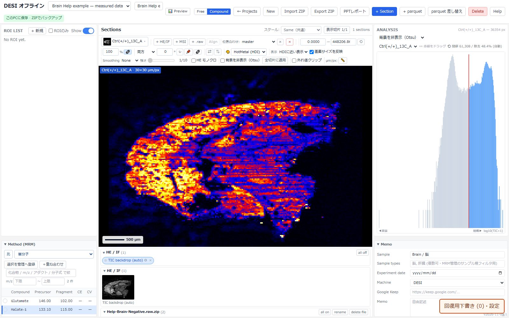

実操作画面：独立したローカル環境に原本を読み込み、2 分子を表示。共有データは変更していません。

**集計への影響**

色の見た目と測定値は区別します。Range・カラーマップ・Median・Linear は表示調整です。ROI の数値は元データから計算します。

**保存と共有**

ローカル編集は、このブラウザーの保存領域に保存されます。別 PC へ渡すときは Export ZIP または Publish を使います。

共有リンクの閲覧権限と管理権限は異なります。画面に出ない編集操作を、Help から有効にすることはできません。

### 切片と分子を見比べる

Free / Compound、表示切片、レイヤーを組み合わせて、同じ条件で画像を見比べます。

1. **View を選ぶ** — Free は切片ごとに分子を選びます。Compound は選んだ分子を切片間で揃えて比較します。下の例では同じ切片の Malate-1 と Glutamate を切り替えます。
2. **表示する切片を絞る** — 表示切片の選択で必要な切片を残します。非表示は削除ではありません。再表示して比較を続けられます。
3. **レイヤーを組み合わせる** — HE / IF / MSI のチェックを切り替え、歯車から透明度・Grayscale・Apply opacity を調整します。HE 未登録時は TIC 背景が使われる場合があります。
4. **向きと尺度を確認する** — 拡大・移動・Rotation とスケールバーを確認します。作成者は切片の Flip H / V を変更できます。
5. **KMD 図で系列を探す** — ANALYSIS で KMD図を選び、CH₂・H₂・O の単位を切り替えます。点のクリックで分子を表示、ドラッグで囲むと Method 表を絞ります。系列の「重ねる」で色分けし、⟲ または Method 表の「KMD 選択」で解除します。

#### 分子を切り替えて、信号の分布を見比べる

Method の分子一覧で Malate-1、Glutamate を選びます。同じ切片でも、分子によって明るく見える場所が変わります。

**Malate-1**

MRM 133.101 → 115

Malate-1：登録原本からの再描画

**表示範囲: 0 - 448,206.855 信号強度**

**Glutamate**

MRM 146 → 102

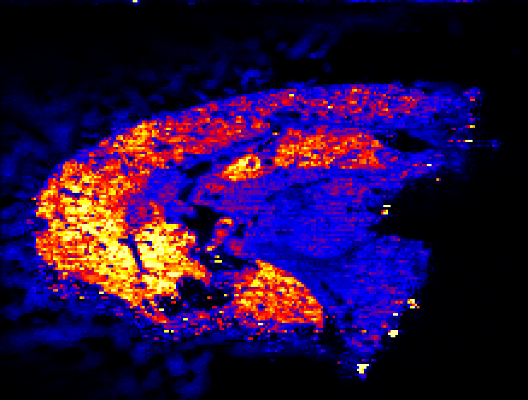

Glutamate：登録原本からの再描画

**表示範囲: 0 - 1,116,827.345 信号強度**

> HotMetal ／ Smoothing: None ／ 各分子の Range は 0 ～ 原信号の 99.5 パーセンタイル値。背景除外は使っていません。

> 色は信号強度を表します。この例は分子ごとに表示上限が異なるため、画像間の同じ色が同じ信号強度や濃度を意味するわけではありません。

**出典・条件**: 261030_Hirabayashi_13C_Brain ／ Ctrl(+/+)_13C_A。登録原本の同じ切片を再描画しています。登録画素サイズは 30 × 30 µm。

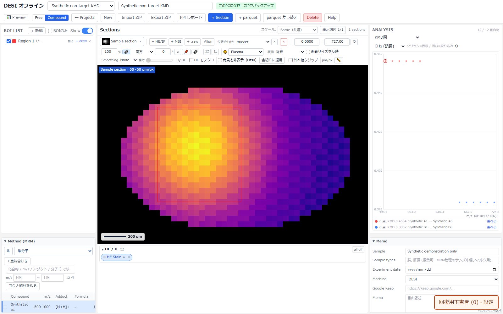

ANALYSIS の KMD図：単位選択、系列一覧、重ねる、選択解除

**集計への影響**

レイヤーの表示、透明度、ズーム、表示切片の選択だけでは元の信号値は変わりません。非表示の切片が出力対象に含まれるかは出力画面で確認します。

KMD は m/z から Kendrick 質量欠損を計算する図です。MRM では precursor を使い、m/z のない候補は件数を示して除外します。比（X / Y）とは別の見方で、元信号や ROI 集計は変えません。

ノンターゲット表には m/z・Adduct・Formula・Mean・Max が表示されます。検索や m/z 範囲、列見出しで候補を絞り、並べ替えられます。Mean が未計算なら「TIC と統計を作る」を使います。source 別の TIC と表示用の TIC backdrop は用途が異なります。

**保存と共有**

表示操作の保存範囲は操作と権限によって異なります。共有画面で行う一時的な見え方の調整を、公開元データの変更と混同しないでください。

KMD の選択・Method 表の絞り込み・系列の「重ねる」は一時的です。プロジェクトの比定義や保存済み重ね合わせには追加されません。別プロジェクトへ移動すると選択を解除します。

### 色・Range・滑らかさを調整する

表示だけを調整して分布を読み取りやすくします。Median と Linear の強さは、それぞれ 1～10 で選べます。

1. **表示スタイルと色を選ぶ** — MSI style とカラーマップを選びます。物理縦横比の表示を使うと、MSI pixel size に基づいた見え方になります。 背景を非表示（Otsu）と外れ値クリップも、必要に応じて表示を整えるために使います。
2. **Range を合わせる** — 表示する強度範囲を調整します。Same は比較対象の尺度を揃え、Individual は各画像に合わせます。下の Malate-1 の例では下限 0、上限 448206.855 を入力します。明るい領域が最大色になる場合は上限を見直します。
3. **Smoothing と強さを選ぶ** — None は平滑化なし。Median は近傍の中央値を使う表示用フィルターです。Linear は補間なしに近い 1 から、従来の Linear と同じ 10 まで選べます。
4. **ROI の範囲を見やすくする** — ROIのみ表示では表示対象の ROI に絞って確認できます。自動 Range の対象が変わるため、全体表示と明るさが変わることがあります。

#### Range の上限を下げて、弱い信号を見やすくする

同じ Malate-1 の画像で Range だけを変えます。上限 448206.855 を入力した例では、信号を色へ割り当てる範囲が変わります。

**全測定値が収まる上限**

上限 = 原信号の最大値

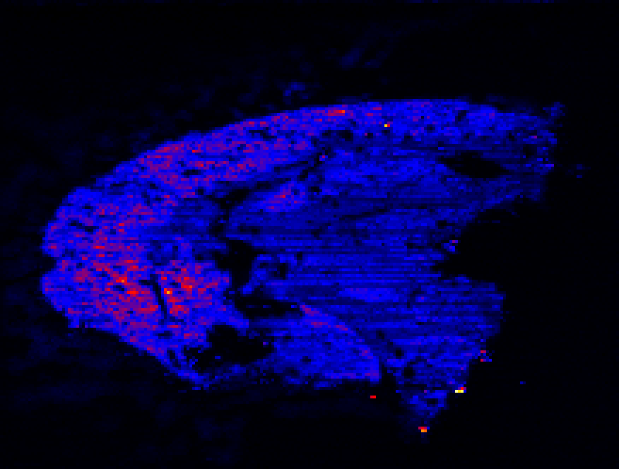

Range 0 ～ 1,026,290：原本からの再描画

**表示範囲: 0 - 1,026,290 信号強度**

**弱い信号を見やすくした例**

上限 = 原信号の 99.5 パーセンタイル値

Malate-1：登録原本からの再描画

**表示範囲: 0 - 448,206.855 信号強度**

> 元データ・ROI の集計値は変わりません。低い上限の図では、上限を超える 182 点が最大色になります。明るく見えたことだけで信号が増えたとは判断しません。

> 99.5 パーセンタイルは、この説明例のために原本から求めた値です。自動設定ボタンの紹介ではありません。配色・倍率・Smoothing: None は同一です。

**出典・条件**: 261030_Hirabayashi_13C_Brain ／ Ctrl(+/+)_13C_A。登録原本の同じ切片を再描画しています。登録画素サイズは 30 × 30 µm。

#### 同じ場所を拡大し、滑らかさと細部を確認する

Smoothing で種類を選び、強さスライダーを調整します。以下は同じ拡大範囲・同じ Range での比較です。

**None**

補間・メディアン処理なし

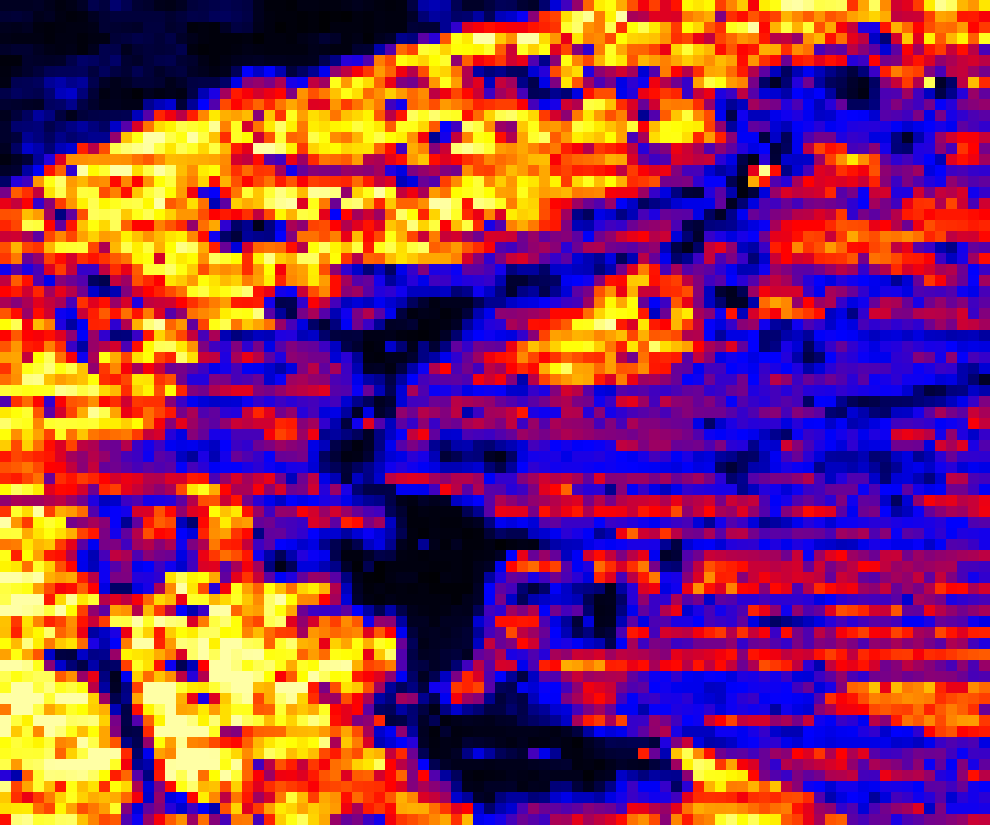

None：同じ範囲の拡大再描画

**表示範囲: 0 - 448,206.855 信号強度**

##### 比較する表示

**Linear 10 / 10**

Linear は画素間の色を補間します。1 は補間なしに近く、10 が従来の Linear と同じ強さです。

**Linear 10 / 10**

従来の Linear と同じ最大の補間量

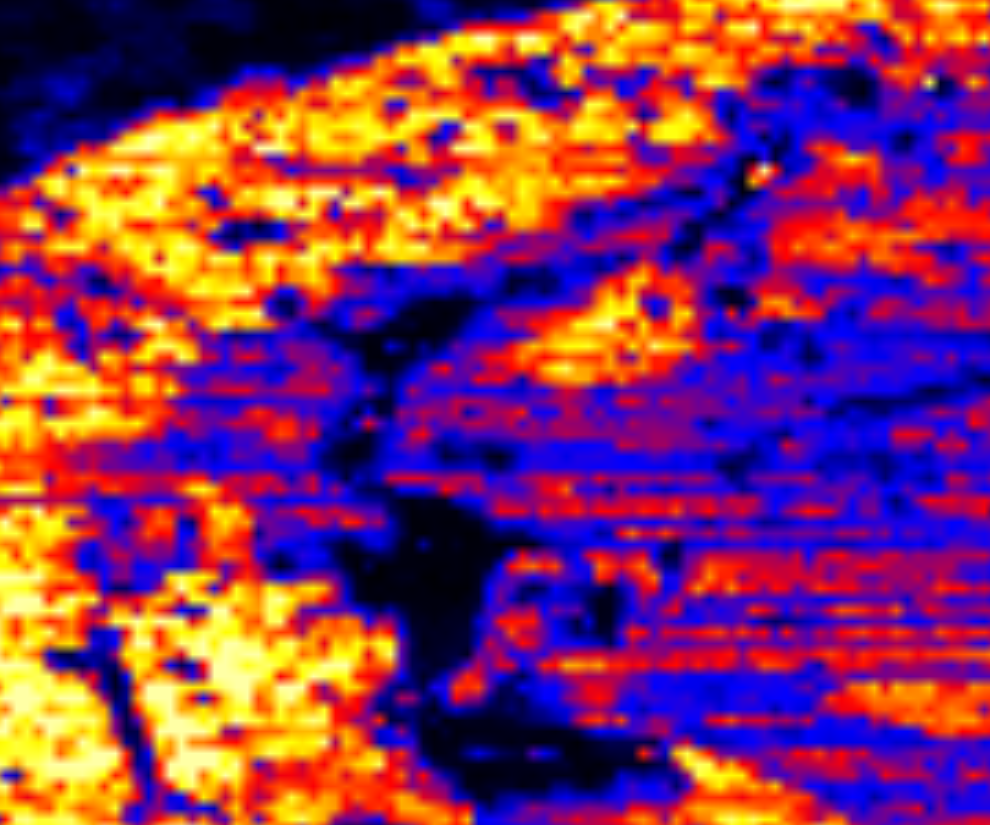

Linear 10 / 10：表示専用の補間

**表示範囲: 0 - 448,206.855 信号強度**

**Median 3 / 10**

Median は周囲の表示値の中央値を使います。この例は 3 / 10（7 × 7 画素）。細かい点や細い構造も変わるので、None と見比べて強さを選びます。

**Median 3 / 10**

近傍 7 × 7 画素の中央値を用いた表示

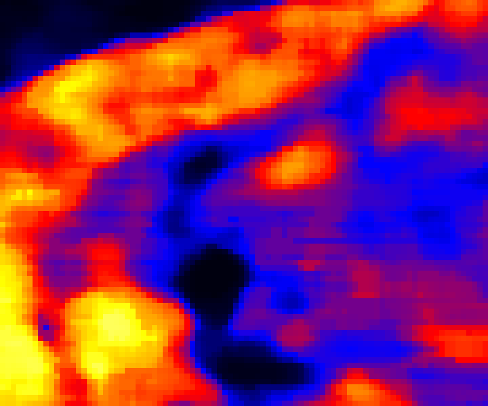

Median 3 / 10：表示専用のフィルター

**表示範囲: 0 - 448,206.855 信号強度**

> 元データ・ROI の集計値は変わりません。強くすると細い構造が見えにくくなることがあります。

> HotMetal、Range 0 ～ 448,206.855。拡大図は同じ 90 × 75 画素の範囲です。

**拡大した位置を確認**

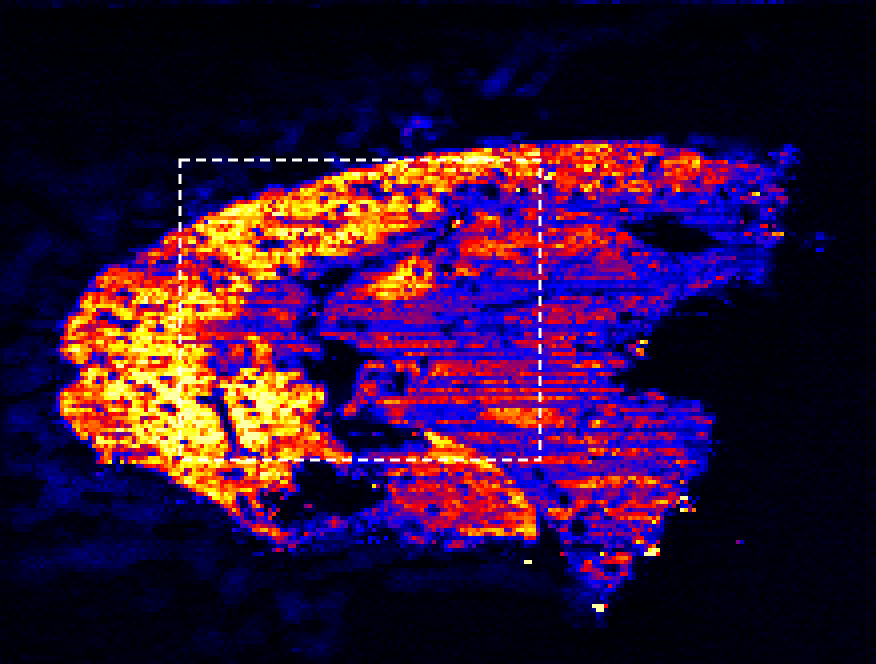

拡大した場所：原本からの再描画に範囲を追記

**出典・条件**: 261030_Hirabayashi_13C_Brain ／ Ctrl(+/+)_13C_A。登録原本の同じ切片を再描画しています。登録画素サイズは 30 × 30 µm。

**集計への影響**

Median・Linear・Range・カラーマップ・物理縦横比は、元データや ROI 集計値を変更しません。集計は平滑化前の数値を使います。

Median の段階は表示の滑らかさを選ぶためのものです。異なる装置やアプリの同じ番号と同一処理を保証する尺度ではありません。

ROIのみ表示で自動 Range が変わっても、ROI の形や集計対象の元データは変わりません。

背景を非表示（Otsu）は TIC のヒストグラムで背景を判定する表示機能です。ANALYSIS で閾値を調整し、必要なら全切片に適用します。元の強度・座標・ROI 定量・数値出力は変えません。

**保存と共有**

作成者の表示設定はプロジェクトの保存・ZIP・公開に引き継がれます。共有画面の MSI style・色・Median / Linear はこのタブの個人設定で、再読み込み後も保持します。viewer と Admin は別設定です。公開元は変更しません。

Range はプロジェクトごとの一時的な表示設定です。固定条件で比較したいときは範囲と Same / Individual を記録してください。

### 比（X / Y）を表示する

同じ切片の 2 分子から比画像を作ります。酸化分子 / 非酸化分子など、任意の X / Y に使えます。

> この共有画面で編集する比は自分用です。元の公開データは変わりません。

1. **「比」を開く** — 数値データを含むプロジェクトで「比」を開きます。作成済みの比は一覧から選べます。
2. **分子 X と分子 Y を選ぶ** — 分子側（X）と分母側（Y）を切片ごとに選び、名前を付けます。この例は X = Malate-1、Y = Glutamate です。検索で候補を絞り、同名ならファイル・列・測定条件で区別します。別ファイルでは座標の単位と原点が同じことを確認します。
3. **分母の下限を確認する** — Y の下限は初期値 0 です。下限以下の Y、欠損、負の信号は有効な比として扱いません。無効部分は 0 に置き換えず、計算対象から除きます。
4. **比画像を表示して比較する** — 「保存して表示」で比画像と ROI 集計を確認します。「ROI集計CSV」は指標を、「測定点CSV」は測定点ごとの値・有効性・除外理由を保存します。

#### 分母が弱い場所を含めるかで、比の画像が変わる

「比」で X に Malate-1、Y に Glutamate を指定します。この例では同じ RAW ファイル・function 1 の同じ測定位置で、原信号 X ÷ Y を計算しています。

**分母の下限: 0**

Glutamate > 0 の点を採用

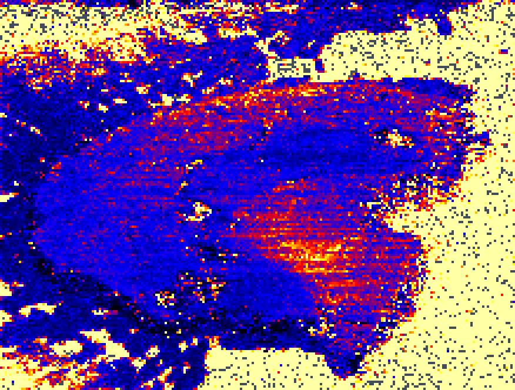

分母下限 0：原本からの信号比を再描画

**表示範囲: 0 - 1.5 信号比**

有効 35,267 / 36,354 点（97.0%）

**分母の下限: 10,000**

Glutamate > 10,000 の点を採用

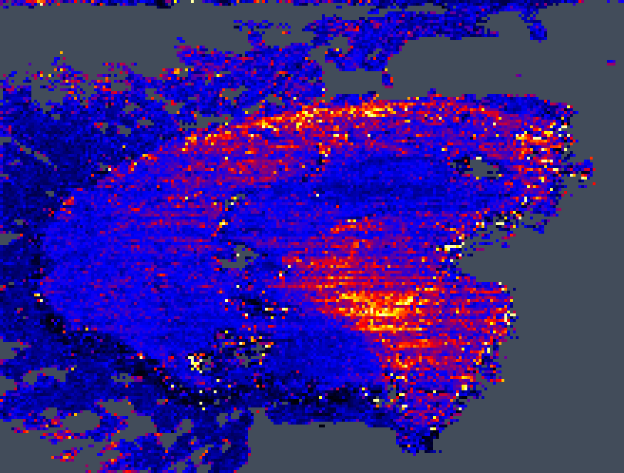

分母下限 10,000：原本からの信号比を再描画

**表示範囲: 0 - 1.5 信号比**

有効 23,512 / 36,354 点（64.7%）

> この比較図では無効点を灰色で表示しています。説明用に再描画した図であり、実際の Viewer の背景色は表示設定によって異なります。両図とも HotMetal、Range 0 ～ 1.5、None、Otsu なしです。

> 10,000 は操作説明用の任意の値で、検出限界や推奨基準ではありません。分母が 0 または下限以下の点は、比を 0 にせず表示・比の集計から除外します。下限 0 では 1,087 点、下限 10,000 では 12,842 点が除外されています。

> 表示上限の 1.5 を超える比は最大色です。下限 0 では 8,715 点、下限 10,000 では 99 点が該当します。表示 Range の変更は計算済みの比を変えません。

> これは測定信号の比です。濃度比や生物学的な差を、この画像だけから断定しません。分母下限は比の有効点と統計を変えますが、原本や元の分子別 ROI 集計は変えません。

**出典・条件**: 261030_Hirabayashi_13C_Brain ／ Ctrl(+/+)_13C_A。登録原本の同じ切片を再描画しています。登録画素サイズは 30 × 30 µm。

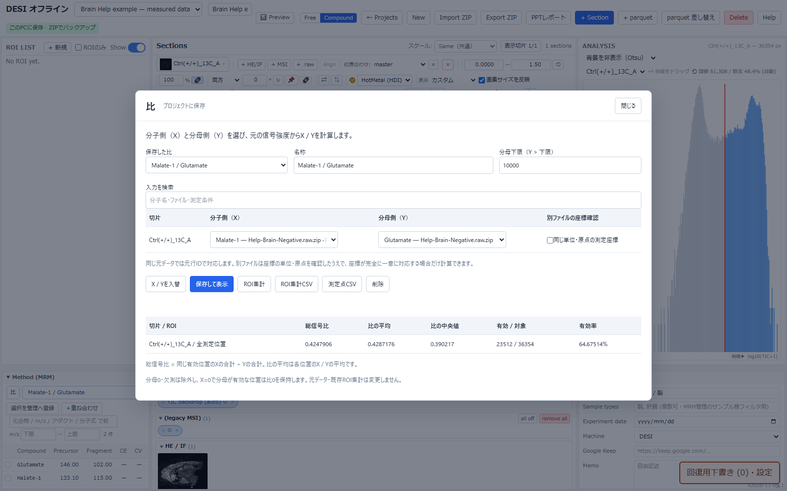

実操作画面：同じ測定ファイルの信号比を設定

**集計への影響**

比は対応する元データの値から計算します。表示済みの色や、Median / Linear をかけた画像から計算しません。X = 0、Y > 下限の位置は有効な 0 です。

ROI総信号比 = 有効な位置の X の合計 / 同じ位置の Y の合計。個別比の平均 = 各位置の X / Y の平均。個別比の中央値 = 各位置の X / Y の中央値。これらは異なる指標です。

例：X が 2, 8、Y が 1, 2 のとき、ROI総信号比は 10 / 3 ≈ 3.33、個別比の平均は (2 + 4) / 2 = 3 です。

結果には有効数・有効率・除外理由・分母下限を添えて判断します。元の分子別 ROI 集計と比の集計は別の結果です。

**保存と共有**

作成者が保存した比の定義は、プロジェクト・ZIP・公開に含まれます。定義は X / Y と分母下限を記録し、元の信号値を書き換えません。

共有の閲覧者・管理者が編集した比は、このタブの個人用設定です。同じタブの再読み込み後も保持し、タブを閉じると失われます。公開元の比定義や他の閲覧者の設定を上書きしません。

比の ROI 結果は専用出力で保存します。画像や PPT に表示する比と、数値結果の指標・条件を対応させて記録します。

### HE / IF と MSI を位置合わせする

Align で同じ組織の位置を揃え、重ね合わせて確認します。

1. **切片から Align を開く** — 対象の切片を選び、Align を開きます。HE / IF、Source、比較する MSI を選びます。
2. **尺度と手動位置を調整する** — MSI pixel size を確認し、移動・回転・拡大縮小などの手動スライダーでおおまかに揃えます。
3. **対応点または自動整合を使う** — Landmark では両画像の同じ位置を対応させます。シルエットによる自動整合も結果を目視確認してから採用します。
4. **重ね合わせを確認して保存する** — 重ね合わせ表示と MSI の濃さを使ってずれを点検します。Save で確定、Cancel で今回の変更を破棄します。

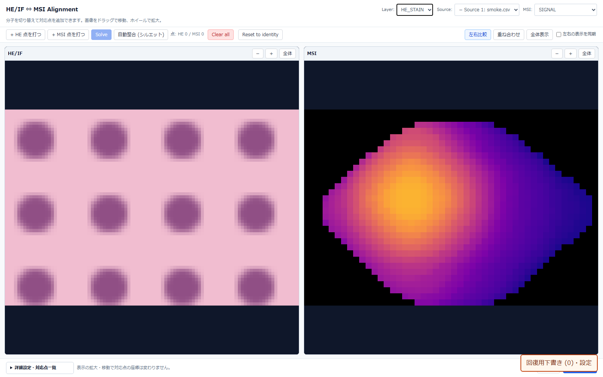

対象画像・尺度・対応点を確認

**集計への影響**

位置合わせは表示座標の対応です。元の MSI 信号値を書き換えません。ROI はどの座標系で描かれたかを保って扱います。

**保存と共有**

作成者の Save はプロジェクトへ保存します。共有画面では必要な書き込み権限・ロックを確認します。Cancel では確定しません。

### ROI を描いて集計する

関心領域を描き、元の信号値を集計します。比の集計では、分子単独の値と区別します。

1. **ROI と編集権限を確認する** — ROI 一覧で名前・色・表示状態を確認します。共有画面で描画や削除をするときは、必要な書き込みロックを取得します。
2. **領域を描く** — ROI の描画操作を選び、画像上で領域を囲みます。同じ ROI を別切片へ描く場合も、切片ごとに対応する位置を確認します。
3. **表示と対象を点検する** — ROI の表示切替・ROIのみ表示を使い、意図した範囲か確認します。削除は確認画面で対象 ROI を確認してから行います。
4. **集計を確認して出力する** — 元信号の集計を確認します。比の場合は専用結果の指標名、有効数、除外理由、分母下限も合わせて確認します。

#### ROI の数値を元の測定値から確認する

位置が分かるように、同じ大きさの仮 ROI A・B を重ねました。この説明用の ROI は、原本・プロジェクト・共有データには保存していません。

**Malate-1 と仮 ROI**

None ／ 各 ROI: 30 × 25 画素

仮 ROI A・B：原本からの再描画に説明用の枠を追加

**表示範囲: 0 - 448,206.855 信号強度**

ROI A・B は説明用の名称です。解剖学的な部位を意味しません。

**原本 Malate-1 の集計**

| 仮 ROI | 測定点数 | 平均信号 |
| --- | --- | --- |
| ROI A | 750 | 307,293.13 |
| ROI B | 750 | 177,911.67 |

> Range・Linear・Median を変更しても、この集計対象と元信号は同じです。画像の色ではなく、ROI 内の元の測定値を集計しています。

> 「比」の ROI 集計では、分母条件を満たす有効点だけが対象です。単分子の ROI 集計と区別し、ROI総信号比・個別比の平均などの指標名も確認します。

**出典・条件**: 261030_Hirabayashi_13C_Brain ／ Ctrl(+/+)_13C_A。登録原本の同じ切片を再描画しています。登録画素サイズは 30 × 30 µm。

**集計への影響**

ROI 集計は元の数値データを対象とします。Median / Linear・色・Range を変更しても集計値は変わりません。

比の「ROI総信号比」と「個別比の平均」は異なります。比の章の式を確認し、結果に記載された指標を使って比較してください。

**保存と共有**

作成者の ROI はプロジェクト・ZIP に保存します。共有 ROI の書き込みは共有権限とロックに従います。非表示は削除ではありません。

ZIP では元データと ROI 情報を分けて保存します。比の専用出力も、測定条件が分かる名前で保存してください。

### ROI に顕微鏡画像を付ける

ROI に対応する顕微鏡画像を登録し、MSI と一緒に確認します。

> 共有画面では顕微鏡画像は閲覧専用です。登録・編集・削除はローカル作成者の画面で行います。

1. **対象 ROI の画像画面を開く** — ROI の画像操作を開き、対象の切片と ROI を確認します。複数の顕微鏡画像を同じ ROI に関連付けられます。
2. **画像と説明を登録する** — 画像ファイルを選び、タイトルや説明を入力します。位置・倍率など、読み手が対応関係を判断できる情報を残します。
3. **MSI と見比べる** — 顕微鏡画像を拡大して確認し、ROI の MSI 表示と見比べます。分子または比の選択・表示条件も確認します。
4. **順番・説明を整えて保存する** — 画像の順序や説明を整え、不要な画像は確認して削除します。共有時は画像を含めた公開・書き出し結果を確認します。

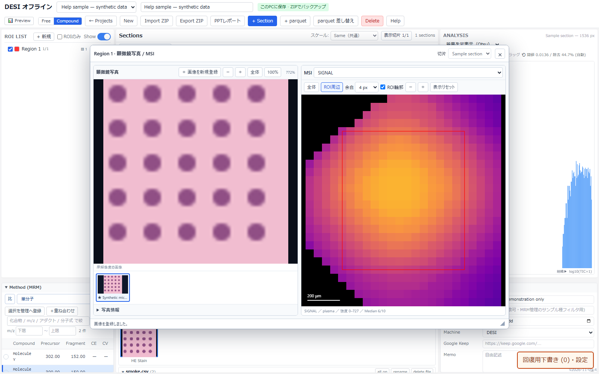

ROI に関連付ける顕微鏡画像

**集計への影響**

顕微鏡画像は ROI の説明資料です。画像を追加しても MSI の元信号や ROI の集計値は変わりません。

**保存と共有**

画像と説明は ROI に関連付けて保存し、ZIP・共有に含めます。編集の可否はローカル / 共有の権限に従います。

### Preview・重ね合わせ・PPT

画像一覧で比較し、複数分子のカラー合成や PPT レポートを作ります。

1. **Preview を開く** — Preview で分子や比、切片の画像を一覧表示します。公開前には、受け手の見え方を確認します。
2. **比較条件を揃える** — 表示切片と分子を選び、Range・Same / Individual・色・ROI の表示を確認します。
3. **複数分子を重ね合わせる** — 重ね合わせで複数分子に色を割り当てます。明るさを揃える設定の意味を確認して分布を比較します。比の多色重ね合わせは対象外です。
4. **PPT レポートを作る** — PPTレポートは全切片が独立の初期設定です。出力対象を選び、比較する切片を同じ比較グループに割り当てます。グループ内は同一分子・測定条件の共通自動Range、独立切片は個別の自動Rangeを使い、画面のSame／Individualや手動Rangeは使いません。各グループは追加・名前変更・削除でき、一括割り当てと「すべて独立」も使えます。登録のない分子は省き、読み込み失敗は表示に残します。出力後にグループ名と実数Rangeを確認してください。

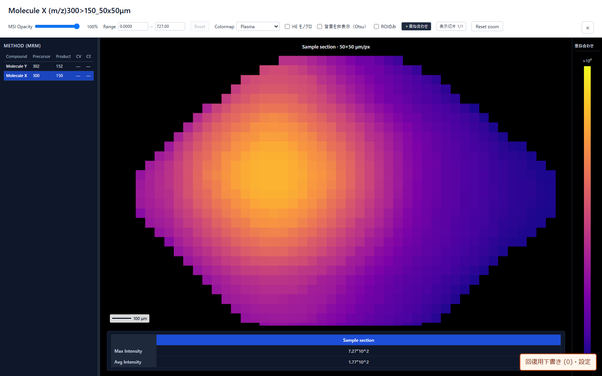

切片・分子を一覧で比較

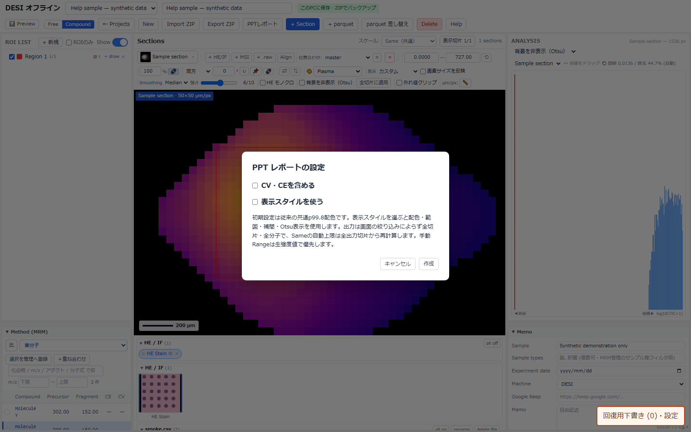

レポートの出力条件を確認

**集計への影響**

重ね合わせの色や明るさは表示条件です。色の混ざり方から、比や元信号の集計値を読み替えないでください。

**保存と共有**

PPT は書き出した時点の画像を保存します。プロジェクトを編集しても、既存の PPT は自動更新されません。

共有画面で個人設定を使った場合は、その条件を資料にも記録します。

共有先で作った重ね合わせは、対応する共有環境では同じ URL の利用者に共有されます。作成者が公開した重ね合わせは読み取り専用です。保存できない環境では画面の通知に従います。

### 保存・ZIP・共有・Memo

ローカル保存、ファイルバックアップ、サーバー公開を目的に応じて使い分けます。

> 共有閲覧者は公開元の Publish を実行しません。利用できる書き出しと個人設定を使います。

1. **Memo と保存状態を確認する** — 実験条件や気付きを Memo に残し、保存状態を確認します。「このPCのみ・未公開」はブラウザー内の保存、「このPCに保存・公開待ち」は共有先への反映待ちです。保存エラーがあるときは内容を確認してから閉じてください。
2. **Export ZIP でバックアップする** — Export ZIP を選び、元データ・ROI・顕微鏡画像・比の定義を含むアーカイブを保存します。ZIP は公開とは独立しています。
3. **Import で復元する** — 保存した ZIP を読み込み、復元内容を確認して確定します。別 PC でも対応するアプリから復元できます。
4. **公開内容を確認して共有する** — 作成者は Preview の後に Publish to share を実行します。完了と Sync 状態を確認し、共有 URL と必要なパスワードを渡します。

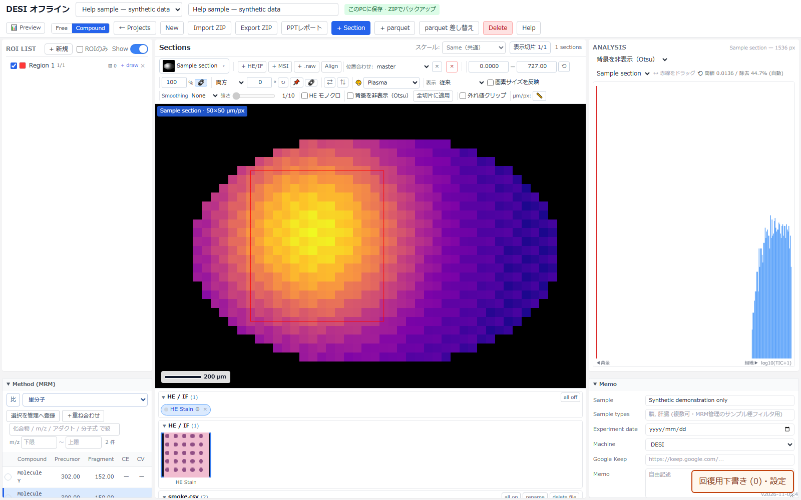

バックアップと記録の入口

**集計への影響**

保存・ZIP・公開は、表示用の色を元信号に置き換える操作ではありません。元データと ROI・比の定義を区別して保持します。

**保存と共有**

ローカル保存はこのブラウザー内、Export ZIP は自分で保存したファイル、Publish はサーバー上の共有内容です。それぞれ別の保存先です。

「✓ 公開版 vN を保存済み」は、この PC が保存した公開版の基準番号です。別 PC の変更まで含めた最新版との一致を保証する表示ではありません。他 PC の公開内容を取り込むときは「共有の最新版を確認」を使います。

Auto-publish は公開済みプロジェクトのローカル変更を共有先へ送る処理です。共有版との競合や基準番号が未確認のときは停止します。比較・再公開を明示するまで、ローカル保存だけで自動再公開は再開しません。再 Publish は共有側への影響を確認し、大容量アップロードは完了まで進捗を確認します。

同じ Google アカウントでもローカルデータは PC ごと・ブラウザーごとに独立しています。初回の別 PC ではサーバー一覧から Open (master) で取り込むか、閲覧用の共有 URL を開きます。未公開の内容は Export ZIP / Import で移せます。

共有の表示設定と比の個人変更は、公開元への保存ではありません。共有 ROI・位置合わせ・重ね合わせの保存は各機能の権限とロックに従います。共有画面の Memo 編集は一時的で、再読み込みで破棄されます。

### 困ったとき・ショートカット

表示、データ不足、保存、共有、オフライン起動の問題を切り分けます。

1. **画面の状態を確認する** — 画像が見えないときは、切片・Method / Compound・レイヤーのチェック・Opacity・Range・ROIのみ表示を確認します。
2. **数値データの有無を確認する** — 比や ROI が計算できないときは、元ソースがあるか、X / Y が同じ位置に対応するか、分母下限で全て除外していないかを確認します。
3. **保存先と権限を確認する** — 保存競合・容量不足・共有ロックの通知を読みます。未保存の作業は ZIP や回復用下書きで確保してから再読み込みします。
4. **操作をやり直す** — Method 表では ↑ / ↓ で分子を移動します。ROI 描画は Enter で確定、Esc で中止します。問い合わせ時はビルド番号・操作・入力形式・エラー文を記録します。

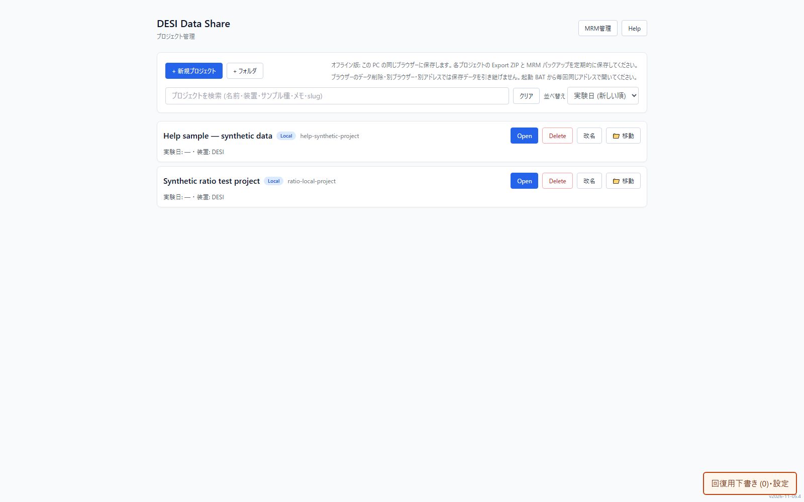

プロジェクト管理画面

**集計への影響**

計算できない領域を 0 と解釈しないでください。欠損・分母条件・非対応データなどの理由を確認し、有効データと区別します。

**保存と共有**

オフライン版は ZIP を完全に展開して START_OFFLINE.bat を起動します。起動用ウィンドウを閉じるとローカルサーバーも終了します。保存済みブラウザーデータと ZIP バックアップは別です。

Help の印刷 / PDF から、現在の権限・言語の全章を紙面にできます。画像をクリックすると実画面を拡大できます。

<!-- GUIDED_HELP_END -->
